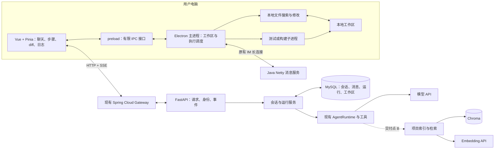
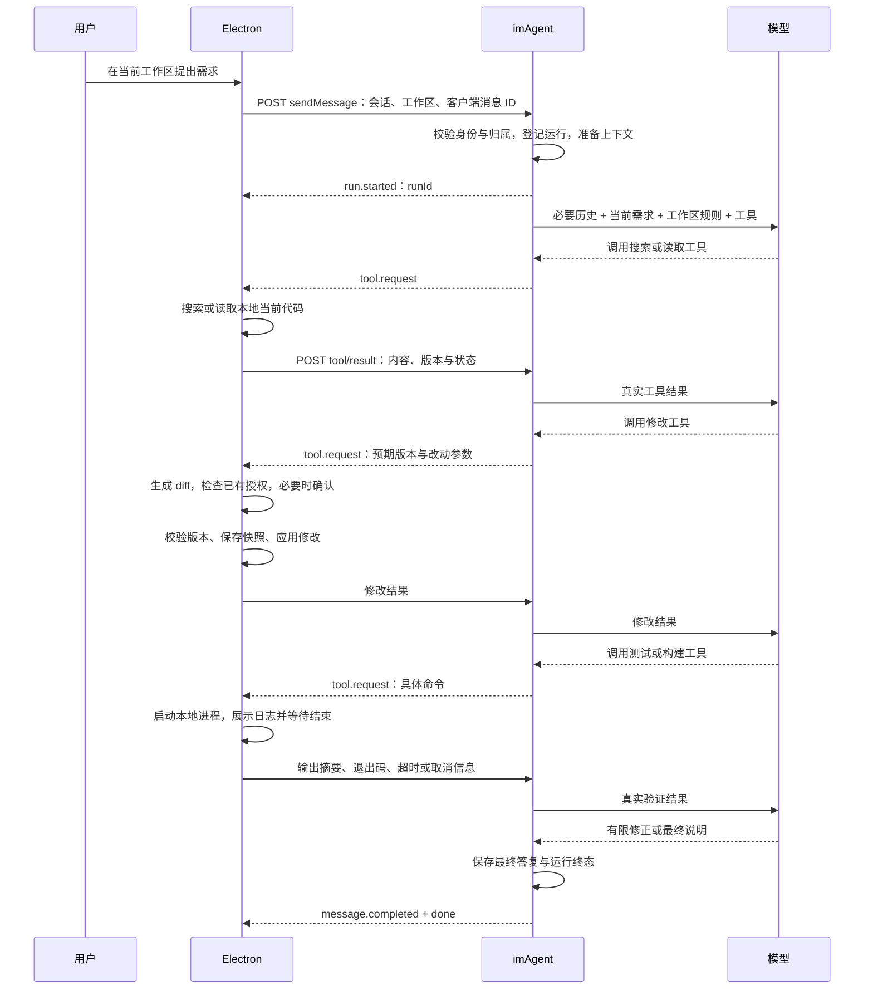

# imAgent 初版开发方案与技术架构

> 更新日期：2026-10-21。
>
> 本文回答“现在要做什么、为什么这样做、具体怎么做、技术架构是什么、做到什么程度可以展示”。它面向当前的实习准备阶段，完整产品方向见 [总目标.md](总目标.md)。
>
> 实际开工按 [阶段A开发指导书.md](阶段A开发指导书.md) 逐章执行：从存储边界、演示项目、本地搜索示例开始，完成局部验证后再补齐本篇的完整交付要求。
>
> 本次只编写文档。现状来自当前工作区源码的静态阅读，没有启动服务、调用真实模型或运行测试。下文新增接口、字段、文件与能力均为实施建议，不代表已经实现。

## 1. 当前交付目标与范围

当前目标是交付一个**可以通过对话完成真实小型代码任务的单 Agent 桌面助手**：

```text
用户选择本地项目并提出需求
    → Agent 检索、读取必要代码
    → 生成并展示改动
    → 客户端按授权应用修改
    → 运行测试或构建
    → Agent 根据真实结果修正或汇报
```

开发沿用现有 Electron 客户端、Python imAgent、Java IM 与网关，不另外创建一个独立平台。

本稿采用的边界是：后端部署到服务器；源码原件保留在用户电脑；文件与开发命令由客户端执行；模型使用服务器可访问的 API。首个完整演示先验证一个模型供应商，包含其流式输出和工具调用能力。

### 1.1 分清两个交付点

| 交付点 | 必须完成 | 完成后意味着什么 |
|---|---|---|
| A：面向实习的可演示初版 | 多轮上下文、工作区绑定、本地代码搜索与读取、受控修改与 diff、测试或构建、失败与取消、基本远程部署 | 可以拿一个真实小需求演示完整链路，并解释实现与取舍 |
| B：完整工作区检索增强 | 添加目录后自动后台建索引、语义检索、按需优先补建、增量更新与删除同步 | 实现此前讨论的后台向量索引方案，改善较大工作区的代码定位 |

先完成 A，再推进 B。B 是保留的产品目标；实现顺序不改变你希望自动索引工作区的方向。准备投递时，可以先使用已经验收的 A，不必等待全部远期功能完成。

MCP、Skills、多 Agent 协作、服务器代码沙箱、完整 IDE、长期开发服务进程管理和复杂记忆系统均放在后续版本。A 支持新建文件和必要的多文件修改，首先通过已有项目中的小需求验收；大型项目从零生成不作为首个验收任务。

### 1.2 初版的完成标准

- 用户能连续两轮讨论同一个项目，模型能承接前文。
- 模型能找到真实代码位置，并读取修改前的当前内容。
- 用户能检查实际 diff；修改有版本检查，能够撤销本轮受控文件改动。
- 至少能运行一种项目的测试或构建，并返回输出、退出码与超时信息。
- 失败、拒绝、停止与断线不会被展示为成功；模型修正有明确上限。
- 服务器上的 Agent 能通过客户端完成上述操作，用户与工作区之间不串数据。

## 2. 当前实现可以复用哪些部分

| 现有入口 | 当前实际职责 | 接下来补什么 |
|---|---|---|
| `app/services/ai_message_service.py` | 保存消息、创建模型或 Agent、转发流式内容与工具事件 | 历史上下文、运行记录、取消、最终结果整理 |
| `app/agent/runtime.py` | 无工具时返回模型，有工具时调用 LangChain `create_agent()` | 沿用该入口，加入必要的上下文与调用限制 |
| `app/llm/` | 模型供应商选择、创建与适配 | 验证一个供应商的完整工具链，统一调用超时与错误 |
| `app/agent/tools/workspace.py` | list/read/write/edit/delete 工具 | 内容搜索、版本信息、本地命令工具 |
| `app/services/tool_dispatcher.py` | SSE 下发请求，使用 Future 等待 HTTP 回传 | 绑定运行、取消清理、迟到结果处理、明确错误类别 |
| `app/services/workspace_service.py` | 内存中维护用户、工作区名称和相对文件集合 | 稳定 ID、会话绑定、重启后的重新登记与清单刷新 |
| `app/integrations/database/` | MySQL 会话、消息、模型配置读写 | 查询必要历史，补最小运行与工作区元数据 |
| `app/embedding/`、`app/integrations/vector_store/` | Embedding API 与 Chroma 操作封装 | 交付点 B 接入真实的源码索引流程 |
| `app/project_index/indexer.py`、`retriever.py` | 目前只有职责说明 | 交付点 B 再实现分块、入库与检索组织 |
| Electron `src/main/File/fileInfo.js` | 扫描目录、校验路径、执行文件读写修改删除 | 搜索、内容版本、修改预览、快照与撤销 |
| Electron `src/main/IPC/uploadFileIPC.js`、`src/preload/index.js` | 暴露本地工作区操作入口 | 增加有限的预览、应用、命令和取消入口 |
| Electron `AIMessageStream.js`、`Ai-chat.vue`、`AgentWorkspaceStore.ts` | 消费 SSE、展示消息与步骤、发起本地工具操作 | diff、命令日志、运行终态、后台工具任务调度 |

需要特别注意的现状：

1. 消息已经写入 MySQL，但当前模型调用主要只传本轮 `body.content`，尚未形成多轮上下文。
2. 添加工作区时上传的是相对文件列表，尚未自动上传源码与生成向量索引。
3. 客户端收到文件工具请求后直接执行，尚无修改前预览与内容哈希校验。
4. 停止按钮目前会中止前端请求；尚不能由此认定后端模型任务和未来的本地命令均已停止。
5. 当前工具等待表与工作区集合都在后端进程内存中，服务重启会丢失这些状态。
6. `tests/` 当前未发现测试文件，`pyproject.toml` 也未声明 pytest，实施时需要先建立最小验证入口。

## 3. 总体思路：沿着现有调用链补齐职责

### 3.1 Agent 负责决定，客户端负责执行

后端模型决定需要搜索、读取、修改或运行命令。后端工具负责参数校验、请求下发与结果整理；Electron 负责把请求落到用户电脑上的真实文件和进程。

Tool 是请求接口，Node、Python、Shell 是具体执行方式。普通文件操作继续使用固定参数工具；项目测试和构建增加命令工具；自由 Python 脚本在确有批量处理需求时再引入。

### 3.2 先做实时搜索，再增加语义检索

交付点 A 使用“路径定位 + 本地内容搜索 + 按行读取”。它能查询最新代码，也能作为以后向量索引不完整时的兜底。

交付点 B 再加入语义定位。向量库负责提供候选位置，修改依据仍然是客户端的当前源码。检索能力可以逐步增强，文件修改与验证链路始终沿用同一套工具。

### 3.3 复用已有 Agent 循环

当前 `AgentRuntime` 已使用 LangChain `create_agent()`。先在这一入口完成“模型调用工具—接收结果—继续推理”，无需再手写一套重复循环或提前增加规划 Agent、审查 Agent。

官方将这一运行方式描述为模型持续调用工具直至任务结束，行为可以通过提示词、工具与中间件约束。具体接口仍需与项目实际安装版本核对。[LangChain Agent 文档](https://docs.langchain.com/oss/python/langchain/agents)

## 4. 技术架构与职责

### 4.1 部署结构

下图是本稿建议的目标结构，不表示所有模块都已完成：



工作区绝对路径只在客户端保存。后端工具使用 `workspaceId` 和相对路径；后端部署在服务器后，不能直接读用户的 `E:` 盘，也不能把用户电脑的 `localhost` 当作后端自己的服务地址。

### 4.2 组件选择与边界

| 组件 | 初版怎么用 | 原因 |
|---|---|---|
| Electron + Vue + Pinia | 复用现有界面和状态管理，补 diff、日志与运行状态 | 已经具备客户端与本地能力入口 |
| Node 文件 API / 子进程 | 文件操作使用异步 I/O；开发命令使用独立进程 | 操作本地项目，避免把开发环境负担放在服务器 |
| FastAPI + HTTP/SSE | POST 发起对话，同一响应流下发消息和工具请求；HTTP 回传结果 | 沿用现有通信方式 |
| LangChain Agent | 复用 `create_agent()` 与结构化工具 | 已有基础，方便限制调用与处理工具结果 |
| MySQL | 复用会话、消息和配置存储，增加必要元数据 | 避免维护两套业务持久化来源 |
| Redis | 保留现有接入，本稿不新增跨实例调度职责 | 单进程初版暂时不需要分布式任务编排 |
| Nacos 与现有网关 | 复用现有注册和路由方式，部署时实际联调 | 网关与服务发现不是本轮重新开发的内容 |
| Chroma + Embedding API | 交付点 B 使用现有封装 | 已有代码入口，先验证真实索引闭环 |

普通 IM 消息继续使用原有 Netty 长连接；AI 交互继续使用 HTTP/SSE。后台源码同步使用独立 HTTP 批量上传流程，无需依赖聊天连接一直打开。

Electron 主进程承担受控入口和调度。大量扫描、哈希、搜索如出现卡顿，再放到工作线程或独立进程；命令一开始就使用异步子进程。preload 只暴露具体能力，不把完整 Node 或任意 IPC 接口直接交给界面。[Electron IPC 文档](https://www.electronjs.org/docs/latest/tutorial/ipc)

## 5. 一次编码任务的完整链路



每次请求固定绑定一个会话和一个工作区。运行过程中用户切换界面，不能改变已经下发请求的操作目录；工具执行必须使用请求绑定的工作区标识。

交付点 A 对同一工作区只允许一个活跃编码 Run，避免多个会话同时修改同一目录。服务整体也设置活跃 Run 上限，达到上限时明确返回忙碌状态，不通过无限创建异步任务承接请求。

## 6. 各模块具体怎么实现

### 6.1 多轮上下文

首版采用“现有 MySQL 历史 + 本次 Agent 状态”的简单方式：

1. 校验会话归属，读取该会话最近的必要历史，按时间正序组织。
2. 登记本次运行并保存用户消息，把当前用户内容加入模型输入一次。
3. 普通聊天和带工具 Agent 都使用消息列表，补齐当前只传 `body.content` 的缺口。
4. 当前运行内保留模型工具调用与对应结果；跨轮先保留用户消息、最终助手答复与必要操作摘要，需要代码时重新读取。
5. 为历史、文件内容、工具输出和模型输出预留不同预算，超出预算先裁剪不再需要的内容。

若实际实现采用“先保存用户消息，再查询历史”，必须按消息 ID 排除重复加入的当前消息。失败或取消的半截回复不能冒充已完成结果进入下一轮上下文。

首版编码会话绑定一个工作区。切换到另一个工作区时，新建或切换对应会话，减少旧代码上下文混入新项目的情况。

暂不同时引入第二套 checkpoint 历史来源。需要跨进程恢复 Agent 执行位置时，再评估 LangGraph checkpointer；仅保存聊天记录与恢复完整执行状态是两个层次。历史裁剪也不能破坏工具调用与结果的配对关系。[LangChain 短期记忆文档](https://docs.langchain.com/oss/python/langchain/short-term-memory)

**主要改动位置**：`ai_message_service.py`、`message_repository.py`、`runtime.py`。上下文组织逻辑实际变复杂后，再抽出小模块，避免一开始增加完整的上下文框架。

### 6.2 工作区绑定与恢复

- 注册时由后端产生稳定 `workspaceId`，客户端保存“当前用户 + workspaceId → 本地真实根目录”的映射，名称只用于展示。
- 后端保存工作区归属、展示名称等元数据，客户端通过原有注册接口提交或刷新相对路径清单。
- 读取、写入、命令、工具回传和未来的索引查询都绑定相同 `workspaceId`。
- 同名目录可以分别注册；客户端登录用户变化后，不能继续使用上一用户的映射。
- 客户端或服务重启后先验证绑定与目录仍有效，再刷新清单，不声称旧的进程内文件集合仍然存在。
- 用户在外部编辑器新增或删除文件时，应能刷新目录清单。交付点 A 先提供手动刷新，并在路径失效时提示刷新；交付点 B 再增加变更监听和增量同步。

已有相对路径与真实路径检查继续保留，包括符号链接解析后的范围校验。后端资源归属以可信登录身份为准，请求体中的 `userId` 不能自行决定访问权限。

### 6.3 本地代码搜索

增加一个明确的内容搜索工具，例如 `search_workspace_code(query, path_prefix, limit)`：

1. 复用工作区绑定与过滤规则，限定搜索目录。
2. 首版支持字面量关键字和可选相对目录前缀，不先实现任意正则、AST 分析或代码图谱。
3. 在客户端读取允许范围内的文本文件，跳过依赖、产物、二进制、敏感文件和超大文件。
4. 返回相对路径、行号、少量上下文和是否截断；数量与扫描量均有上限。
5. 模型根据候选位置调用现有读取工具，取得更完整的上下文。

先用当前 Node 文件能力完成有边界的实现，避免要求用户额外安装全局搜索命令。若大项目实测证明速度不足，再比较打包 ripgrep 等方案。

读取工具返回源码时，同时提供整文件内容哈希、实际行范围和截断标记。原始源码与界面行号分开表示，避免模型把 `12: ` 一类展示前缀写回文件。

**主要改动位置**：后端 `agent/tools/workspace.py` 与工具 schema；客户端 `fileInfo.js`、preload、IPC、工具请求处理和 TypeScript 类型。

### 6.4 文件修改、diff 与撤销

沿用现有 write/edit 能力，客户端增加“准备修改—检查授权—应用修改”三个步骤：

```text
读取当前文件并取得哈希
    → 根据修改参数计算候选内容
    → 生成真实 diff
    → 检查当前任务是否已授权该操作；必要时由用户确认
    → 落盘前重新校验哈希
    → 保存修改前快照并应用
    → 返回修改后哈希和改动摘要
```

修改已有文件时，`expectedHash` 必须对应本轮生成改动所依据的读取版本，由工具层传递或核验，不能由模型猜测。不能在准备落盘时读取最新哈希，再替旧改动补上新哈希。创建文件则明确要求目标原本不存在。版本冲突时返回明确错误，重新读取并生成改动；不使用模糊替换强行通过。

授权范围明确时可以连续执行，不机械地重复询问同一权限。读取、修改、删除和命令的许可需要由客户端逻辑执行，提示词作为模型行为指导。

快照保存在客户端应用私有目录，记录运行、文件路径、修改前内容与修改后哈希。撤销前验证当前内容仍等于本轮修改后的版本；用户后来又修改过时返回冲突。新文件也要区分“原来不存在”和“原来为空”。

同一文件在一轮中被修改多次时，保留本轮初始版本用于整体撤销，同时跟踪最新写入版本。多文件按顺序应用，部分失败就准确报告哪些已经修改，首版不承诺跨文件原子事务。

先限定在已支持大小范围内的 UTF-8 文本文件，保留未涉及部分的换行与内容。删除继续使用回收站，并为受控文本改动保留恢复信息；批量删目录、二进制编辑暂不加入。

界面需要显示文件列表、增删行与应用状态。快照与 diff 的核心逻辑可放在主进程现有文件模块附近；界面组件只负责展示与用户操作，不能自行绕过版本检查。

### 6.5 本地测试与构建命令

增加 `run_workspace_command` 工具，目标参数包括：可执行程序、参数列表、相对工作目录、超时时间。先选择一个演示项目的测试或构建命令完成闭环，再覆盖更多项目类型。

客户端执行步骤：

1. 解析固定工作区与工作目录，展示实际命令，并检查对应授权。
2. 使用异步子进程启动，登记 `runId`、`toolCallId` 与进程标识；后台辅助进程不弹出额外控制台窗口。
3. stdout/stderr 通过本地 IPC 流式展示，限制缓存与单条输出大小。
4. 进程结束后回传退出码、耗时、是否超时或取消，以及裁剪后的输出。
5. 模型根据结果判断下一步，不能仅凭输出中出现“success”就认定测试通过。

普通可执行程序优先使用程序名与参数数组，不拼接任意 Shell 文本。Windows 上的 `.cmd/.bat` 需要显式的平台处理，不能假设 `npm.cmd` 与普通二进制程序启动方式相同。实现时还需核对 Electron 内置 Node 的实际版本。[Node 子进程文档](https://nodejs.org/api/child_process.html)

设置 `cwd` 只规定初始工作目录，不构成命令沙箱。首版面向用户授权的本地开发命令，不承诺任意脚本都被限制在目录内。原有文件工具的路径限制也不能自动约束任意子进程。

命令完成后如有错误，Agent 可以在明确的模型调用次数、工具次数和总耗时上限内修正。不能只依赖提示词中的“不要循环”。优先使用当前版本支持的调用限制机制，实际接入与回归后再确认效果。[LangChain 内置中间件文档](https://docs.langchain.com/oss/python/langchain/middleware/built-in)

交付点 A 先处理会结束的测试与构建。需要持续运行的开发服务器，后续单独实现启动、就绪检测、日志会话与停止，不把长驻进程套进一直等结果的普通工具调用。

### 6.6 运行状态、停止和异常

区分三个对象：

| 对象 | 用途 | 首版管理方式 |
|---|---|---|
| Conversation | 一段长期对话 | 继续使用现有会话表，并绑定工作区 |
| Run | 一次用户提交触发的执行 | 新增轻量持久化记录，使用 `runId` 标识 |
| Tool call | 本轮中的一次具体操作 | 使用 `toolCallId`，后端等待表与客户端执行记录共同关联 |

Run 的持久化状态先使用 `running / completed / failed / cancelled / interrupted`。等待用户确认、等待工具等可以展示为当前步骤，不必一开始扩展很多运行状态。

客户端提交时沿用现有 `id` 作为客户端消息 ID。后端按用户和客户端消息 ID 防止重复建 Run；客户端在实际执行前登记工具请求，对已经完成的重复请求返回已有结果。重启时只知道“曾经开始执行”的命令应标为状态不确定，核查结果，不能自动重放。这样做减少重复副作用，但不宣称实现了任意命令的严格执行一次。

停止按钮同时处理三件事：阻止尚未执行的客户端工具、向后端请求取消、停止当前可终止的本地命令。取消接口独立于 SSE；即使界面随后中断流，也能继续清理进程与等待状态。

后端在 `finally` 中清理对应 Future 和运行任务；客户端处理目标进程树，已经完成的文件写入保留在改动列表中。无法确认本地命令是否停止时，不能显示“全部已停止”，应展示未知状态并提供重新核查。

服务重启后将遗留的未结束 Run 标记为 `interrupted`。首版允许用户重新发起任务，但不自动恢复到任意 Agent 中间步骤。

当前 `AIMessageStream.js` 会等待 `onToolRequest` 完成。命令和人工确认接入时，需要把长操作登记为独立任务，继续消费 SSE，避免后续控制事件被阻塞。Agent 仍然等真实结果再推进；同一文件的写入由客户端串行处理。

一次 Run 可能包含多次模型调用。步骤中的自然语言与最终助手答案应能区分；消息落库时不能简单把所有模型循环的 chunk 都当成一份最终答案。模型输出、文件操作和最终验证结果都应关联到同一 Run。

## 7. 最小接口与事件调整

保留已有接口，在现有 camelCase 对外字段约定上增加必要内容：

| 接口 | 现状 | 目标调整 |
|---|---|---|
| `POST /ai-message/sendMessage` | 已有 | 绑定工作区 ID，登记并返回 `runId`，传入完整必要上下文 |
| `POST /ai-message/workspace/register` | 已有 | 返回或校验稳定 ID，支持重启后刷新清单 |
| `POST /ai-message/workspace/tool/result` | 已有 | 校验用户、运行、工作区与工具调用归属，接收结构化结果 |
| `GET /ai-message/run/{runId}` | 建议新增 | 查询运行终态与简要结果，供重连后核查 |
| `POST /ai-message/run/{runId}/cancel` | 建议新增 | 请求取消对应运行，不依赖流仍保持连接 |

工具请求至少携带 `runId`、`workspaceId`、`toolCallId`、`operation` 和对应参数；原有 `workspaceName` 可在迁移阶段继续用于展示。示例为目标结构：

```json
{
  "runId": "run-xxx",
  "workspaceId": "workspace-xxx",
  "toolCallId": "tool-xxx",
  "operation": "read",
  "path": "app/services/example.py",
  "startLine": 1,
  "endLine": 120
}
```

结果保留 `success/content/error` 的易读表达，并增加有限的结构化 `data`：读取使用内容哈希和行范围，修改使用前后哈希和摘要，命令使用退出码、超时和裁剪标记。错误类别至少区分路径失效、版本冲突、用户拒绝、工具超时与执行失败，避免全部变成“模型调用失败”。

继续使用 `run.started`、`message.delta`、`tool.request`、`tool.completed`、`message.completed`、`done` 和 `run.failed`；增加取消终态 `run.cancelled`。成功以 `done` 结束，失败以 `run.failed` 结束，取消以 `run.cancelled` 结束，三者互斥。`message.completed` 是最终消息事件，不是第二个运行终态。

运行正常结束也不自动证明代码正确。最终展示仍须列出验证命令、真实退出码、验证范围与未解决问题，不能把模型已经给出答复展示成测试全部通过。

前端需要同步修改现有“必须收到 done”的判定，让失败和取消也能正确关闭运行。断线后没有收到终态时，查询 Run 状态再决定如何显示。

工具等待的总时限需要覆盖用户确认，命令执行时限从真正开始执行计时。确认已经过期或 Run 已取消时，不再执行迟到的操作；工具结果晚到时可以记录实际情况，但不能恢复已经结束的 Agent。

## 8. 数据保存在哪里

| 数据 | 保存位置 | 初版要求 |
|---|---|---|
| 会话、用户消息、最终助手消息、模型配置 | 现有 MySQL | 复用当前存储，明确归属与完成状态 |
| 工作区 ID、归属、展示名称、会话绑定 | MySQL 最小工作区元数据及会话关联 | 不持久化用户电脑绝对路径 |
| Run 状态、客户端消息 ID、开始结束时间、错误摘要 | MySQL 新增最小运行记录 | 支持去重、取消和重连查询 |
| 当前 Agent 任务与等待工具的 Future | 后端进程内存 | 单进程使用；重启后按中断处理 |
| 工作区绝对路径映射 | 客户端按用户保存 | 重新打开后校验目录有效性 |
| 工具执行记录、文件快照与撤销信息 | 客户端应用私有存储 | 先登记再执行，保存必要状态，不混入项目源码 |
| 原始源码与开发环境 | 用户工作区 | 文件改动由客户端执行 |
| 文件索引清单、向量切片 | 交付点 B 的 MySQL 清单与 Chroma | 按用户、工作区和版本隔离 |

先增加必要的运行和工作区元数据，不预建完整事件溯源、任务平台或多 Agent 数据模型。数据库变更需要保留迁移脚本；不要依靠手动改库后口头记忆结构。

模型密钥沿用现有配置入口，本轮不重新设计密钥产品；日志、运行摘要、工具记录与文件同步中不额外复制密钥。

## 9. 按什么顺序开发

每个阶段完成后留下可检查的结果，再继续下一段。下表中的验证是未来实施任务，本次没有运行。

| 顺序 | 具体工作与主要入口 | 验收结果 |
|---|---|---|
| 0：固定基线 | 记录现有聊天、选目录、读文件的真实行为；检查 `lifespan.py` 的启动与关闭；建立最小测试入口 | 能重复启动与关闭，并准确列出已有功能的成功或失败证据 |
| 1：身份、绑定与运行标识 | 接入可信用户身份，补工作区 ID、会话绑定与最小 Run；涉及 API、schema、服务和客户端类型 | 不同用户和同名目录不串数据；重复消息不重复创建运行 |
| 2：多轮上下文 | 从 MySQL 组织必要历史，普通聊天和 Agent 使用一致输入思路 | 第二轮能承接第一轮，当前消息不重复，会话间隔离 |
| 3：代码定位 | 增加本地内容搜索、版本化读取和目录刷新 | 只靠工具找到真实函数和调用位置，外部新增文件刷新后可见 |
| 4：可检查的修改 | 客户端增加准备修改、diff、授权检查、哈希校验、快照与撤销 | 正常改动可应用，冲突不覆盖，撤销不抹掉后续人工内容 |
| 5：命令与执行控制 | 本地命令进程、日志与结果回传、调用上限、全链路取消和终态 | 完成测试或构建，失败能有限修正，停止后不残留不受控任务 |
| 6：交付点 A 验收 | 远程部署、完整小需求演示、异常回归与资源记录 | 固定可演示版本，记录哪些能力真正通过验证 |
| 7：交付点 B | 实现后台同步、项目索引、语义检索和增量一致性 | 索引未完成也可查询，变化文件会更新，未变文件不重复计算 |

第 1 阶段的可信身份必须与现有网关实际约定一致：验证访问令牌，或只信任网关验证后注入的身份，并阻止外部伪造内部身份字段。不能仅把请求体的 `userId` 改读一个任意请求头就认为完成鉴权。

目前 `lifespan.py` 启动会初始化 MySQL、Redis、Chroma、Embedding 并注册 Nacos。虽然 A 不使用语义检索，也不能据此假设现有程序已不依赖这些组件。第 0 阶段需核对真实依赖和生命周期接口，再对影响当前闭环的问题作最小修正，不提前删掉索引模块。

首版后端先单实例、单业务进程运行，工具回传必须到达持有 Future 的进程。开启多个 worker 或多个实例前，需要先解决等待归属和结果转发；只把工作区清单放进 Redis 不足以让 Future 跨进程工作。

## 10. 交付点 B：后台索引具体怎样接上

### 10.1 自动处理链路

```text
添加目录或恢复工作区
    → 客户端扫描、过滤、生成文件清单与哈希
    → 后端比对当前版本，返回需要同步的文件
    → 客户端自动分批上传允许的源码
    → 后端有界队列按文件处理
    → 分块 → Embedding API → Chroma
    → 更新文件索引状态并向界面提供进度
```

后台同步默认排除依赖、产物、二进制、超大文件和敏感文件，并接入 `.gitignore` 与明确的包含规则。同步范围、暂停和失败状态需要用户可见；后台程序不直接上传未经筛选的整个目录。

先按文件更新，分块可以使用保留路径和行范围的文本切分；代码函数边界切分在确有检索收益时再增强。不要把行号前缀、模型解释和工具错误当源码切片入库。

`indexer.py` 负责串联分块、Embedding 与存储；`retriever.py` 负责问题向量、过滤查询与候选整理；`EmbeddingService` 与 `ProjectCodeStore` 继续承担各自现有职责。

### 10.2 与对话查询结合

1. 根据问题选择路径、关键字或语义定位，不要求每次调用全部检索方式。
2. 语义查询始终按可信用户和已授权工作区过滤。
3. 读取命中文件的当前内容，用于回答或修改。
4. 发现文件尚未索引或已经过期，将其加入同一队列并提高优先级。
5. 本轮模型直接使用读回内容，不等待向量入库。

同一文件哈希与索引配置未变化时，不重复调用 Embedding。只读到局部行时先服务本轮对话，后台补齐允许同步的全文后统一分块，避免任意片段重叠和覆盖状态不清。

### 10.3 版本、一致性与资源控制

文件清单至少包含用户、工作区、相对路径、内容哈希、索引配置版本、状态与错误摘要。Embedding 模型、维度或分块规则变化时明确重建；不兼容的向量维度使用新集合，完成重建后切换。

- 内容变化：先标记旧结果过期，重建文件并清理旧切片；检索候选还需核对当前文件版本。
- 删除与重命名：删除旧路径切片，并保留当前清单版本，使迟到任务不能把旧文件重新写回。
- 并发更新：按同一文件合并或串行，写入前检查目标仍是当前版本；旧任务失效后不覆盖新索引。
- 入库失败：标记未完成或失败，查询走实时工具；不能把部分切片标为完整索引。
- 服务重启：依据清单重新比对补做，避免重传所有未变化文件。

Chroma 的 `upsert`、元数据过滤和删除提供底层操作，应用仍需负责版本与调度；文件变短时还必须清理多余旧切片。[Chroma Collection 文档](https://docs.trychroma.com/reference/python/collection)

从一个后台 worker 和有界队列起步，控制批次与上传量，交互任务优先。现有 Embedding 与向量操作包含同步调用，接入 FastAPI 时放入受限执行器，避免阻塞事件循环。异步只能改善等待和调度；减少重复计算与无效同步才会降低总工作量。

## 11. 怎样验证，怎样证明初版完成

### 11.1 必要回归

| 类型 | 场景 | 观察结果 |
|---|---|---|
| 身份与归属 | 用户 A 使用用户 B 的会话、工作区或工具 ID | 请求被拒绝，未泄露内容 |
| 上下文 | 连续两轮、不同会话、失败后重试 | 正确承接，消息不重复，未串会话 |
| 路径与搜索 | 普通文件、越界路径、符号链接、无匹配与结果超限 | 范围检查与截断信息符合约定 |
| 文件修改 | 普通替换、多个匹配、人工同时修改、新文件、部分失败 | 改动准确；歧义和冲突明确拒绝；不假报全部成功 |
| 撤销 | 修改后直接撤销、人工再次编辑后撤销 | 前者恢复本轮初始版本，后者保留人工内容并报告冲突 |
| 命令执行 | 成功、非零退出、程序不存在、输出过长、超时 | 返回真实状态与有限输出，不把启动当完成 |
| 取消 | 等模型、等确认、等工具、本地命令运行中 | 停止后续操作并清理可终止任务，保留实际已发生的改动 |
| 去重与重启 | 重复消息、重复工具请求、进程中断后重连 | 不盲目重放副作用，状态不确定时明确核查 |
| SSE | 分片、工具等待、失败、取消、没有终态便断线 | 界面不丢片段，不永久运行，不误报成功 |
| 索引增强 | 重复读取、修改、删除、旧任务迟到、索引失败 | 只处理必要版本，旧结果不成为修改依据 |

后端先建立 pytest 入口，使用假模型、假工具和独立测试存储验证业务规则；真实模型、网关、MySQL 与 Electron 联调单独验收。客户端不依赖 Electron 的纯逻辑可用 Node 内置测试验证，IPC 与进程生命周期仍需真实 Electron 回归。

测试应验证行为与失败边界，避免只复述实现。测试环境不能指向用户真实项目去演练破坏性操作，也不能为通过验收删除断言或掩盖失败。

### 11.2 首个完整演示任务

准备一个小型、可独立运行测试的示例项目，例如 FastAPI 注册接口，提出：

> 为用户名增加长度校验，覆盖正常、边界和非法输入，并运行测试；随后根据测试结果继续修正。

演示需要同时看到真实搜索与读取、实际修改的 diff、测试命令和退出码。再追问一次“调整刚才的边界条件”，检查多轮承接；用独立场景验证冲突、撤销与停止。

保留需求、代码改动、运行结果和未解决事项。源码静态检查、假模型测试、真实模型成功、远程部署成功分别记录，不互相替代。

### 11.3 部署与资源基线

交付点 A 记录空闲、单次对话、工具等待和本地命令执行时的后端 CPU、内存、延迟及模型用量；交付点 B 再记录后台索引与交互并行时的情况。

先测出实际瓶颈，再决定是否增加实例、任务队列或更复杂的缓存。首版不承诺未经测量的高并发、生产稳定性或性能优化结果。

## 12. 接下来第一批具体工作

1. **固定一个演示项目和一个支持工具调用的模型**，记录现有“对话—选目录—读文件”的实际结果。
2. **完成最小身份、工作区和运行绑定**，让后续搜索、修改与取消都能找到明确目标。
3. **补多轮上下文**，先通过两轮承接、去重和会话隔离验证。
4. **补本地内容搜索与版本化读取**，让模型能够稳定找到需要修改的位置。
5. 按第 9 节继续完成 diff、受控修改、撤销、命令与终态，形成交付点 A。

当前可以围绕同一条调用链持续推进：**对话上下文 → 代码定位 → 可检查的修改 → 真实验证 → 明确交付**。后台索引在此基础上增强定位能力，后续 MCP、Skills 和多 Agent 继续复用已经验证过的工具执行与运行状态机制。
