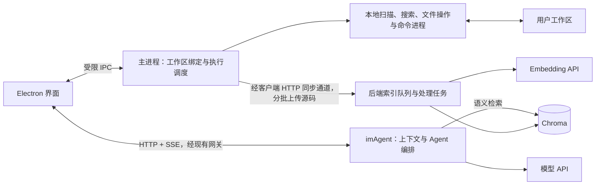

# imAgent 总目标

> 更新日期：2026-10-21。本文是结合当前源码和本轮讨论整理的规划初稿，供后续讨论与实施排序使用。
>
> 本次仅编写文档。下文“已有代码”来自静态阅读，不代表经过运行验收；“首版目标”和“后期目标”均不应当作已完成能力。

## 1. 项目最终要做成什么

imAgent 的主要方向是：**依托现有 IM 与 Electron 客户端，做一个能够围绕用户本地工作区完成真实开发任务的 Vibe Coding 助手。**

用户用自然语言描述需求后，系统能够理解项目、定位代码、提出修改、操作文件、运行开发命令，并根据执行结果继续修正，最终交付用户可以检查的代码改动和验证结果。

核心闭环是：

```text
选择工作区 → 描述需求 → 检索与读取代码 → 制订必要的修改步骤
    → 查看并应用改动 → 执行测试或构建 → 根据结果修正 → 汇报结果
```

当前最重要的交付物是一个可以日常使用、可以完整演示的单 Agent 编码版本。MCP、Skills、多 Agent 协作均属于明确保留的后期目标，不作为首版完成的前置条件，也不因为它们有技术热度就提前扩展范围。

本稿采用以下假设：

- Python imAgent 后端最终部署到服务器，负责 Agent 编排和模型调用。
- Electron 客户端运行在用户电脑上，负责访问真实工作区、执行本地开发命令。
- 首版沿用现有模型与 Embedding API 接入方式，不要求服务器自行部署大模型或 Embedding 模型。
- 用户添加工作区后，系统自动开始处理允许同步的源码；同步范围需要在界面中说明，并提供忽略规则与暂停入口。
- 先完成单用户、单工作区的一次真实开发任务，再验证多用户隔离与服务部署。

## 2. Apix 主要做什么，对 imAgent 有什么参考价值

Apix 的定位是一个通用 AI Agent 协作平台，覆盖代码编写、文件处理、知识检索和自动化任务。代码开发是其应用场景之一。

结合本地 README 与相应源码，可以看到以下功能结构：

| 能力 | 主要作用 | 本地源码入口 |
|---|---|---|
| Agent 运行与协作 | 主 Agent 调用工具、委派子任务、查询子任务状态 | `AGENT/.../agent_factory/`、`AGENT/.../agent_team_task/task_manager.py` |
| 工作区与代码执行 | 文件操作、Shell 命令、Python 脚本执行 | `AGENT/.../tools/basic_tools/file_manager.py`、`AGENT/.../tools/code_runner/` |
| Docker 执行环境 | 管理容器和工作区，命令与 Python 工具通过 `docker exec` 执行 | `AGENT/.../sandbox_manager/` |
| 对话上下文与记忆 | 加载和保存消息、处理短期记忆与上下文压缩 | `AGENT/.../context_manager/context_process.py`、`MEMORY/` |
| 文件与知识库 | 文件管理、Embedding、基于 Milvus 的向量检索 | `FILE/file_service/` |
| MCP 与 Skills | 加载 MCP 工具、获取技能包供 Agent 使用 | `AGENT/.../tools/mcp/mcp_tool.py`、`AGENT/.../tools/basic_tools/skills.py` |
| 桌面交互与任务流 | Electron/Vue 界面、聊天与任务流配置 | `CLIENT/apix-app/`、`TASK/task_flow_module/` |

表中的 `AGENT/...` 统一指 `AGENT/agent_module/apix_agent/apix_agent_core/`。以上说明其代码包含相应实现入口，本次没有启动 Apix，也没有验证各项功能的实际运行质量。

对 imAgent 最有价值的参考是：工具调用如何形成执行闭环、工具结果如何回到模型、上下文如何组织、后续如何扩展工具来源。

Apix 的容器执行方案适合研究通用 Agent 的运行环境；imAgent 当前希望让服务器保持轻量，因此首版采用用户电脑上的工作区与执行环境。是否采用服务器沙箱，留到确实需要云端开发环境时再评估。

## 3. imAgent 当前已经有什么，还缺什么

| 模块 | 当前源码状态 | 距离目标的主要缺口 |
|---|---|---|
| 流式聊天 | 已有 SSE 输出、模型接入、消息保存与历史查询接口 | 端到端稳定性、异常与取消的完整验收 |
| 多轮上下文 | 历史消息能够保存；当前调用主要传入本轮 `body.content` | 加载必要历史、隔离不同会话、限制上下文长度 |
| 工作区注册 | 只写本机 sqlite（别名 → 绝对路径）；后端不保存任何工作区状态，注册接口已移除 | 稳定工作区 ID、增量同步、多设备同步 |
| 文件工具 | 已有 list/search/read/write/edit/delete/command；全部经 `tool.request` 下发，Electron 实时读取并回传 | 改动预览（diff）、版本冲突检查、审批与回滚 |
| 执行控制 | 工具等待表已有超时、结果匹配与结束清理 | 取消执行、清晰终态、客户端断线后的状态处理 |
| 向量存储 | 已有 Chroma 持久化封装、upsert、检索、删除接口及 Embedding 服务 | 真实源码接入、分块、任务调度、版本与索引状态管理 |
| 项目索引 | `app/project_index/indexer.py`、`retriever.py` 目前只有职责说明 | 尚未形成“上传源码—建索引—查询—更新”的完整链路 |
| 本地命令 | 当前工作区工具集合是文件操作 | 测试、构建等命令的本地执行与结果回传 |
| 部署身份边界 | 当前相关接口仍接收请求中的 `user_id` | 对外部署前，从可信登录身份取得用户并校验资源归属 |

当前文件工具请求到达客户端后会直接进入执行流程。提示词中有修改约束，但客户端尚需补充可执行的授权与检查规则，才能支撑改动预览、版本保护等产品行为。

本轮定位的主要源码入口：

- 后端：`app/services/ai_message_service.py`、`app/agent/runtime.py`、`app/agent/tools/workspace.py`、`app/services/tool_dispatcher.py`、`app/core/path_safety.py`。
- 检索：`app/embedding/`、`app/project_index/`、`app/integrations/vector_store/`。
- Electron：`src/renderer/src/views/chat/Ai-chat.vue`、`src/preload/index.js`、`src/main/IPC/uploadFileIPC.js`、`src/main/File/fileInfo.js`。

因此，下一步可以沿用现有工具链，逐段补齐编码闭环；不需要先重建整套架构。

## 4. 首版 Vibe Coding 必须具备哪些能力

“基础 Vibe Coding 完成”的标准，应当是用户能够通过对话完成一次真实代码任务，而不仅是收到一段生成代码。

| 能力 | 首版应有的行为 |
|---|---|
| 选择与切换工作区 | 明确当前操作哪个目录，切换后上下文与工具目标一致 |
| 理解项目 | 查看目录、按路径和关键字搜索、按行读取文件，回答时指出依据 |
| 多轮跟进 | 理解“继续修改刚才那个文件”等指代，避免不同会话串上下文 |
| 创建与修改文件 | 从空目录初始化小项目、新建文件、精确修改、完成必要的多文件改动 |
| 检查与撤销改动 | 展示 diff，保留本轮涉及文件的原始内容，支持撤销且避免覆盖后续人工修改 |
| 运行开发命令 | 在本地项目环境中运行测试、构建等命令，返回输出与退出码；支持启动和停止项目服务，展示日志与可访问地址 |
| 根据反馈修正 | 将真实错误反馈给模型，在有次数和时间上限的前提下继续修复 |
| 可观察与可停止 | 展示读取、修改、命令等步骤，用户可以停止后续执行 |
| 清楚地交付 | 说明改了哪些文件、做了哪些验证、哪些问题仍未解决 |

首版需要一套完整的文件修改方式，可以先沿用现有精确文本替换；统一 patch 工具可在确有需要时补充。基础 diff 与撤销是必需能力，完整 IDE 编辑器、Git 图形管理和任意历史时间点恢复可以后续实现。

对权限交互，建议先采用容易理解的规则：工作区内允许读取；用户发起修改任务后，可对本轮改动批次确认，后续执行遵守已授权范围；删除、大范围覆盖和命令执行展示具体影响。需要时再增加“本会话允许此类操作”，避免每读一个文件都打断用户。

停止意味着停止后续模型与工具调用，并取消可以中止的运行任务；已经落盘的修改需要显式撤销，已经产生的外部副作用也不能声称被自动恢复。

## 5. 工作区与服务器如何分工

建议采用：**服务器运行 Agent，客户端持有真实工作区，服务器保存授权同步的代码索引。**

以下是目标结构，包含尚未实现的模块：



| 工作 | 建议承担位置 | 原因 |
|---|---|---|
| 目录扫描、忽略规则、文件变化检测、内容哈希 | 客户端 | 文件在本地，减少无效上传 |
| 路径查找、代码关键字搜索、实时读取 | 客户端 | 能查询最新文件，索引未完成时也可工作 |
| 文件写入、测试、构建、依赖相关命令 | 客户端 | 使用用户已有环境，减少服务器 CPU、内存和磁盘消耗 |
| 模型调用、工具编排、上下文组织 | 后端 | 复用现有 Python Agent 逻辑 |
| 允许同步的代码分块、Embedding 调用、向量入库 | 后端后台任务 | 先沿用现有 Chroma 与 Embedding 封装 |
| 交互进度、diff、确认、停止 | Electron 界面 | 让用户掌握本地实际发生的操作 |

“客户端执行”不等于把耗时工作都放进 Electron 主进程。主进程负责受控入口与调度；普通文件 I/O 可以沿用现有异步操作；大量扫描、哈希与搜索按需要放进工作线程或独立进程；开发命令通过子进程执行并流式回传输出。Electron 提供 `utilityProcess` 作为独立 Node 进程的一种选择，具体选型以实现复杂度和实测为准。[Electron utilityProcess 文档](https://www.electronjs.org/docs/latest/api/utility-process)

该方案减少服务器承担的开发环境负担，但服务器仍需处理同步流量、向量存储、检索和 Agent 运行。源码进入后端或 Embedding API 的范围，也要与用户看到的同步设置一致。

## 6. 工作区代码检索方案

### 6.1 把“建索引”和“检索”区分开

你提出的方案可以整理为两条互相配合的链路：

1. **后台预建索引**：添加目录后，自动扫描、分批同步允许的源码，后端后台生成向量并入库。
2. **对话时按需补建**：用户提问后，先查现有索引；需要读取尚未入库或已经修改的代码时，将这些文件优先排入同一索引队列。

后台进行的主要是“扫描、同步、建索引”；用户带着问题查询代码时才是“检索”。向量库既不是全部对话历史，也不是所有工具结果的堆放处。

**异步处理主要解决等待和调度问题，不会自动减少全量 Embedding 的总工作量。** 真正控制资源消耗，需要过滤、内容去重、增量更新、批处理与并发限制。

### 6.2 添加目录后的后台流程

```text
用户添加目录
    → 客户端登记本地根目录，取得稳定工作区标识
    → 按忽略规则扫描，生成相对路径、大小、内容哈希等清单
    → 后端比较已知版本，返回需要同步的文件
    → 客户端自动分批上传允许同步的源码
    → 后端加入有界队列，分块、调用 Embedding、写入 Chroma
    → 展示同步与索引进度，允许暂停和重试
```

不能只上传目录列表就期待后端自动生成代码向量；后端必须收到实际源码。远程服务器也不能主动读取用户电脑的本地路径。后台同步由客户端发起，可以在没有正在进行的聊天时运行。

首版过滤范围包括 `.git`、`node_modules`、`.venv`、构建产物、缓存、二进制和超大文件；遵守 `.gitignore`，同时单独排除 `.env`、私钥等敏感文件。用户需要时通过明确的包含规则同步特定文件，避免把“添加目录”实现成不加区分的整目录上传。

后台优先处理 README、项目配置和源码。单个文件失败应有记录并可重试，不能让整个工作区一直卡在无解释的“处理中”。

### 6.3 用户提问时的查询流程

建议组合三种来源：路径查找、代码关键字搜索、语义向量检索。

| 问题类型 | 优先方式 |
|---|---|
| 已知文件名、函数名、报错文本 | 路径或关键字搜索 |
| “登录功能在哪里”“谁负责消息保存” | 语义检索辅助定位，再读取原文确认 |
| 索引尚未完成、没有命中、文件刚修改 | 客户端实时搜索与读取 |
| 准备修改已定位的文件 | 再读取或校验当前版本，防止依据旧内容覆盖 |

一次查询不必机械地调用全部方式，由 Agent 根据问题选择；直接读取当前文件应始终可用。

```text
用户提出问题
    → 根据问题定位候选文件或片段
    → 必要时请求 Electron 搜索、读取当前源码
    → 当前读回的内容直接供本轮模型使用
    → 对缺失或过期的文件，异步提高建索引优先级
    → 模型继续回答或修改，不等待后台入库结束
```

索引只用于帮助定位；真实文件是修改依据。向量结果至少带相对路径、行范围和内容版本；发现版本不一致时丢弃过期候选并实时读取。工作区未完成索引时，界面说明覆盖情况，查询仍可继续。

### 6.4 “查询了哪些代码就入库哪些代码”如何落地

这个方向可以保留，但需要避免每次读取都重新向量化，也要区分原始源码与带行号的展示文本。

建议首版**以文件为索引更新单位**，按需读取负责把相关文件提前排入队列：

- 同一文件、相同内容哈希、相同索引配置已经完成时，直接复用。
- 读取到文件全文时，可以直接进入统一的分块与入库流程。
- 工具只读了几十行时，这些行先用于本轮回答；后台再补齐该文件允许同步的全文后建索引。
- 工具返回中的行号前缀、解释文字和错误消息不作为源码入库。

这是相对“任意查询片段立即入库”的一项简化建议：统一文件版本和分块规则，更容易处理修改、重复片段与删除。若后续确实需要只同步命中片段，再增加明确的片段覆盖记录，避免把一个文件的局部内容标记为已经完整索引。

### 6.5 增量更新与一致性

需要建立一份轻量的文件索引清单，而不是每次对话重新扫描、上传、向量化整个项目。

建议清单至少记录：

```text
user_id、workspace_id、relative_path、content_hash
index_version、status、最近错误
```

`index_version` 表达 Embedding 模型、维度与分块规则等索引配置版本。换模型或规则后，应当明确重建受影响索引，避免混用不兼容向量。大小和修改时间可用于快速发现候选变更，内容哈希用于确认是否真正变化。

| 事件 | 应有处理 |
|---|---|
| 新增文件 | 更新清单并排队建索引 |
| 文件内容变化 | 将旧索引标为过期，重建该文件并清理旧切片 |
| 删除文件 | 更新清单、删除对应切片，使旧任务不能把文件重新写回 |
| 移动或重命名 | 首版按旧路径删除、新路径新增处理 |
| 同一文件多次被查询 | 合并队列任务，按哈希和索引版本跳过重复处理 |
| 后台旧任务晚于新任务结束 | 写入前核对当前版本；旧任务结果不得覆盖新版本 |
| 应用或服务重启 | 重新比对清单，补做未完成任务，不重传全部未变源码 |

同一文件的后台处理与按需处理共用一条更新链路，按文件串行或合并为最新版本。索引更新期间可以暂时走实时读取；失败时标记为失败或未完成，不把残缺结果当作完整索引。

Chroma 提供按 ID 的 `upsert` 以及元数据过滤、删除能力，适合作为这些操作的底层接口；版本检查、去重和调度仍由应用负责。文件变短后也要删除多余旧切片，不能仅 upsert 新切片就认为旧内容已清理。[Chroma Collection 文档](https://docs.trychroma.com/reference/python/collection)

### 6.6 如何控制服务器压力

- 首版使用一个受限的后台处理队列，从单个索引 worker 起步；控制每批文本大小与并发，队列满时让客户端等待或暂停上传。
- 交互查询与正在进行的 Agent 请求优先，后台任务不能占满共享线程、连接和模型调用额度。
- 当前 Embedding 服务使用同步接口，后续接入时需放在受限线程或任务执行器中，避免直接阻塞 FastAPI 事件循环。
- 只为变化内容计算向量；先按文件重建，是否进一步做切片级复用由实测决定。
- 用现有业务存储记录清单与必要任务状态，单进程起步；暂不为这一功能单独引入整套任务平台。
- 记录同步字节数、待处理文件数、Embedding 用量、索引耗时，以及建索引时的交互延迟、CPU 和内存。

如果服务器仍然承受不了，再依据数据比较减少同步范围、调整批次或把更多预处理移到客户端。全量本地 Embedding 与本地向量库也是后续选项，但会增加模型分发、客户端资源占用和版本管理成本。

## 7. 文件与命令执行：Tool 和 Python 怎么取舍

### 7.1 这两个方案处在不同层面

Tool 是模型提出操作请求的接口；Python、Node 或 Shell 是执行请求时可能使用的实现方式。

因此，“模型生成 Python，客户端执行”仍然可以包装成一个 Tool。真正需要选择的是：哪些操作使用固定参数接口，哪些操作允许执行自由脚本，以及它们在哪里运行。

| 方案 | 适合场景 | 对当前项目的影响 |
|---|---|---|
| 结构化文件工具，客户端用 Node 实现 | 列目录、读取、精确修改、创建、删除 | 延续现有实现，参数和结果清楚，便于展示 diff、校验版本 |
| 结构化命令工具，客户端启动命令进程 | 测试、构建、项目命令 | 能补齐开发验证闭环，需要超时、输出、退出码与取消 |
| 模型生成 Python，由客户端 Python 进程执行 | 批量数据处理、复杂文件转换、确需脚本的任务 | 表达能力强，但增加解释器依赖、脚本审查与执行范围管理 |
| 服务器沙箱执行代码 | 云端工作区、无需客户端在线的任务 | 增加服务器执行环境、存储与资源管理，留待后期需求明确 |

**建议：文件操作继续使用结构化 Tool，补充本地命令 Tool；自由 Python 脚本作为以后的一种工具能力。**

对普通 read/write/edit 再生成一段 Python，没有明显的服务器减负收益：这两种方式只要都在客户端执行，文件处理成本就都主要由客户端承担。固定接口还能减少模型生成执行代码和排查脚本环境问题的步骤。

Python 更适合确实需要程序表达的批量任务。届时通过明确的脚本执行工具提交代码、运行参数与预期结果，而不是把每次普通文件操作都转换成脚本。

### 7.2 沿用现有通信链路

```text
模型发出工具调用
    → 后端生成 toolCallId，发出 SSE tool.request
    → Electron 识别工作区，检查本次操作的授权与参数
    → 经 preload / IPC 交给主进程调度
    → 本地文件操作或命令进程执行
    → HTTP 回传 tool.result
    → 后端匹配本次调用，将真实结果交给模型
    → 模型继续下一步
```

SSE 下发加 HTTP 回传可以继续使用。后台索引同步通过独立的客户端上传流程运行，不依赖聊天 SSE 一直打开；暂时不需要为了工具调用新增一条 WebSocket。

Electron 的 IPC 适合暴露有限的本地能力，preload 应提供明确的方法，并检查调用来源与参数。[Electron IPC 文档](https://www.electronjs.org/docs/latest/tutorial/ipc)、[Electron 安全文档](https://www.electronjs.org/docs/latest/tutorial/security)

### 7.3 首版执行层的必要约束

- **工作区绑定**：本地绝对路径只由客户端持有；请求使用工作区标识和相对路径。展示名称不作为唯一标识，避免同名目录冲突。
- **修改前版本检查**：应用改动时验证原内容或内容哈希；人工已修改时返回冲突，不能静默覆盖。
- **去重与结果归属**：结果绑定用户、工作区、运行与工具调用；客户端记录已执行请求，重复下发时返回已有结果。对不确定是否完成的写入或命令先核查状态，避免自动重放。
- **命令生命周期**：记录实际工作目录、命令、输出、退出码、超时和取消结果；停止时处理相应进程树，不能只中断界面等待。测试、构建等待命令结束；开发服务保留进程标识供后续查看与停止，不能把“已启动”当作“已验证可用”。
- **执行范围**：文件工具的路径校验继续保留；任意命令或 Python 脚本即使设置了工作目录，也仍然可能访问其他位置。若开放这类能力，需要单独定义授权和隔离边界，不能把工作目录限制称为沙箱。

当前工具等待状态保存在单进程内存中。首版部署先保持单 Agent 服务进程，并保证回传请求到达同一进程；多 worker 或多实例时，必须先解决等待任务归属和结果转发，不能仅把工作区清单存进 Redis 就认为问题已解决。

## 8. 实施顺序：从哪里开始

| 阶段 | 做什么 | 验收方式 |
|---|---|---|
| A：补齐现有链路 | 补必要历史上下文，梳理会话和工作区绑定、工具失败与终态 | 连续两轮讨论同一文件，第二轮能承接第一轮；失败有明确状态 |
| B：完成代码定位 | 增加本地内容搜索，与目录、读取工具配合 | 不依赖向量库，也能定位一个实际函数并解释调用链 |
| C：完成编码闭环 | 改动 diff、版本检查、可撤销修改、本地命令、结果回传与有限修正 | 完成一次真实小需求，展示改动并运行相应测试或构建 |
| D：补后台增量索引 | 自动同步、分块入库、语义检索、按需提优先级、修改和删除同步 | 索引期间可继续聊天；重复读取不重复计算；变更后不使用旧索引 |
| E：服务器部署验收 | 可信身份与归属校验、重连与重启行为、资源上限、可重复部署 | 远程后端操作客户端工作区；验证用户隔离并记录资源基线 |
| 后期扩展 | MCP → Skills → 多 Agent 协作 | 每增加一类能力，都复用已验证的执行和状态机制 |

身份与资源归属可以在前几个阶段逐步补齐，必须在服务对外开放前验收。C 完成基础编码闭环，D 补齐本轮讨论的检索目标，E 通过后才具备本轮首版的交付条件。

**现在建议从 A、B 开始：先让模型在真实项目里“找得到、读得准、记得住”，随后完成修改与验证。** 自动后台索引是确定要做的能力，可以在已有实时搜索兜底后接入，减少同时调试检索、执行和交互三条链路的难度。

每个阶段只增加完成当前验收需要的职责与代码；现有模块能承载的逻辑先留在现有模块中，避免为后期设想提前引入复杂分层或基础设施。

## 9. 后期目标

### 9.1 MCP

目标是接入外部工具与数据源，让工具来源可以扩展。先选择一个真实需要的服务接入，完成连接配置、工具发现、调用、错误处理和生命周期管理。

访问用户电脑的本地 MCP 服务应由客户端一侧承接；后端可访问的远程服务按需要由后端连接。它们仍然需要遵守同一套用户归属、授权、超时和运行记录规则。

### 9.2 Skills

目标是沉淀可复用的开发流程，例如“为接口补测试”“按项目约定排查错误”。技能可以包含说明、示例和资源，必要时使用脚本；实际操作仍通过已有工具执行。

先支持发现、选择或按需加载技能，再考虑自动匹配、版本管理和分享。加载技能不会自动取得新的文件或命令权限。

### 9.3 多 Agent 协作

目标是让复杂任务能够拆分、独立执行和汇总，例如一个 Agent 调查代码，一个实现修改，一个检查结果。

开始这一阶段前，单 Agent 应已经具备可靠的检索、修改、测试、取消与成本限制。首个协作版本先选一个确有收益的场景，处理并发上限、文件冲突和结果合并，再逐步扩展角色与通信方式。

### 9.4 其他远期方向

原 README 中的视频通话、AI 图像识别、实时建模和全新记忆系统继续保留为远期方向，具体形态另行讨论。首版所需的历史上下文、任务状态与有限摘要仍应按编码任务需要先完成。

简历与项目介绍应分别表述“计划实现”“已有代码”“通过测试”“通过部署验证”。目前没有写进简历的 MCP、Skills 和多 Agent，不需要为了补技术关键词提前实现。

## 10. 首版交付验收

以下场景需要保留可检查的演示记录、改动与执行结果；本次文档编写没有运行这些场景。

| 场景 | 通过标准 |
|---|---|
| 添加工作区 | 自动开始允许范围内的后台同步，能看到进度、暂停与失败原因 |
| 提问并追问 | 找到真实代码位置并引用依据，下一轮能承接前文 |
| 索引尚未完成 | 仍能通过本地搜索和读取完成问题定位 |
| 完成一个小需求 | 实际修改必要文件，展示 diff，执行相应验证并汇报真实结果 |
| 执行中发现错误 | 模型读取工具错误后合理修正；无法修正时在上限内结束并说明原因 |
| 人工同时修改文件 | 版本冲突被识别，未静默覆盖；撤销也不会抹掉之后的人工修改 |
| 文件变更与删除 | 更新后不再依据旧索引修改；删除后旧任务不能重新恢复其索引 |
| 重复读取与网络重试 | 未变源码不重复计算向量；重复写入或命令请求不会被盲目再次执行 |
| 停止、断线或重启 | 状态明确，不假报完成；恢复连接后核查实际执行状态，必要时重新登记与同步 |
| 用户和工作区隔离 | 不同用户、同名目录或不同设备之间不串索引、不串工具结果 |
| 服务器资源 | 记录空闲、后台建索引、交互查询及两者并行时的延迟、CPU、内存和用量，再确定可接受上限 |

本轮优先讨论的具体取舍是：文件级索引是否满足预期、改动批次如何确认，以及首个完整演示需求选什么。其余方向可以随着首版闭环逐步明确。
