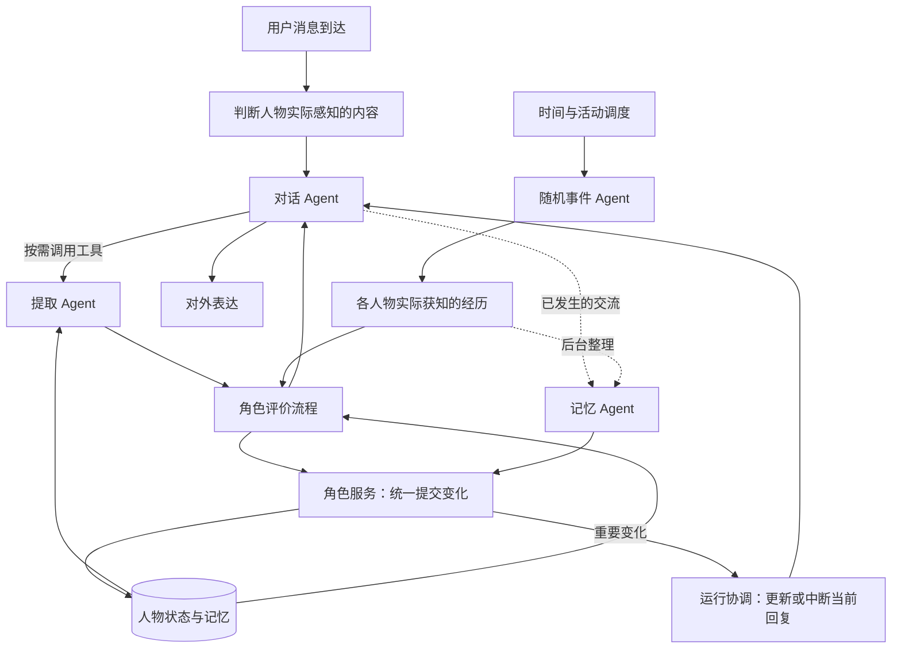
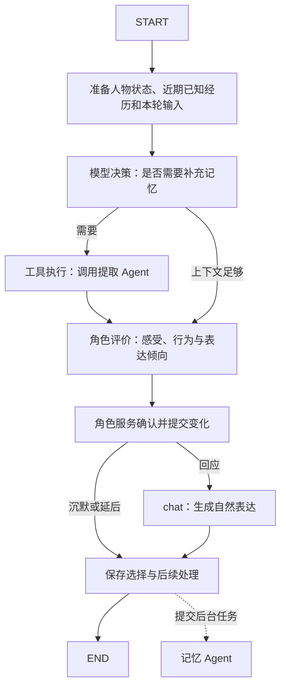
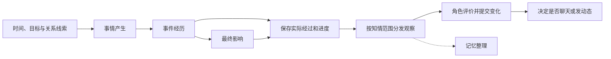

# imAgent 架构设计

## 一、从基础对话开始的实现路线

先让一条文字对话链路稳定工作，再逐项加入人物能力。LangChain 负责模型和工具调用，LangGraph 负责组织步骤、条件分支与运行状态；使用 LangGraph 后继续复用 LangChain，不重写另一套对话服务。

| 阶段 | 要实现什么 | 做到什么算完成 |
| --- | --- | --- |
| 1．基础文字聊天 | 模型配置、切换、初始化、发送、历史加载；通过 LangChain 调用一次模型 | 连续对话能承接近期上下文，回复和历史可保存，切换模型不丢失角色 |
| 2．对话 Agent 与基础图 | 封装少量 tool；先保留 `START → chat → END`，再分出模型决策和工具执行 | 模型能正确选择工具，执行结果回到对话，内部调用过程不混入聊天正文 |
| 3．按需提取与后台记忆 | 将提取 Agent 包装成检索工具；事后由记忆 Agent 异步整理 | 需要旧事时能查到合法记忆，无需检索时不强制调用；近期消息衔接后台整理空档 |
| 4．角色评价 | 结合人格、当前心情、状态、近期经历、相关记忆和心理知识，先形成行为及表达倾向 | 同一输入在不同处境下有不同反应，变化能保存并影响后续，而非每轮重置心情 |
| 5．生活推进与对话中断 | 加入用户可设置的时间窗口、连续生活、手机/现场感知和正在运行的回复控制 | 平淡生活能持续，合理事件能打断检索或表达，迟到结果不会继续发送 |

当前代码已具备基础文字链路和单个对话业务节点的 LangGraph 图。上表后续阶段是接入顺序，不表示这些能力已经实现，也不要求把已有基础链路再做一遍。

`START` 和 `END` 是起止标记，不是两个额外业务节点。调用工具时，模型先提出工具请求，程序执行后把结果交回模型；节点数量不等于 Agent 数量，也不等于必须调用几次大模型。

基础电脑操作工具按具体用途逐项封装。服务端直接执行工具时操作的是服务端电脑；要操作用户设备，需要由对应客户端承接执行。这里仅规划能力边界，不恢复旧工作区规划、命令回传和代码索引链路，也不把电脑工具作为人格与记忆的前提。

## 二、四个 Agent 怎样组成一个人物

对话、记忆和提取三个 Agent 共同服务一个主 AI。它们共享人物资料和经历，各自负责不同工作。随机事件 Agent 在后台推进这个人物的生活。

| Agent | 负责什么 | 输出什么 |
| --- | --- | --- |
| 对话 Agent | 理解当前交流，决定回复、沉默、拒绝或分享，组织表达 | 行为选择与文字、图片、语音等表达意图 |
| 记忆 Agent | 整理人物实际获知的经历，维护长期记忆，进行反思 | 记忆记录与有依据的长期变化建议 |
| 提取 Agent | 根据话题、人物状态和知情范围寻找相关记忆 | 本轮可以使用的记忆及其引用 |
| 随机事件 Agent | 按时间窗口合理推进生活，延续当前活动或产生有依据的新事件 | 实际经过、事件进度和后续影响建议；也允许没有新变化 |

另外有以下共用职责：

- **角色评价流程**：结合性格、当前情绪、关系和经历，判断“这件事对我意味着什么”。它放在 `person/appraisal.py`，不增加第五个 Agent。
- **角色服务**：校验各 Agent 提出的变化，再统一保存。它负责避免聊天、事件和后台反思相互覆盖。
- **运行协调**：由现有业务服务负责本轮任务、取消、恢复与结果有效性检查，执行生活变化带来的中断。它是程序职责，不增加一个大模型 Agent。



图表示完整设计，虚线表示后台处理。四个 Agent 先运行在同一个后端应用内，不要求拆成四个服务；权限过滤、时间判断和事务提交直接由代码完成。

主 AI 的资料、状态、记忆和生活进度由服务端统一保存，按用户与世界隔离。桌面端和移动端访问同一个角色，客户端只缓存所需内容；人物独立不意味着必须在每台设备各存一份人格。首版本机后台和后续服务器部署沿用此边界。

## 三、对话、提取与记忆怎样配合

### 3.1 一次交流的完整流程

1. **接受与感知分开**：先保存到达的用户消息，再按作息、模拟手机与现场状态判断人物是否察觉、是否已读。只有实际获得的预览或正文进入人物上下文。
2. **准备本轮上下文**：读取人格、当前心情、关系、活动状态、近期重要的已知经历与聊天；不把全世界事实和全部历史都交给模型。
3. **按需提取**：模型判断缺少哪些过去信息，通过工具调用提取 Agent；近期已经足够时不重复检索。
4. **角色评价**：结合本轮可知输入、相关记忆和按需取得的心理知识，形成即时感受、行为选择及表达倾向；由角色服务校验、保存获准变化。
5. **对话表达**：愿意回应时，按已确认的倾向生成文字；沉默或延后时不强行生成回复。技术故障单独报告，不能伪装成人物选择。
6. **保存并提交后台任务**：记录实际发生的观察、选择和已经发送的表达，再由记忆 Agent 整理。未察觉正文不能通过后台整理被偷偷授予人物。

记忆整理可以晚一些完成，但这条消息引发的即时感受要在本次行为前形成。提取 Agent 虽然异步运行，当前判断需要其结果时仍需等待；迟到结果不能回头改写已经发出的回复。

### 3.2 当前基础文字流程

当前已接通模型配置、切换、基础角色初始化、文字回复及消息保存。调用顺序是：

```text
api/ai_message.py                   接受 HTTP 请求
  → services/model_config_service.py  选择有效模型并解析凭据
  → message_repository.begin_turn     初始化或取得唯一世界，保存用户消息和本轮任务
  → services/character_service.py      组织角色设定和可见的近期对话
  → person/coordinator.py              LangGraph 调用 dialogue/agent.py
  → message_repository.complete_turn   保存完整回复、经历和客户端事件
  → SSE                               返回公开正文与完成事件
```

当前 `coordinator.py` 只有对话节点。记忆、提取、角色评价和随机事件尚未加入这条执行链。最近对话上下文也不等于长期记忆。具体请求与返回见[设计文档中的基础文字接口](设计文档.md#四当前已实现的基础文字接口)。

### 3.3 对话 Agent 内部怎样分节点

下图是阶段 3、4 逐步形成的目标流程。到达但尚未被人物察觉的消息先留在消息服务，不把完整正文直接送进此图。



| 步骤 | 怎样实现 | 职责边界 |
| --- | --- | --- |
| 准备上下文 | 程序读取持久数据和近期消息 | 提供当前状态及有范围的经历，不重新猜一遍人物是谁 |
| 模型决策 | 将检索工具说明提供给对话模型 | 判断缺少什么信息，不只匹配“记得”“上次”等词 |
| 工具执行 | 程序执行异步函数，内部调用提取流程 | 绑定用户、世界、人物和本轮任务；拿到结果再继续 |
| 角色评价 | 模型结合人物资料、记忆及按需心理知识形成内部结果 | 决定感受和行为倾向，不直接输出聊天正文 |
| chat | 根据已确定的倾向组织表达 | 不擅自把沉默改成回复，也不把拒绝改成原谅 |
| 保存与后台提交 | 业务服务处理事务和任务 | 保存实际结果，允许后台重试，不阻塞当前表达 |

初期没有角色评价时，不需工具可直接使用首轮模型的回答；接入评价后，跳过检索不等于跳过人物状态和行为判断。以上是逻辑步骤，可以按实际成本合并节点，不要求每个步骤各调用一次大模型。

提取 Agent 初期可从过滤、检索和结果筛选做起；需要查询改写、多次查找或整合时再引入模型。工具返回记忆引用、内容、来源性质和必要的不确定程度，区分没有找到与技术失败；不直接把检索摘要变成无来源的确定事实。

### 3.4 等待回忆时怎样表达

较慢的检索可以配合“等我想想”等过渡短句。候选表达由模型结合人格、现有心情和已知场景提出，发送前由程序检查仍在等待、本轮仍有效且人物仍愿意交流。检索很快时不必发送，也不强制每轮生成语气词。

实际发送的短句单独保存，并进入后续回复上下文。内部工具名、查询词、分析与推理不进入公开正文。检索尚未返回前，不能在过渡短句里先声称记起未经核实的细节。

### 3.5 记忆 Agent 怎样异步接续

消息服务先保存用户输入和实际表达；记忆 Agent 整理值得保留的认识、来源与反思，不承担聊天记录唯一保存职责。即使人物读后选择沉默，只要已有实际观察和行为结果，也可以进入整理流程；未读正文除外。

用户连续发消息时，可以合并未处理范围，待短暂安静期后整理，而不是每条消息都启动完整反思。需要保存已处理位置并限定最长延后，避免合并时丢消息或持续聊天时永远不整理；具体时间参数待定。近期上下文继续承接尚未形成长期记忆的消息。

后台工作登记为可恢复任务，不只启动一个进程内任务后不再跟踪。它形成记忆或长期变化建议，由统一服务提交；本轮即时情绪不能因为事后整理再次施加同一影响。

## 四、随机事件 Agent 怎样合理推进生活

### 4.1 时间窗口与活动连续性

用户可以设置半小时、一小时等推进窗口。窗口控制后台检查和推进生活的节奏，不是固定频率的“换剧情”。默认值、允许范围和修改后的生效方式待定，不在这里增加配置接口或表字段。

每次检查依次考虑当前活动的进展、已存在的作息/目标/约定，以及是否有合理的新情境，可以得到三种结果：

| 结果 | 含义 | 例子 |
| --- | --- | --- |
| 继续当前活动 | 当前状态仍合理，没有需要处理的变化 | 没有其他事情，人物愿意继续和用户聊天 |
| 推进已有安排 | 到达活动阶段、约定或作息的实际触发条件 | 看完一章书、约定时间到了，决定下一步 |
| 产生新事件 | 有符合背景、地点、人物关系和前因的情境 | 爸爸在家叫它帮忙，或朋友按已有安排来联系 |

平淡是合法结果。没有新变化时，可以直接保留当前活动，不必每次调用模型生成“现在没事”的描述，也不反复新增相同经历和记忆。并非所有后台小变化都值得打断对话。

活动转换要有依据及过程，但不禁止自然切换；看书后出去玩可以由读完、约定或新邀请促成。正在聊天不屏蔽合理的外部干扰，也不使既有计划默认同时完成。

已知约定、活动结束和正在经历事件有自己的推进时间，不被粗粒度窗口推迟。例如 14:45 到期的安排不能只因用户选择一小时窗口，就一律等到 15:00 才处理。具体提前量与调度方式留待实现。

### 4.2 三阶段事件工作流

随机事件 Agent 使用三阶段工作流：



| 阶段 | 做什么 | 例子 |
| --- | --- | --- |
| 事情产生 | 结合生活背景和当前条件生成情境，检查是否能够发生 | 在学校活动中有机会认识新同学 |
| 事件经历 | 推进具体互动，记录人物选择和对话 | 聊天投机，约定下次一起参加活动 |
| 最终影响 | 汇总结果，提出目标、日程、关系等变化 | 新增关系，原有安排发生调整 |

生成一个情境不代表它已经发生；世界生成器也不能直接替主 AI 决定“必须开心”。心理反应仍由角色评价流程形成。

生活同时包含作息、目标、约定与随机事件。已经约好的活动按计划推进，不能被新的随机事件无条件替换。半小时散步持续现实半小时，聊天可以参与并改变过程，后续要承接耽误学习、失约等实际后果。

虚拟伙伴保留简单性格、必要状态和人物关系。他们之间可以发生具体交流，再经转述或共同参与影响主 AI；不为每个伙伴复制完整的三个主角色 Agent。

客户端关闭而后台仍运行时，生活继续。后台真正停机后，从恢复时刻接续，不补写空档里的生活事件。人物按居住地时区作息；未完成活动与跨空档生日的处理见设计文档的生命周期规则和待定项。

### 4.3 生活怎样中断当前对话

事件先保存实际经过和人物实际获知的内容，再进入角色评价。人物是否离开、先解释、兼顾或不接受请求，取决于事件、性格、关系、当前活动和聊天情境；事件 Agent 不直接替人物决定必须生气或必须断聊。

一旦决定当前回应不能继续，运行协调逻辑更新状态、作废本轮待发送结果，并取消或停止消费旧任务。不能等待提取节点或模型整轮返回后才处理。每次工具回调、草稿发送和流式输出都须检查本轮是否仍有效；旧结果即使晚到，也不能重新开启已结束的回复。

已经发送的内容保持原样；取消不回滚真实发生的消息、已执行操作或观察。未发送草稿不伪装成已说过。中断后的技术收尾不要求人物必须解释，也不能把正常人物中断报告成模型故障；需要让客户端停止等待，但不泄露人物没有分享的内部理由。

| 顺序 | 实际经过 | 后续处理 |
| --- | --- | --- |
| 1 | 用户问“还记得上次吵架吗”，AI 说“等我想想” | 保存过渡短句，开始按需检索 |
| 2 | AI 听到爸爸叫它帮忙 | 评价事情是否紧急、是否愿意去，以及还能否回复 |
| 3 | 决定立即离开，手机留在房间且静音 | 保存活动/手机状态，中断未发回复，使旧任务结果失效 |
| 4 | 用户又问“你人呢” | 保存消息，人物尚未察觉，不按正文提前产生情绪 |
| 5 | 旧检索返回结果 | 不继续发送原草稿，后续可用时重新核对范围和版本 |
| 6 | 人物回来查看手机 | 形成实际观察，结合后续消息重新评价，决定是否接续话题 |

是否一定离开、是否先告知都不是固定结局，上例只用于检验连续性和旧结果隔离。

### 4.4 先察觉，再判断是否回复

人物手机是模拟世界的一部分，与真实桌面端或移动端在线状态分开。先用足以判断行为的状态描述，不模拟整部手机系统。

```text
消息入库 → 是否察觉通知 → 实际读到多少 → 是否方便回复 → 是否愿意回复
```

| 状态 | 对交流的影响 |
| --- | --- |
| 当前活动、能否暂时中断 | 是否有条件分出注意力 |
| 手机是否在身边、是否可操作 | 是否可能阅读或发送 |
| 静音、振动、通知方式与免打扰 | 能否获知有新消息；静音不禁止主动查看 |
| 周围人物与现场环境 | 是否方便交流，是否想让旁人知道聊天内容 |
| 当前心情、关系和联系意愿 | 获知消息且有条件时，愿意怎样回应 |

只察觉振动不能把整条正文交给评价节点；已读但选择不回可以产生观察和情绪。人物有空、主动查看、实际收到可察觉通知等变化才触发相应处理，不因后台已收到正文就让人物无条件知情。

## 五、人格、情绪和记忆怎样协作

### 5.1 稳定人格与即时情绪分开

人物身份、背景、兴趣和知识技能保存在人物资料中；即时情绪、真实作息和当前关注点保存在人物状态中。关系与长期目标单独保存。

角色评价流程读取这些内容，回答三个问题：这件事如何被这个人理解、此刻有什么感受、可能采取什么行动。比如同一句玩笑，对陌生人和熟悉朋友可能有不同反应。

短暂心情不能直接覆盖整个人格。记忆 Agent 可以结合多次经历进行反思，形成长期变化建议；已经生效的即时影响不能在后台再计算一次。心理维度、权重与记忆维护算法留在对应模块中研究，不提前固定成几列“开心值”和“好感度”。

角色评价节点使用的上下文包括人格、情绪、关系、当前活动和手机/现场状态、近期已知重要经历、本轮实际输入及相关长期记忆。近期经历由程序按范围和大小组织，不能仅因用户没提某件事，就让它对当前心情的影响消失；也不重复施加已包含在当前状态中的旧影响。

评价结果至少表达：怎样理解当前事情、当前感受及变化、是否/何时回应、表达倾向及依据引用。它不直接输出聊天正文；后续 chat 节点把倾向变成符合人物的自然语言。心理知识按需提供参考，不把某性格与唯一反应绑定，不把推测包装成对用户的确定判断。

### 5.2 真实经过、人物认知和对外说法分开

| 层次 | 保存什么 | 例子 |
| --- | --- | --- |
| 经过 | 世界里实际发生了什么 | AI 正在看书，没有睡着 |
| 观察 | 某个人物实际看见或听见了什么 | 用户收到“我睡了”这条消息 |
| 记忆与判断 | 人物记住或相信什么，依据是什么 | 用户可能认为 AI 已经休息 |
| 对外表达 | 人物决定说什么、分享什么 | AI 为了独处说“我睡了” |

说谎只改变表达，不把真实作息改成睡眠。伙伴私下经历了某事，也不代表主 AI 自动知道。用户自述的现实经历要保留“用户如此陈述”的来源，不能当作系统已经验证的事实。

对话只能使用当前角色自己的合法观察、记忆和状态，不能读取全世界事实、其他伙伴私密观察或管理员审计资料。

### 5.3 长期记忆与向量库分工

MySQL 保存记忆正文、来源、持有人、状态和版本；向量库保存用于相似度检索的索引。

```text
经历 → 角色实际获知的观察 → 记忆整理 → MySQL 保存正文与来源
                                            ↓ 提交后同步
                                         向量索引
                                            ↓ 检索候选
                         回 MySQL 核对归属、状态和版本 → 当前对话
```

向量命中不能直接当作可用记忆。先限定用户、世界与持有人，再回表检查有效性。切换嵌入模型要区分索引空间；索引失败可以重建，不丢失人物正文。

淡忘仍可能被提醒、回想或相似事件唤起；真正遗忘则退出普通召回。不能从原始聊天、初始设定或管理员记录里偷偷补回旧细节。清理用户界面历史和人物遗忘是两个操作。

## 六、多模态能力放在哪里

多模态负责感知和表达，人物核心负责感受和选择。

| 模块 | 职责 | 交给人物核心的内容 |
| --- | --- | --- |
| `multimodal/input.py` | 识别图片、理解音频、转写语音、提取语气与情绪线索 | 内容、媒体引用、来源和不确定程度 |
| `multimodal/output.py` | 执行文字、图片、短语音和通话输出，处理插话及送达 | 实际发送、播放和被打断的结果 |
| `llm/` | 创建并适配各供应方模型 | 对应能力的调用结果 |

“用户说了什么”和“听起来是什么情绪”分别传递，只保留语音转写会丢失声音线索。模型识别到的低落只是线索，人物如何回应仍取决于关系和自身性格。

已经生成、已经发送和对方已经听到的内容分别记录。用户插话后，停止旧语音输出，未播出的尾句不能进入双方共同经历。打断通话输出不会取消已经发生的生活事件。

声线、外貌和参考媒体属于人物资料；模型配置只决定怎样调用能力。切换模型保留人物身份，实际声音与图像一致性仍需验证。所选模型缺少能力时提示用户，不静默更换模型。

## 七、代码怎样分层

| 位置 | 承担的工作 | 不放在这里的工作 |
| --- | --- | --- |
| `api/`、`schemas/` | HTTP/SSE、参数校验、身份核对和公开响应 | 人格判断、SQL、长期工作流 |
| `services/` | 组织业务、读取上下文、控制生命周期、统一提交变化 | 模型供应方细节、记忆算法 |
| `agent/` | Agent 节点、提示词、协作流程和内部算法 | HTTP 路由、直接覆盖数据库状态 |
| `llm/`、`multimodal/` | 模型适配、媒体感知和输出执行 | 决定人物关系与人格变化 |
| `integrations/` | MySQL、向量库、Redis 等外部资源的存取 | 替人物作心理判断 |
| `core/` | 配置、启动和关闭 | 各条业务的具体行为 |

```text
imAgent/
├── main.py
├── app/
│   ├── api/
│   │   ├── ai_message.py           # 状态、历史、发送
│   │   ├── model_config.py         # 配置和切换
│   │   ├── identity.py             # 可信网关身份核对
│   │   └── sse.py                  # 公开事件编码和保活
│   ├── schemas/                    # 输入输出与事件结构
│   ├── services/
│   │   ├── ai_message_service.py   # 本轮对话生命周期
│   │   ├── character_service.py    # 人物上下文；统一状态提交待实现
│   │   ├── model_config_service.py # 有效模型和凭据解析
│   │   ├── background_service.py   # 后台调度，待实现
│   │   └── moment_service.py       # 动态业务，待实现
│   ├── agent/
│   │   ├── runtime.py              # 公共模型创建能力
│   │   ├── person/
│   │   │   ├── coordinator.py     # 目前为对话图，后续组织三个 Agent
│   │   │   ├── state.py           # 本轮上下文和状态
│   │   │   ├── appraisal.py       # 共用角色评价，待实现
│   │   │   ├── dialogue/          # 对话节点与提示词
│   │   │   ├── memory/            # 整理、反思、算法，待实现
│   │   │   └── retrieval/         # 记忆提取与算法，待实现
│   │   └── event/                 # 三阶段生活事件图，待实现
│   ├── multimodal/                # 多模态输入输出，待实现
│   ├── llm/                       # 模型创建与供应方适配
│   ├── embedding/                 # 向量化能力
│   ├── system_knowledge/          # 内部辅助知识加载基础
│   ├── integrations/
│   │   ├── database/
│   │   │   ├── user_space_repository.py  # 用户空间与统一锁顺序
│   │   │   ├── character_repository.py   # 当前世界及基础人物初始化
│   │   │   ├── model_config_repository.py # 模型配置和绑定
│   │   │   ├── message_repository.py     # 消息、经历、观察和本轮任务
│   │   │   └── memory_repository.py      # 长期记忆存取，待实现
│   │   ├── vector_store/          # Chroma 连接与记忆索引骨架
│   │   ├── redis/                 # Redis 连接
│   │   └── nacos.py               # 服务注册
│   └── core/                      # 配置与生命周期
├── resources/
├── tests/
└── docs/
    ├── 需求分析.md
    ├── 架构设计.md
    ├── 设计文档.md
    └── sql/imagent_init.sql
```

目录中注明“待实现”的位置保留职责，不提供假的默认结果。旧任务规划、工作区文件/命令执行和项目代码索引不再参与人物对话。

## 八、存储与并发怎样配合

MySQL 的 25 张表按业务划分，由四个 Agent 共同使用；具体用途见[表说明](设计文档.md#二25-张表的作用)。Chroma 只做语义索引。Redis 保留为运行基础，当前基础聊天没有把它作为人物状态或记忆的持久来源。

提交变化遵循以下规则：

1. **先推理，后短事务提交**。模型调用和向量写入不占用数据库行锁。
2. **固定锁顺序**。同一用户按用户空间 → 当前世界 → 业务记录加锁。
3. **校验版本**。提交前检查使用的状态是否仍有效；冲突时重读并重新评价，不能覆盖整份旧快照。
4. **每项影响有独立标识**。消息、记忆、评论或任务重试时去重；不同阶段的不同影响可以分别提交。
5. **最终写入再次核对世界与任务**。管理员重置后，旧任务即使返回也不能写入新角色。过期租约也不能继续提交。

`world.state_version` 表示人物状态版本，`message.seq` 表示消息顺序，`client_event.event_seq` 表示客户端同步顺序，三者不能混用。详细事务和断线恢复契约见设计文档。

当前对话还需要绑定可作废的运行标识；相关生活变化决定中断时，先让旧标识失效，再取消任务，回调与发送检查相同标识。普通无关状态变化不应一律打断；有意义但不必离开的变化可以重新评价或改写未发草稿。标识怎样复用现有任务记录、如何通知客户端结束本轮，留到详细设计时确定，不在本次文档更新中直接变更表或接口。

## 九、当前接入范围与验证

| 部分 | 目前具备 | 后续工作 |
| --- | --- | --- |
| 基础对话 | 模型配置、dialogue 切换、基础人物初始化、单节点 LangGraph、文字 SSE 和历史 | 工具决策与执行分离、按需检索、过渡短句与多条消息节奏 |
| 人物核心 | 资料和状态的存储位置、评价与提交模块骨架 | 角色评价与表达分离、即时情绪、关系判断、成长和统一状态提交 |
| 长期记忆 | 表结构、向量基础、整理与提取目录 | 形成记忆、来源追踪、淡忘、检索、反思 |
| 自主生活 | 世界、事件、目标和伙伴的数据设计 | 可设窗口、活动连续、无新事件、三阶段推进、消息感知与对话中断 |
| 多模态与朋友圈 | 媒体、通话、动态、受众和互动的数据设计 | 识别、生成、通话与插话、动态发布和互动 |

按第一节路线逐项接入，不在基础对话尚未稳定时并行实现全部人物系统。以下场景随阶段增加，用于确认流程正确衔接，不把本节描述当作已通过测试：

| 场景 | 需要验证 |
| --- | --- |
| 普通问候、无需旧信息 | 不强制调用检索，接入评价后仍尊重当前人物状态 |
| 用户提起一次旧争执 | 工具取回合法依据，评价形成倾向，对话不编造没有找到的细节 |
| 检索较慢，先说“等我想想” | 短句只发送一次并保存，后续回复知道已经说过 |
| 用户连续发消息，记忆仍在整理 | 近期上下文保持连续，后台合并不丢消息、不重复施加影响 |
| 时间窗口到达但没有合理新事 | 当前聊天或读书继续，不强制换活动或新增重复记忆 |
| 等待回忆时被叫走 | 未发回复停止，旧结果晚到不能继续发送，已发内容不回滚 |
| 手机留在房间并静音，用户追问 | 消息保存但人物不提前知道正文，回来阅读后重新判断 |
| 从电脑切换到手机 | 继续同一人物和世界，不以客户端副本覆盖服务端状态 |

心理算法、检索预算、记忆合并时间、生活窗口范围、消息感知和中断优先级等仍需逐步细化。多模态、关系网和朋友圈的完整需求保留，不在起步阶段一次展开。

## 参考实现

<details>
<summary>展开已有调研的代码参考</summary>

以下保留调研时定位的固定提交，用于查找对应机制，不代表这些项目完整覆盖本需求，也不代表本项目已经达到其效果。

| 参考 | 主要借鉴 |
| --- | --- |
| [Generative Agents 检索](https://github.com/joonspk-research/generative_agents/blob/fe05a71d3e4ed7d10bf68aa4eda6dd995ec070f4/reverie/backend_server/persona/cognitive_modules/retrieve.py)、[反思](https://github.com/joonspk-research/generative_agents/blob/fe05a71d3e4ed7d10bf68aa4eda6dd995ec070f4/reverie/backend_server/persona/cognitive_modules/reflect.py) | 近期性、重要性、相关性及从多次经历形成反思；不直接照搬游戏时间与权重 |
| [Soul Protocol 状态管理](https://github.com/qbtrix/soul-protocol/blob/9d77be0be7c10ce1a36c485c8f1615ca2707d5df/src/soul_protocol/runtime/state/manager.py)、[关系](https://github.com/qbtrix/soul-protocol/blob/9d77be0be7c10ce1a36c485c8f1615ca2707d5df/src/soul_protocol/runtime/bond.py) | 人格、情绪惯性、关系与状态更新分开；具体数值不当作心理学规律 |
| [Mem0 记忆实现](https://github.com/mem0ai/mem0/blob/753496cf1435d76c3a711f3af51303f7fdcb6420/mem0/memory/main.py)、[抽取提示](https://github.com/mem0ai/mem0/blob/753496cf1435d76c3a711f3af51303f7fdcb6420/mem0/configs/prompts.py) | 记忆带主体、来源与时间；本项目另需区分谎话、认知与真实经过 |
| [Letta Code 后台反思](https://github.com/letta-ai/letta-code/blob/df63a3197621aa6036e9a166584baeedf653aeae/src/agent/subagents/builtin/reflection-v2.md) | 即时交流和后台整理分开；不引入其代码编辑与 Git 工作流 |
| [Open-LLM-VTuber 插话处理](https://github.com/Open-LLM-VTuber/Open-LLM-VTuber/blob/992309c0aa19845960228f880013d4685fde93b5/src/open_llm_vtuber/agent/agents/basic_memory_agent.py) | 用实际播出内容处理被打断的回复，不把基础消息列表当作长期记忆 |
| [LangMem 搜索工具](https://github.com/langchain-ai/langmem/blob/main/src/langmem/knowledge/tools.py)、[延迟整理](https://github.com/langchain-ai/langmem/blob/main/docs/docs/guides/delayed_processing.md) | 按需搜索与后台整理分工，连续消息合并处理；本项目另以持久任务保证恢复，不直接复制进程内队列 |
| [Pipecat 工具执行](https://github.com/pipecat-ai/pipecat/blob/main/src/pipecat/services/llm_service.py) | 取消或超时后拒绝迟到结果，借鉴任务生命周期而不引入整套语音运行框架 |
| [AIRI 表情定义](https://github.com/moeru-ai/airi/blob/6e9cb7c4365b2d317b9ce05178653ad08d1d857b/packages/stage-ui/src/constants/emotions.ts)、[Noema](https://github.com/HappyFox001/Noema/blob/bf9ad182f6f2d4ecf05741a2d4fd84e2874d7d6c/README.md) | 表达层和语音交互的参考，不能据此证明长期情绪和独立生活已经实现 |

</details>
