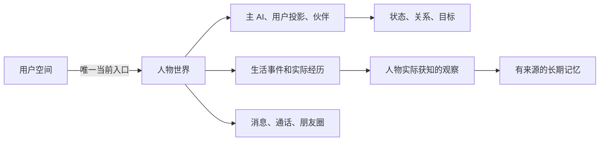

# imAgent 设计文档

## 一、数据怎样组织

**25 张表放在同一个 MySQL 业务库中**，由四个 Agent 共同使用。Chroma 负责语义检索，Redis 保留为运行基础。

| 存储 | 放什么 | 为什么这样分 |
| --- | --- | --- |
| MySQL | 人物、状态、经历、观察、记忆正文、消息、任务等 25 张表 | 作为业务数据的正式来源，处理归属、关联与事务 |
| Chroma 向量库 | 记忆的语义索引，关联 MySQL 的 memoryId 与版本 | 用于找相似记忆；不是唯一的记忆保存位置，索引可以重建 |
| Redis | 现有运行基础，可用于短期缓存和临时状态 | 当前基础聊天未用它持久保存人格或长期记忆 |
| 文件或对象存储 | 图片、音频和声线参考的文件内容 | MySQL 只保存存储键、属性及分析，不保存大文件字节 |

Electron 的本地 SQLite 继续服务客户端和普通 IM 数据，不用这 25 张服务端 MySQL 表替换它。账号、登录、好友和群聊也继续复用现有 IM 系统。

人物数据从 `user_space.active_world_id` 进入：一个用户只有一个当前世界，一个当前世界对应一个主 AI 的长期聊天入口。世界中还包含用户投影和虚拟伙伴，所有关联都要限定在同一个世界内。



## 二、25 张表的作用

### 2.1 用户与人物：谁拥有这个 AI，它是谁

#### `imagent_user_space`：用户的 AI 入口

一行代表一个现有用户在 Agent 系统中的空间，回答“这个用户现在和谁相处”。

- **主要保存**：`user_id`、唯一当前世界 `active_world_id`、用户自己的通知/状态公开设置，以及客户端事件序号。
- **作用**：创建前可以没有世界；管理员重置后更新指针。用户的静音只影响提醒，不会改变 AI 的性格或阻止它生活。
- **例子**：用户 A 的 `active_world_id` 指向世界 W，聊天、历史和动态都从 W 加载。

#### `imagent_world`：一个角色的生活世界

一行代表一次角色生命周期，是人物、经历和聊天数据的共同归属。

- **主要保存**：所属用户、主 AI 和用户投影 ID、当前通话、世界状态、状态版本、消息序号、初始设定和最后推进时间。
- **作用**：把同一角色的一切数据放在同一个世界下。归档旧角色与创建新角色时用不同世界 ID，避免旧消息和旧任务混入。
- **例子**：切换聊天模型仍使用世界 W；管理员重置才按重置方案产生新的世界。

#### `imagent_actor`：人物身份和相对稳定的资料

一行代表世界中的一个人物：主 AI、虚拟伙伴，或者真实用户在该世界内的投影。

- **主要保存**：姓名、公开介绍、私有人格/兴趣/背景/知识技能、稳定声线、外貌资料、居住地时区、当前年龄和生日。
- **作用**：保存“这个人是谁”。`actor_type` 只区分用户投影与虚拟人物；主 AI 由 `world.primary_actor_id` 指定。
- **例子**：主 AI 和它的同学都在此表；同学只需简短性格和必要背景。用户投影不是新建登录账号。

公开资料只包含表面介绍，不直接展示性格、爱好和目标。完整初始往事不能在每次对话中作为永久背景注入，否则会绕过遗忘。

#### `imagent_character_candidate`：创建前的候选人物

一行代表系统生成的一个待选方案，还不是正在生活的角色。

- **主要保存**：用户期望、生成批次、相识方式、公开预览、完整内部设定、生成任务及选中结果。
- **作用**：把“先生成给用户挑选”和“正式建立角色”分开。用户可选其他候选或整批重生成，不能局部编辑内部人格；声线选择按已确认需求保留。
- **例子**：系统生成三个人物，用户只看到表面介绍并选择其中一个；选中后才创建世界、人物和初始数据。

确认创建必须在一个事务中写入人物、状态、关系、目标、种子经历/观察等，再激活世界并回填当前指针。一个用户不能通过重复选择创建两个当前主 AI。

### 2.2 心理与成长：现在怎样，为什么变化

#### `imagent_actor_state`：人物当前状态

一行代表一个人物当前的心理和生活快照，与 `actor` 配合回答“这个人此刻怎样”。

- **主要保存**：`emotion_json` 情绪、`routine_json` 真实作息、`display_state_json` 对外状态、当前活动及状态版本。
- **作用**：即时状态频繁变化，单独保存，避免每次心情波动都改写整份人物资料。
- **例子**：AI 实际醒着读书，但对外展示忙碌；真实状态与展示状态可以不同。

#### `imagent_relationship`：有方向的人物关系

一行代表“人物 A 怎样看待人物 B”。反方向是另一条判断。

- **主要保存**：双方人物、关系称谓、信任/亲近/反感等评估、联系偏好和最近互动时间。
- **作用**：支持主 AI—用户、主 AI—伙伴、伙伴—伙伴关系网，以及认识新人、疏远、绝交等变化。
- **例子**：AI 对用户设为免打扰，不代表用户也对 AI 静音。A 信任 B，也不代表 B 同等信任 A。

关系不由单一好感数值保证变成恋人，也不允许人物与自己建立关系。

#### `imagent_goal`：人物的长期目标

一行代表一个可持续推进、改变或结束的目标。

- **主要保存**：目标内容、状态、进度、可选期限与变更版本。
- **作用**：目标跨多次聊天和生活事件存在，不随一次回复结束而消失。
- **例子**：准备考试是目标；今晚复习是关联该目标的生活安排。散步耽误复习后，要留下进度变化或补做安排。

#### `imagent_state_change`：已经生效的变化记录

一行代表一次成功提交的状态变化，回答“为什么变了、具体变了哪里”。

- **主要保存**：来源经历、变化标识 `change_key`、前后世界版本、实际修改和评价依据。
- **作用**：追踪情绪、人格、关系等变化，并阻止重试重复施加同一个影响。当前快照在 `actor_state` 等表，这张表保存变化过程。
- **例子**：一次争执降低信任，只提交一次；后台整理同一争执时不能再次扣减。

心理维度和公式由算法后续定义，使用带版本的 JSON，不预先固定成大量情绪分值列。即时感受先服务本次行为，长期反思再提出独立变化。

### 2.3 生活与记忆：发生了什么，谁知道，记住了什么

#### `imagent_life_event`：正在推进的生活事件

一行代表一个有过程的活动或事件，可以是随机事件、日常作息、约定、共同活动或学习。

- **主要保存**：参与者、关联目标、计划和实际时间、下一次推进时间、阶段与进度。
- **作用**：记录“事情进行到哪一步”，允许聊天中途加入、打断或改变活动。
- **例子**：一起散步半小时，过程可以发生对话和小插曲，不因计划结束时间到了就自动认定完成。

事件阶段为 `generated → experiencing → impact_applied`；生命周期另用 `planned/running/suspended/completed/cancelled/missed`。计划生成与事情发生分开判断。

#### `imagent_experience`：已经发生的具体经过

一行代表一次已发生的动作、发言或事件片段，按发生顺序追加。

- **主要保存**：所属事件、参与人物、实际内容、发生时间、来源领域 `realm` 和去重摘要。
- **作用**：保留不可原地改写的经过。一场活动可以产生多条经历；主 AI 与伙伴、伙伴之间的具体对话也放在相应经历里。
- **例子**：AI 说了“我睡了”，确定的经过是“说过这句话”，不能据此把实际作息改成睡眠。

`realm` 区分用户自述现实经历、虚拟世界经过和共同虚拟活动。初始往事可作为种子经历；日期不确定时留空，不用创建时间假装过去的发生时间。

#### `imagent_observation`：某个人物实际知道的内容

一行代表某人物对一条经历实际获得的内容快照。

- **主要保存**：观察者、对应经历、直接参与/转述/动态等获知方式、来源人物、当时看到或听到的内容及时间。
- **作用**：限定人物知情范围。后台知道全部经过，不代表每个人物都知道。
- **例子**：两个伙伴私下争执，主 AI 当时没有观察；朋友后来转述时，才为主 AI 产生相应观察。

有查看权限不等于已经阅读，消息入库也不等于 AI 已读。只有通知预览时不能授予整条正文。同一经历对同一观察者只有一个快照，补充或纠正通过新经历和观察追加，不修改旧快照。

#### `imagent_memory`：人物整理后的长期记忆

一行代表一个人物的一条记忆、知识或反思，不是原始聊天记录的简单副本。

- **主要保存**：持有人、正文、相关人物、亲历/转述/推测类型、记忆强度等评估、有效时间、状态、正文修订号和向量同步状态。
- **作用**：支持长期理解、淡忘、唤起、修正和遗忘。提取 Agent 查找的是这些有归属、有状态的记忆。
- **例子**：用户多次说喜欢猫，AI 可以整理出“用户似乎喜欢猫”；推测要保留推测性质，不能升级成已验证事实。

| 状态或字段 | 含义 |
| --- | --- |
| `active` / `faded` | 正常或较弱地召回，提醒、回想和相似事件可再巩固 |
| `forgotten` | 真正遗忘，正文置空，索引删除或失效，普通召回不可恢复旧细节 |
| `superseded` | 信息被更新替代，仍可按有效时间回答过去的问题 |
| `revision` / `indexed_revision` | 正文版本与已索引版本，不一致时不能把旧向量当最新记忆 |
| `embedding_space` | 区分供应方、嵌入模型和维度，换模型时隔离并重建索引 |

#### `imagent_memory_source`：记忆的依据

一行代表“一条记忆与一条观察的关联”，可以是支持或反驳依据。

- **主要保存**：记忆、观察、同一个持有人及依据作用。
- **作用**：一条记忆可能来自多次交流，一次观察也可能支持多条记忆，因此用关联表保存，而不是只存一个来源 ID。
- **例子**：AI 认为用户喜欢猫，依据是用户三次提到养猫；之后用户说以前误会了，新观察可以成为反驳依据。

复合外键要求记忆持有人与观察者一致，不能借用伙伴未告知的观察。对话只读取自己的可用记忆和观察，不沿来源链接遍历全部世界事实。

五张表配合的例子：

| 步骤 | 写入哪里 |
| --- | --- |
| 约定一起散步，保存过程和时间 | `life_event` |
| 途中确实聊到了用户喜欢猫 | `experience` |
| 主 AI 实际听到了这段话 | `observation` |
| 整理为“用户可能喜欢猫” | `memory` |
| 将这条判断关联到当时听到的话 | `memory_source` |

记忆写入先在 MySQL 保存正文、版本和索引任务，事务提交后再同步向量库；检索命中后回表核对世界、持有人、状态和版本。只有影响正文或索引有效性的修改才增加 `revision`，访问统计不触发全文重嵌入。索引失败可重试，不回滚已形成的记忆。

真正遗忘不能靠原始聊天、初始模板或管理员记录绕过。用户后来重新讲述时可以形成新记忆，但不能凭空补出旧细节。

### 2.4 聊天与多模态：说了什么，对方收到了多少

#### `imagent_message`：聊天与通话发言

一行代表一条已经接受的用户消息或决定发送的对外消息，尚未选定发送的草稿不放在这里。

- **主要保存**：发送者、`chat/call` 渠道、世界内序号 `seq`、文字/图片/音频内容块、回复引用和来源经历。
- **作用**：保存用户可见的长期交流。多条短回复各是一条消息；它不是人物记忆库，也不保存完整私有生活。
- **例子**：AI 实际发出一句谎话，消息照实保存这句表达，但不证明谎话内容为真。

首版只允许用户与主 AI 私聊。伙伴之间的后台对话保存在经历中，不混入用户消息列表。

#### `imagent_message_delivery`：每一方的消息视图和回执

一行代表某个人物对一条消息的视图，同一消息可以有双方的两条记录。

- **主要保存**：实际送达、实际阅读、允许展示的已读、已播时长、已听内容，以及历史隐藏时间。
- **作用**：把“消息存在”“对方看到”“愿意展示已读”和“界面还能看见”分开。
- **例子**：AI 隐藏已读时，内部可以已经读过；管理员清理用户历史只隐藏用户视图，保留 AI 视图、原消息和记忆依据。

#### `imagent_media_asset`：图片和音频的登记表

一行代表一个上传或生成的媒体对象，不直接保存文件字节。

- **主要保存**：所有者、世界、格式、`storage_key`、大小、摘要、时长、处理状态、媒体属性及内部分析。
- **作用**：图片、短语音、自拍、声线参考等统一登记。图片理解、语音转写和声音情绪线索分别保留，不把语音理解简化为转写文本。
- **例子**：用户发一张猫的照片，消息保存 mediaId，文件在媒体存储，识别结果在内部 `analysis_json`，之后可整理成记忆。

媒体属于同一用户或世界，不代表用户能下载 AI 所有私有照片。下载还要检查本人上传、候选公开预览或当前可见消息/动态引用；隐藏附件不能通过猜 mediaId 取回。

#### `imagent_call_session`：一次实时语音通话

一行代表一次呼叫的生命周期，不是每个音频分片。

- **主要保存**：呼叫双方、响铃/接通/拒接/未接/结束状态、连接参数、起止时间和输出代次 `generation_epoch`。
- **作用**：管理接听、挂断和插话。当前世界最多一通未结束通话，技术异常与人物拒接分开表示。
- **例子**：用户打断 AI 说话后递增输出代次，使旧分片失效；按实际播放回执推导已经听到的内容，未播出的尾句不能进入共同记忆。

首版只设计用户呼入。原始音频保留时间和容量待定；临时访问票据不写入业务表。

### 2.5 朋友圈：发了什么，谁能看，谁回应了

#### `imagent_moment`：主 AI 发布的动态

一行代表一条动态。

- **主要保存**：作者、图文内容、发布时间、来源经历、发布/撤回状态和可见版本。
- **作用**：保存 AI 选择分享的内容；它与真实经过可以有取舍，内部保留表达与事实的关联。
- **例子**：AI 分享今天画的画，但不一定讲出创作时全部心情。只有主 AI 发布，用户和伙伴不能发布自己的动态。

#### `imagent_moment_audience`：动态可见范围与实际浏览

一行代表某个人物对一条动态的查看授权和浏览位置。

- **主要保存**：授权/撤销时间、实际看过的版本和最近浏览时间。
- **作用**：表达“允许谁看”，同时区分“谁已经看过”。授权本身不产生观察，实际浏览才形成相应经历和认知。
- **例子**：关系疏远后撤销用户查看权限，新请求及事件重放不再返回正文；但之前已经看过的经历不会因此从人物记忆中消失。

发布时展开明确受众，新认识的伙伴不自动获得旧动态权限。普通用户不能自行修改受众或伪造未提供过的浏览版本。

#### `imagent_moment_interaction`：点赞与评论

一行代表某人物的一项点赞或评论。

- **主要保存**：动态、互动人物、类型、正文、回复对象、有效状态、去重键与修订号。
- **作用**：让用户与虚拟伙伴的互动成为情绪、关系和记忆的后续依据。
- **例子**：用户评论关心 AI，产生一条评论和互动经历。取消点赞更新原记录，再次点赞复用并递增版本；网络重试不重复施加影响。

回复只能指向同一动态内有效且可见的评论。首版互动沿用该动态的受众范围，不额外引入“共同好友才可见”的规则。

### 2.6 模型与任务：用哪个模型，工作做到哪里

#### `imagent_model_config`：一份模型连接配置

一行代表一份可被复用的模型配置。

- **主要保存**：供应方、模型名、地址、参数、能力、启用状态、版本及受控凭据引用。
- **作用**：定义“这个模型怎样调用”，与人物性格、声音身份和记忆分离。`owner_user_id` 为空表示管理员公共配置。
- **例子**：一份模型配置既可用于对话，也可在后续用于记忆整理；切换配置不会重建人物。

API Key 不写进此表或消息、任务、事件。当前私有密钥由 Electron safeStorage 按账号和配置 UUID 加密保存，发送时临时提供；公共配置可以引用管理员受控环境凭据。

#### `imagent_model_binding`：把配置分配给某项能力

一行代表某个作用范围下、某个能力槽位的模型选择。

- **主要保存**：`scope_key`、`slot`、`config_id` 和绑定版本；作用范围为 `system` 或 `user:<userId>`。
- **作用**：把“有哪些模型”与“每个 Agent 使用哪个模型”分开，支持管理员默认及用户单独覆盖。
- **例子**：用户的 `dialogue` 使用模型 A，`memory` 使用模型 B；删除个人覆盖后继承系统默认，而不是删除公共配置。

槽位包括 dialogue、memory、retrieval、event、embedding、vision、image、asr、tts、audio_emotion，它们不是新增 Agent。存在个人覆盖但模型停用、缺少能力或凭据时提示，不静默换模型。当前接口只接通 dialogue 绑定。

#### `imagent_background_task`：一次处理工作的执行记录

一行代表一次对话处理、记忆整理、提取、事件推进、媒体处理或候选生成任务。

- **主要保存**：任务类型、输入/结果引用、执行状态、最早运行时间、租约持有人与期限、尝试次数及错误码。
- **作用**：管理重试、取消和进程中断后的恢复。“租约”表示某个执行者在一段时间内有权处理这项工作。
- **例子**：处理进程退出后，任务到期可重新领取；旧执行者晚到的结果不能覆盖新执行。

`life_event` 是人物世界里的活动，`background_task` 是程序执行的一项工作，一次生活事件可能经过多次任务推进。只有明确公开的候选/媒体任务进度可供用户查询，内部心理判断与检索结果不公开。

### 2.7 客户端同步与管理员处理

#### `imagent_client_event`：客户端可恢复的变更通知

一行代表一项允许通知用户的业务变化。

- **主要保存**：用户内递增序号 `event_seq`、资源类型和 ID、公开事件内容、所属世界及去重键。
- **作用**：断线后按游标补同步消息、动态、通话和世界切换等变化。它不是生活事件表，也不是 AI 的内部思考日志。
- **例子**：AI 发出消息时同时写入 `message.created`；客户端重新连接后知道需要取得哪条公开消息。

序号在用户空间锁内分配，与业务变化同事务提交，不能仅用全局自增主键代替提交顺序。重放仍要检查当前可见性，不能恢复已隐藏消息或已撤销动态。

#### `imagent_admin_operation`：管理员操作记录

一行代表一次管理员发起的干预、历史清理、重置、重建或公共默认模型修改。

- **主要保存**：可信操作者、目标、原因、幂等请求、参数范围、执行状态、关联状态变化和结果世界。
- **作用**：追踪人工处理，保留事实和处理依据。普通用户没有直接修改人格、关系和记忆的入口。
- **例子**：管理员减轻一次争执带来的负面影响，原争执经历仍存在，新的影响调整通过 `state_change` 关联记录。

这些表各有用途：`actor_state` 保存现在怎样，`state_change` 保存怎样变成现在，`admin_operation` 保存哪位管理员因何进行了处理。

## 三、字段与数据规则

### 3.1 标识、时间与索引

- 使用 MySQL 8.0.16+、InnoDB、`utf8mb4_bin`；完整字段类型、默认值、主外键、CHECK 与索引见附录 SQL。
- 新资源使用应用生成的 UUID，字段为 `CHAR(36)`；已有账号 ID 复用为 `VARCHAR(64)`。
- 数据库存 UTC `DATETIME(6)`，连接使用 `time_zone = '+00:00'`；人物居住地单独保存 IANA 时区。对外时间采用带 Z 的 RFC 3339。
- SQL 字段为 snake_case，HTTP 字段为 camelCase。BIGINT 序号、版本、时长和字节数对外使用十进制字符串。
- 不另建 AI 会话表。世界内消息按 `seq` 排序，客户端同步按用户 `event_seq` 排序，人物状态按 `state_version` 提交。
- 查询索引围绕 world+seq、记忆 owner+status、动态受众、任务 status+run_after 或 status+lease_until 设置；实际性能需用真实数据的 EXPLAIN 验证。

### 3.2 四种数据不能混为一谈

| 数据 | 回答的问题 | 主要表 |
| --- | --- | --- |
| 经过 | 实际发生了什么 | experience |
| 观察 | 这个人实际知道了哪些内容 | observation |
| 认知和状态 | 他记住、相信或感受到什么 | memory、actor_state、relationship |
| 对外表达 | 他选择让别人知道什么 | message、moment、display_state_json |

例如用户说“我搬家了”，系统能确认的是用户如此陈述；内容尚未核实时保留用户报告的来源。AI 撒谎同样只改变对外说法，不改写真实经过。

### 3.3 JSON 数据结构

以下是必须支持的结构边界，data 的心理维度与算法含义后续在实现时定义；不是要求大模型自行返回任意 SQL 或任意字段。

| JSON 字段 | 结构与访问规则 |
| --- | --- |
| settings_json | schemaVersion、presenceVisibility、notifications；公开设置只返回用户自己的这一部分 |
| public_profile_json | schemaVersion、avatarMediaId、introduction、appearance；没有性格/爱好/目标列表 |
| private_profile_json | schemaVersion、data、evidenceRefs；主角色完整人格与背景，伙伴可用简短描述 |
| voice_profile_json | schemaVersion、voiceIdentity、referenceMediaIds、providerBindings；保留角色声音身份及当前适配信息 |
| emotion_json / assessment_json / cognition_json | schemaVersion、algorithmVersion、data、evidenceRefs；分别承载情绪、关系和记忆评估 |
| routine_json | schemaVersion、actualActivity、sleepState、currentEventId、energyContext；真实生活状态 |
| display_state_json | schemaVersion、visible、status、text；角色选择展示的状态，可与真实活动不同 |
| actual_json / perceived_json | schemaVersion、content、participants、resourceRefs；前者完整经过，后者只含观察到的片段 |
| progress_json | schemaVersion、elapsedActiveMs、data；事件/目标的具体进展，按所属对象校验 |
| parameters_json | 模型配置中为 schemaVersion、data；管理员操作中为 schemaVersion、scope、parameters |
| capabilities_json | schemaVersion、text、vision、imageGeneration、speechInput、speechOutput、audioEmotion、realtime、source |
| metadata_json / analysis_json | 媒体尺寸/时长/音频对齐信息与多模态感知，内部字段不直接返回 |
| participant_ids_json / subject_actor_ids_json | 同世界 actorId 数组，去重并校验实际存在 |

首次写入即校验 schemaVersion；读取旧版本须经显式适配，不能静默假定新算法兼容旧载荷。JSON 的 ID 引用、状态组合和内容长度需要服务层验证；DDL 的外键不能检查 JSON 内部引用。

### 3.4 Agent 内部传递的对象

| 对象 | 必填的稳定字段 | 用途 |
| --- | --- | --- |
| ObservedExperience | worldId、observerActorId、experienceId、observationId、obtainedAt、perceived | 只把人物获知的内容交给认知流程 |
| AppraisalResult | worldId、actorId、baseVersion、evidenceRefs、algorithmVersion、proposedEffects、behaviorOptions | 评价当前经历及可能行为，结果只供内部使用 |
| RetrievalRequest | requestId、worldId、ownerActorId、baseVersion、currentObservationIds、query | 提取任务归属与本轮问题 |
| RetrievalResult | requestId、worldId、ownerActorId、baseVersion、memoryRefs、generatedAt | 返回 memoryId + revision，不复制成无来源事实 |
| StateChangeProposal | worldId、baseVersion、changeKey、sourceExperienceId、origin、changes、appraisal | 经白名单校验后统一提交 |
| ExpressionDraft | worldId、baseVersion、recipientActorId、parts、sourceRefs、plannedAt | 未发送草稿，可被新消息或事件取消 |
| PlaybackReceipt | callId、utteranceId、generationEpoch、lastChunkSeq、playedMs | 确认实际播放范围，不能自行带入已听文本 |

提取 Agent 可以在消息到达后立即异步启动；对话只等待配置的有限时间，先使用合法的短期观察和已缓存记忆。等待时间是运行参数，不增加人物属性。迟到结果必须核对 requestId、owner 和版本，不能改写已经发送的消息；相关结果可供下一次决策使用。

当前输入的即时评价不能依赖后台记忆写完。聊天、随机事件同时发生时，各自基于已知状态推理；提交时再验证版本，发生冲突则重读受影响状态后重新评价，禁止覆盖整份旧快照。

## 四、当前已实现的基础文字接口

### 4.1 初始化和调用顺序

```text
执行一次 25 表 SQL → 启动后台 → 配置/选择模型 → 查询状态 → 发送文字 → 加载历史
```

首次成功接受消息时，在用户空间锁内创建基础“微光”角色、用户投影、世界和初始状态；已有当前角色则复用。配置和状态查询、加载空历史都不会生成人物，初始化失败回滚。此流程不包含完整候选生成、生活模拟或长期记忆。

当前启动仍沿用 `.env`、MySQL、Redis、Nacos、Embedding/Chroma 的生命周期，需要相应运行配置。数据库已有这 25 张表时无需重新建表，不依赖旧 `ai_*` 表。

### 4.2 模型配置与切换

以下请求字段均为 camelCase。

| 方法与路径 | 请求 | 返回与规则 |
| --- | --- | --- |
| GET /ai-message/config/getConfig | 查询 userId | 本人启用配置和公共配置；含 isActive、isPublic，不含密钥或 credential_ref |
| POST /ai-message/config/add_model | userId、configName、providerName、modelName、可选 baseUrl、modelTemperature | 201：UUID configId |
| PUT /ai-message/config/updateModel | 创建字段加 configId | success；普通用户不能编辑公共配置 |
| PUT /ai-message/config/switchModel | userId、configId | success；configId=null 表示删除个人 dialogue 覆盖并继承默认 |
| DELETE /ai-message/config/deleteModel/{config_id} | 查询 userId | success；被绑定时 409，须先解除绑定 |

供应方限定为 default、openai、custom、deepseek、ollama:local、ollama、mimo。custom 必须提供 HTTP(S) Base URL；地址不带用户凭据、查询参数或片段。温度范围 0～2。

本次选择优先级是：明确 configId → 用户 dialogue 绑定 → system dialogue 绑定 → 服务端 `CHAT__LLM_*` 默认配置。存在选择但已失效时报错，不自动跳到下一项。服务端默认使用 `CHAT__LLM_MODEL`、`CHAT__LLM_BASE_URL`、`CHAT__LLM_API_KEY`。

发送时模型名、地址、供应方和温度以数据库所选配置为准，客户端只临时提供私有 `config.apiKey`。公共配置的凭据仅采用受控 `env:变量名` 引用或 provider=default 的服务端默认配置。不传 configId 时只接受 providerName=default 的继承方式。

### 4.3 技术状态

`GET /ai-message/status?userId=当前用户` 检查必要表和有效模型配置。无 userId 时只检查系统默认，不选择任何用户私有配置。

- `available`：本地必要表与模型配置可用，不表示角色在线，也不表示上游已经连通。
- `requiresClientKey`：发送时是否还需客户端提供本地密钥。
- `upstreamVerified=false`：状态查询不额外调用付费模型。
- 缺表、数据库故障、未配置模型分别报告 `DATABASE_SCHEMA_INCOMPLETE`、`DATABASE_UNAVAILABLE`、`MODEL_NOT_CONFIGURED`。

### 4.4 发送文字与 SSE

`POST /ai-message/sendMessage`，请求示例：

```json
{
  "id": "11111111-1111-4111-8111-111111111111",
  "userId": "当前用户ID",
  "content": "今天想和你聊聊天。",
  "config": { "providerName": "default" }
}
```

显式私有配置使用 `config.configId` 和本次 `config.apiKey`。只接受 1～10,000 字非空文字，身份固定为 user、messageType 为 1，不支持提交图片或音频。兼容的 conversationId 不能用于选择其他世界，实际值以服务端返回为准。

| SSE 事件 | 主要内容 |
| --- | --- |
| run.started | conversationId、clientMessageId、userMessageId、replayed |
| message.delta | 正文增量 delta，可有多条 |
| message.completed | 已入库的 messageId、conversationId、seq、完整 content |
| run.failed | 执行中发生技术故障时的规范化 code、message |
| done | success；本轮结束 |

成功顺序为 started → delta → completed → done。失败时发送 run.failed 和 success=false，不把部分生成内容伪装成已保存回复。推理、工具、密钥和内部状态不进入公开流；SSE 注释用于保活。

请求 id 是客户端幂等 UUID。省略时服务端生成，并在 `run.started.clientMessageId` 和用户消息历史中返回；它与消息主键 userMessageId 不同。相同 id、相同正文重试复用原记录，成功过则回放原回复；同 id 改正文返回 409 `MESSAGE_ID_CONFLICT`。

同一世界同时只生成一轮回复，忙时返回 409 `DIALOGUE_BUSY`。任务租约到期后可以重领，旧租约结果不能提交。模型运行在事务外，错误或断流保留已接受的用户消息，关闭模型迭代器并收尾任务。

无效配置和请求冲突在开启 SSE 前返回 HTTP 错误；执行期间的故障才使用上述失败事件。当前发送前错误使用 `detail: {code, message}`，配置接口部分错误使用字符串 detail，尚未统一为下节目标错误结构。

总回复超时为 `CHAT__REPLY_TIMEOUT`，默认 120 秒、最大 600 秒，任务租约多留 30 秒。OpenAI 兼容与 DeepSeek 客户端单次网络超时 60 秒、不自动重试；Ollama 调用另受总回复超时控制。

### 4.5 历史、身份与当前能力范围

`GET /ai-message/loadMessage?userId=当前用户&limit=50&beforeSeq=100` 返回当前世界、用户视图未隐藏的聊天文字，按 seq 正序；不传 beforeSeq 取最新一页。本页首条 seq 作为下一页 beforeSeq，limit 为 1～500，默认 500。

返回字段包括 id、clientMessageId、conversationId、userId、role、content、messageType、seq 和 createdAt。conversationId 实际是 worldId，没有额外会话表；seq 为字符串，时间为 UTC ISO 日期。不混入旧世界、其他用户、通话或伙伴私聊。

当前模型上下文最多使用主 AI 可见的最近 40 条消息，正文总量最多 24,000 字；在准备上下文时才记录主 AI 实际获得了用户文字。这是近期上下文，不是长期记忆召回。

兼容入口仍接受 userId；经 Java 网关时核对其与可信 `user-info.id` 一致，开发直连保留既有行为。部署须保持在可信网关后，不能把此检查当作独立 OAuth/JWT 验证或完整 `/api/v1` 鉴权迁移。

基础链路使用人物、状态、模型、消息、经历、观察、任务和客户端事件等 12 张表；其余表为完整人物功能预留。完整候选生成、心理评价、长期记忆、事件、朋友圈和多模态仍待实现。

## 五、后续接口设计

以下 `/api/v1` 路径是完整人物系统的目标契约，尚未实现；不能替代上一节已接通的 `/ai-message` 接口。

### 5.1 通用约定

- 身份来自可信登录态；管理员接口另外校验管理员权限。非本人资源和当前不可见内容统一返回 404。
- 所有写入接口拒绝未知字段。普通客户端没有 persona、emotion、memoryPatch、visibleAudience 等任意内部修改入口。
- 资源创建、发送和管理员操作要求 `Idempotency-Key`，取 UUID；与同类客户端请求 ID 一致。相同键、相同参数返回首次资源；同键不同参数为 409 IDEMPOTENCY_CONFLICT。
- 请求摘要基于规范化的业务字段计算。PUT 设置/绑定以 expectedVersion 控制覆盖；只有状态真正改变才产生新的经历和事件。
- 列表响应为 `{ "items": [], "nextCursor": null }`；limit 默认 30、最大 100。游标不透明且绑定用户、世界和筛选条件。
- 普通 API 返回公开 DTO，不返回整行 JSON。服务故障不能伪装成人物“有意不理人”，人物沉默也不作为 HTTP 错误。

错误统一示例：

```json
{
  "error": {
    "code": "WORLD_CHANGED",
    "message": "角色已由管理员重置，请重新加载。",
    "requestId": "req-123",
    "details": {}
  }
}
```

| 状态码 | 主要错误码 | 处理 |
| --- | --- | --- |
| 401 / 403 | UNAUTHENTICATED / ADMIN_REQUIRED | 重新登录或拒绝管理员操作 |
| 404 | RESOURCE_NOT_FOUND | 不泄露其他用户及隐藏资源是否存在 |
| 409 | ACTIVE_CHARACTER_EXISTS、WORLD_CHANGED、VERSION_CONFLICT、IDEMPOTENCY_CONFLICT、CALL_ALREADY_ACTIVE、CONFIG_IN_USE | 刷新当前状态或修正冲突 |
| 422 | INVALID_ARGUMENT、CAPABILITY_UNAVAILABLE | 提示缺少图片/语音等能力，仍可使用可用文字能力 |
| 503 | PERSON_AGENT_NOT_READY、PROVIDER_UNAVAILABLE、CREDENTIAL_UNAVAILABLE | 明确技术不可用，不自动换模型 |
| 500 | INTERNAL_ERROR | 返回 requestId，内部细节留服务日志 |

### 5.2 用户空间与角色创建

| 方法与路径 | 请求 | 响应与规则 |
| --- | --- | --- |
| GET /me | 无 | userId、activeWorldId、settingsVersion、settings、lastEventSeq、公开 character；首次登录幂等创建空间 |
| POST /character-candidates | wishText、meetingMode、可选 voicePreferences | 202：taskId、batchId；后台完整生成候选，当前已有角色则 409 |
| GET /character-candidates | batchId、cursor、limit | 候选公开列表，不返回内部性格、爱好、往事或完整目标 |
| POST /characters | candidateId、可选 voiceOptionId | 201：worldId、character；同一选择重试返回原世界，不能创建第二个角色 |
| GET /characters/current | 无 | 公开角色资料及其愿意展示的状态；没有角色为 404 |
| GET /jobs/{id} | 任务 ID | taskId、kind、status、progress、公开 result 或 errorCode；仅自己的候选/媒体任务 |
| PATCH /me/settings | expectedVersion、presenceVisibility、notifications 的已定义子集 | 200：新 settingsVersion 与 settings；不是人格修改 |
| POST /me/presence | 可选 worldId、online、typing | 204；仅接受当前用户状态，隐藏字段不进入 AI 上下文 |

候选请求 wishText 为 1～2,000 字，meetingMode 为已提供的相识方式标识；voicePreferences 可选择系统推荐或引用用户已上传的合法音频。每次重新提交生成新的 batch，待选批次可标记 discarded；已创建角色不能通过重新生成候选绕过管理员规则。

候选公开项结构为 id、batchId、displayName、avatarMediaId、introduction、voiceOptions。确认之后的角色公开结构为 actorId、displayName、avatarMediaId、introduction、displayState、voiceSampleMediaId。公开 DTO 不因为用户当初提到某性格就自动暴露生成后的完整人格。

用户公开状态的结构：

```json
{
  "expectedVersion": "3",
  "presenceVisibility": {
    "online": false,
    "read": false,
    "typing": true
  },
  "notifications": {
    "muted": true
  }
}
```

在线和输入中状态为有时效的运行态，不逐次创建人生经历或递增世界版本；如行为评价据此产生影响，只记录当时允许公开的观察。客户端静音也不停止后台事件和消息入库。

### 5.3 媒体与长期聊天

| 方法与路径 | 请求 | 响应与规则 |
| --- | --- | --- |
| POST /media | multipart：file、clientAssetId、可选 worldId | 201/202：mediaId、kind、status；创建前声线参考可无 worldId |
| GET /media/{id} | contextType=upload/candidate/message/moment，除 upload 外需 contextId | 通过可见性校验后流式返回字节；不返回磁盘路径或原始内部分析 |
| POST /messages | worldId、clientMessageId、parts、可选 replyToMessageId | 202：持久化后的 Message；接受消息不保证 AI 回复 |
| GET /messages | worldId、可选 beforeSeq、limit | 当前世界 channel=chat 且用户视图未隐藏的消息，按 seq 游标翻页 |
| GET /messages/{id} | 消息 ID | 当前用户可见的 Message，包括公开的本人回执与对方展示回执 |
| PUT /messages/{id}/receipt | 可选 delivered、read、playedMs；通话发言另带 utteranceId、generationEpoch | 200：已接受的本人回执；只推进不能倒退，不代替 AI 标记已读 |

Message 公开字段为 id、worldId、seq、senderActorId、origin、channel、parts、replyToMessageId、createdAt、receipt。receipt 不含对方真实隐藏已读、未播出文本或内部判断。

parts 为 1～10 个内容块，格式限定如下；文字总长 1～10,000 字，有媒体时可以没有文字。图片/音频须 ready 且属于允许引用的当前世界或本人上传内容。

```json
{
  "worldId": "11111111-1111-4111-8111-111111111111",
  "clientMessageId": "22222222-2222-4222-8222-222222222222",
  "parts": [
    { "type": "text", "text": "今天带它去散步了。" },
    { "type": "image", "mediaId": "33333333-3333-4333-8333-333333333333" }
  ]
}
```

音频内容块为 `{ "type": "audio", "mediaId": "..." }`。系统通话记录使用仅服务端可创建的 callSummary 块；用户不能伪造 origin、转写、情绪识别结果或系统记录。

202 示例：

```json
{
  "id": "44444444-4444-4444-8444-444444444444",
  "worldId": "11111111-1111-4111-8111-111111111111",
  "seq": "128",
  "senderActorId": "55555555-5555-4555-8555-555555555555",
  "origin": "user",
  "channel": "chat",
  "parts": [
    { "type": "text", "text": "今天带它去散步了。" },
    { "type": "image", "mediaId": "33333333-3333-4333-8333-333333333333" }
  ],
  "replyToMessageId": null,
  "createdAt": "2026-11-03T08:00:00Z",
  "receipt": { "deliveredAt": null, "displayedReadAt": null }
}
```

用户消息、实际发送经历、用户自身观察、双方消息视图和后台处理任务在同一事务建立。主 AI 是否已经看到/听到另行判定，不在写消息时强制生成完整观察。

能力预检应在接受媒体消息前完成：若当前配置不能理解图片/语音，返回 422 并说明缺少能力。发送后出现推理故障，则通过公开技术错误事件提示，不回滚已存在的聊天记录，也不把重试变成重复消息。

多条短回复是多条独立 message。新用户消息或事件到来时，尚未发送的后续草稿可重新评价或取消，不能更改已发送消息来伪装此前没有说过。

### 5.4 用户呼入的实时语音

| 方法与路径 | 请求 | 响应与规则 |
| --- | --- | --- |
| POST /calls | worldId、clientCallId | 201：callId、status=ringing；是否接听由人物决定 |
| GET /calls/{id} | 通话 ID | callId、公开 status、connectedAt、endedAt、endReason |
| POST /calls/{id}/hangup | worldId | 200：终态；重复挂断返回相同结果 |
| POST /calls/{id}/connection | 无 | 已接通时返回短期、单次 WS ticket 和可用音频格式；ticket 不写业务表 |
| WS /calls/{id}/audio | 已认证同用户，或使用短期 ticket | 音频输入、输出、插话和已播确认 |

最小状态机：ringing → connected/rejected/missed/ended；connected → ended。终态不可回到 connected。来电超时为 missed，AI 拒接为 rejected，用户取消或技术中止为 ended，并提供规范化公开原因。AI 的免打扰阻止叫醒，前台不能用连续拨打绕过。

首版协议采用 JSON 控制帧与 base64 编码 PCM 音频，先保证契约可验证；传输性能优化后可另行升级为二进制帧，不能无版本地改变格式。

| 方向与类型 | 主要字段 | 语义 |
| --- | --- | --- |
| 客户端 audio.configure | protocolVersion=1、codec=pcm_s16le、sampleRate、channels=1 | 采样率允许 16000/24000/48000，服务端确认实际可用格式 |
| 服务端 audio.configured | 相同格式字段 | 后续音频必须匹配协商结果 |
| 客户端 input.audio | inputSeq、audio | 单调序号音频片段，重传相同片段不重复识别 |
| 客户端 input.commit | throughInputSeq | 一段输入结束；同时支持服务端语音活动检测 |
| 服务端 output.audio | utteranceId、generationEpoch、chunkSeq、audio、durationMs | 仅当前 epoch 的有效输出可播放 |
| 客户端 input.interrupt | 当前 generationEpoch | 请求停止当前输出，服务端递增 epoch 并返回 output.stop |
| 客户端 output.played | utteranceId、generationEpoch、lastChunkSeq、playedMs | 播放确认不超过实际发送长度；服务器计算已听文本 |
| 服务端 output.stop | generationEpoch | 清空旧播放队列 |
| 服务端 call.state / error | status 或规范化 error | 生命周期与技术异常 |

播放回执可以确认已经失效 epoch 中**此前确实播放过**的部分，但不能再次播放其剩余片段；服务端保留 utterance 与分片对齐映射用于核验。中断不删除输入经历，也不把未播完的话当作对方已听到。

语音的语气、停顿、笑声等由人物状态驱动表达；是否真正能识别/合成取决于所选配置，缺少能力只提示，不自动更换模型。通话结束后写系统记录和实际发言经历；原始波形与情绪线索不是对外公开的内部分析接口。

### 5.5 朋友圈

| 方法与路径 | 请求 | 响应与规则 |
| --- | --- | --- |
| GET /moments | worldId、cursor、limit | 当前被授权、未撤回的动态列表 |
| GET /moments/{id} | 动态 ID | Moment；不可见为 404 |
| PUT /moments/{id}/like | worldId | 200：liked=true、version；重复点赞不重复影响 |
| DELETE /moments/{id}/like | worldId 查询参数 | 200：liked=false、version；重复撤赞无新影响 |
| POST /moments/{id}/comments | worldId、clientRequestId、text、可选 replyToId | 201：Interaction；text 为 1～2,000 字 |
| POST /moments/{id}/view | worldId、seenVersion | 204；仅接受此前向当前用户提供过的可见版本 |

Moment 公开字段为 id、worldId、author 的表面资料、parts、publishedAt、version、likedByMe、likes 和 comments。Interaction 为 id、kind、actor 的表面资料、text、replyToId、createdAt。大规模评论分页可在实际需要时增加，不引入独立社交平台范围。

点赞/评论前再次检查动态状态和当前受众；回复必须为同一动态的有效评论。点赞、评论及其引发的情绪/关系变化都能成为后续记忆依据。

没有普通用户发布动态、修改受众或冒充伙伴互动的接口。主 AI 发布及伙伴点赞评论通过内部服务进入同一业务校验和状态提交流程。

### 5.6 模型配置与覆盖

| 方法与路径 | 请求 | 响应与规则 |
| --- | --- | --- |
| GET /model-configurations | cursor、limit | 自己的配置及可用公共配置，含能力和 credentialReady |
| POST /model-configurations | name、provider、modelName、可选 baseUrl、parameters | 201：Config；配置归当前用户 |
| PATCH /model-configurations/{id} | expectedVersion、允许修改的配置字段 | 200：新 Config；公共配置不可在普通接口修改 |
| DELETE /model-configurations/{id} | 无 | 204；仍被绑定则 409 CONFIG_IN_USE |
| PUT /model-configurations/{id}/credential | apiKey | 204；目标服务端凭据入口，不落业务表；当前 Electron 使用本机加密凭据 IPC，此端点尚未实现 |
| GET /model-bindings | 无 | 各 slot 的 effectiveConfigId、source、overrideVersion、能力可用性和公共推荐配置 |
| PUT /model-bindings/{slot} | configId、expectedVersion | 200：用户覆盖；只允许本人或公共配置 |
| DELETE /model-bindings/{slot} | expectedVersion 查询参数 | 204；移除覆盖，恢复继承默认，而非静默技术回退 |

Config 的公开字段为 id、name、provider、modelName、baseUrl、parameters、capabilities、status、version、scope、credentialReady。credential_ref、管理员环境参数和内部探测日志不公开。首次绑定 expectedVersion 为字符串 "0"，已有绑定则匹配当前 version，成功后递增。

配置禁用或凭据缺失不自动删除覆盖。管理员修改公共模型也不能改变现有角色的人格和经历；模型本身的表现差异需要验收，不能仅靠数据库声称换模型后声音完全一致。

### 5.7 客户端事件与恢复

`GET /api/v1/me/events` 使用 Last-Event-ID 或查询参数 after，均为本用户的 event_seq。二者同时存在时必须相同，否则 422。客户端先读取 /me 获得 lastEventSeq，再建立该位置之后的流，并加载消息/动态快照；依据资源 ID 与版本合并，避免重复。

```text
id: 305
event: message.created
data: {"worldId":"11111111-1111-4111-8111-111111111111","messageId":"44444444-4444-4444-8444-444444444444","seq":"128"}

: keep-alive

```

| 持久事件 | 公开载荷 |
| --- | --- |
| message.created | worldId、messageId、seq；客户端取当前公开 Message |
| message.receipt.updated | worldId、messageId、允许展示的回执 |
| history.cleared | worldId、throughSeq；客户端移除相应历史缓存 |
| call.state | worldId、callId、公开通话状态 |
| moment.published / moment.updated / moment.removed | worldId、momentId、version；removed 不携带隐藏正文 |
| world.changed | 新 activeWorldId 或 null；客户端关闭旧世界页面和通话 |
| settings.changed | settingsVersion；客户端刷新自己的设置 |
| job.state | 仅候选/媒体的 taskId、status、公开结果引用 |
| message.processing.failed | worldId、messageId、公开技术错误码，不包含评价原因 |

推理过程、心理知识、原始情绪、检索结果和沉默原因不进入 SSE。typing 等短时状态不持久化，不作为可恢复的消息事实；音频分片走通话 WS。

发布与重放时都要复查当前世界和资源权限。持久载荷尽量保存资源引用，不保存整份敏感快照。已清理历史和已撤销动态不能通过旧 SSE 事件重新取回；必要时发送移除通知，客户端对应清理缓存。

跳过已不可见的旧事件时，发送 `sync.cursor` 控制帧，将扫描位置推进到已完成检查的 event_seq，避免客户端反复重放同一批不可见记录；它不暴露原事件内容。保留期之外的游标返回 `sync.required`，附 floorSeq 和 lastEventSeq 后关闭流，客户端重新载入快照。删除旧事件和更新 event_floor_seq 必须在同一事务中完成。

**三种顺序分别使用：**

- world.state_version：人物世界状态的提交版本，不是每个音频片段、心跳的版本。
- message.seq：该世界已公开消息的顺序。
- user_space.next_event_seq：该用户客户端变更的顺序，可跨角色重置延续。

三者各自使用，不能把消息序号当作检索版本，也不能重置 SSE 游标导致旧事件与新角色冲突。

### 5.8 管理员接口

所有管理员写入要求 Idempotency-Key、reason，权限来自可信管理员身份。内部查看仅供受控后台，不能复用普通用户响应。

| 方法与路径 | 请求或用途 | 结果 |
| --- | --- | --- |
| GET /admin/worlds/{id} | 查看人物、状态、目标与内部关系 | 内部投影；归档世界可查 |
| GET /admin/worlds/{id}/memories | actorId、status、cursor、limit | 记忆和依据；忘记后的审计数据不成为普通召回入口 |
| POST /admin/worlds/{id}/history-clear | throughSeq、reason | operationId、clearedThroughSeq；只清理用户界面视图 |
| POST /admin/worlds/{id}/interventions | expectedVersion、sourceExperienceId、scope、adjustments、reason | operationId、stateChangeId、afterVersion |
| POST /admin/users/{userId}/character-replacement | mode=reset/recreate、reason | operationId、新 activeWorldId 或 null |
| POST /admin/model-configurations | 与普通创建相同的模型字段、reason | 创建 owner_user_id 为空的公共配置 |
| PATCH /admin/model-configurations/{id} | expectedVersion、配置修改、reason | 更新公共配置并审计 |
| DELETE /admin/model-configurations/{id} | reason | 未被绑定才允许删除，保留审计结果 |
| PUT /admin/model-configurations/{id}/credential | apiKey、reason | 配置公共运行凭据，不记录 apiKey |
| PUT /admin/model-bindings/{slot} | configId、expectedVersion、reason | 设置 system 默认，须为启用的公共配置 |
| DELETE /admin/model-bindings/{slot} | expectedVersion、reason | 清除公共默认，相应能力显示不可用 |

interventions 的 scope 限定为 emotion、relationship、memory_effect 或上述组合；adjustments 必须使用当前算法登记的字段及范围，由管理员预览后提交，不能接受任意 SQL/任意 JSON 路径。memory_effect 调整认知载荷中的影响，不删除原事实，不把推测标为证实。若后续算法版本暂不支持某种调整，返回 422，不能写入无法解释的值。

history-clear 的 throughSeq 是明确截止点；事务锁定当前世界后隐藏该点及之前的用户视图，新到消息不误删。幂等重试返回原处理范围，不把清理范围延伸到后来消息。

reset/recreate 均先验证当前世界、结束旧通话并使旧任务失效。reset 根据初始模板创建新代次；recreate 释放当前槽位供重新创建。相关指针和 world.changed 同事务提交。整个流程失败则不对用户呈现一半完成的新角色。

暂不提供世界状态任意覆盖接口、用户自己删人格接口、用户—伙伴聊天接口、AI 主动来电接口或外部资料自主学习接口。

## 六、事务与后台任务

### 6.1 固定写入顺序

涉及同一用户的复合写入统一按 **user_space → world → 业务行** 顺序加锁；只改模型配置的简单事务也要遵循与组合操作一致的行锁顺序。模型推理和向量写入均在数据库事务外执行。

统一状态提交的流程：

1. 在事务外读取人物可知的上下文和 baseVersion，进行检索、评价与行为规划。
2. 开启事务，锁定 user_space 和 world，检查 active_world_id、世界状态及 change_key。
3. 已存在相同 change_key 且摘要一致则返回原结果；摘要不同则冲突。不同影响/阶段使用不同键。
4. 验证 baseVersion 等于当前 state_version，检查来源观察、对象归属和允许修改字段。
5. 应用状态变化，令 state_version 加一；写入 state_change 的 before/after 版本及实际变更。
6. 同事务写入本次已发生经历、观察、对外消息或任务，并按需要递增消息序号和客户端事件序号。
7. 提交后执行媒体生成、向量同步、发送与后续任务。结果回来再次验证世界和依据。

只保存成功提交的 state_change，失败提案留在内部任务记录。模型决定的整个 JSON 不能直接覆盖人物表；提交服务只能执行已登记的字段操作。

### 6.2 必须一起提交的操作

| 操作 | 同一事务中的数据 |
| --- | --- |
| 确认创建 | 候选选择结果、世界、人物/状态/关系/目标、种子经历与观察/记忆、空间指针、初始化任务与客户端事件 |
| 接受用户消息 | 幂等核对、message、双方 delivery、发送经历、已成立的观察、处理任务、消息与客户端序号 |
| 生活事件的一步 | 事件阶段/进度、这一动作的经历、观察、已确定的影响、后续任务 |
| 主 AI 发送表达 | 最新状态/可见性核对、已发送 message 或 moment、经历、接收范围、客户端事件 |
| 点赞或评论 | 当前授权检查、interaction/revision、互动经历、直接观察、评价任务、动态版本、客户端事件 |
| 记忆整理 | memory/revision、memory_source、索引同步任务；重大心理影响另外经状态提交处理 |
| 管理员操作 | admin_operation、实际状态调整或归档/切换指针、通话/任务终止、相应客户端事件 |

事件中可直接应用的即时变化和后续复杂反思可以分次提交，各自使用独立 change_key。不能把同一段影响在“经历阶段”和“最终影响阶段”重复算两遍。

### 6.3 后台任务

任务执行语义是至少一次，因此每项副作用必须可去重。领取任务通过短事务原子改为 running，并设置 lease_owner、lease_until 和 attempts；只有持有未过期租约的执行者可提交阶段结果，提交条件同时核对 lease_owner 与领取时的 attempts，防止同一进程重领后旧执行继续写入。运行较久时续租；进程退出后过期租约可重新领取，重领递增 attempts，旧执行者即使返回也会被拒绝提交。

任务载荷保存 worldId、actorId、requestId、baseVersion 和来源 ID。取消旧世界任务不足以阻止已经运行的回调，所有最终写入仍检查 active_world_id。外部生成了媒体但尚未发布时只保留内部结果，不能跳过世界校验直接推送。

### 6.4 后台停机与现实时间

后台存活而客户端关闭时，事件按居住地时间继续；后台真实中断后，从恢复时刻继续，不补算中间一周的事件、情绪衰减或关系变化。

last_tick_at 保存最后有效推进点。恢复流程识别空档，将未完成活动保留为 suspended，过期约定不自动当作已赴约或完成；恢复后的首次决策可以确认取消、错过或重新安排。共同活动进度只累计服务真实运行且活动实际进行的时长，不因 scheduled_end_at 已过就补出半小时散步。

跨空档生日如何处理、伙伴长期无人参与时的事件预算等仍是待确认细节；具体处理仍需在实现前明确。

## 七、权限与生命周期

### 7.1 普通用户与内部数据

目标接口从可信登录态取身份，管理员权限来自已有身份体系。普通响应使用字段白名单；不能直接序列化整行 SQL 或内部 JSON。

私有人格、完整关系判断、真实隐藏状态、心理依据、未分享经历、记忆正文及内部知识库只供内部流程和授权管理员读取。用户状态隐藏后，AI 不能读取隐藏字段。客户端标签页、搜索词和未发送草稿也不写成人物经历。

JSON 内的媒体/人物引用必须校验归属；外键不能验证 JSON 内部引用。媒体下载和客户端事件重放均重新检查当前可见性。

### 7.2 清理历史、干预、重置与重建

| 操作 | 改变什么 | 保留什么 |
| --- | --- | --- |
| 清理历史 | 管理员隐藏截止 seq 之前的用户消息视图 | 原消息、AI 视图及已形成记忆 |
| 减轻某次经历影响 | 管理员按当前算法支持的范围追加状态调整 | 原始经过、原有来源及操作依据 |
| 重置（建议方案） | 归档旧世界，按初始模板建立新世界和新人物 ID | 用户设置、模型配置；旧世界仅供受控审计 |
| 删除后重建（建议方案） | 管理员归档旧世界并释放当前入口，之后重新生成候选 | 用户设置和模型配置 |

重置和重建的具体产品规则仍需确认。归档不等于物理删除；永久抹除要另行明确资料、文件、向量和审计的处理方式，不由重建接口代替。

旧世界的未完成任务和通话必须失效，最终写入仍核对当前世界，不能只依赖一次取消通知。新世界不继承旧聊天和成长。普通用户不能切回归档世界，也不能通过重新生成候选绕过管理员规则。

### 7.3 初始化与普通 IM 的边界

完整建表脚本是 [sql/imagent_init.sql](sql/imagent_init.sql)，无需恢复 `ai_conversation`、`ai_message`、`ai_model_config` 或旧人格表。新结构不双写旧表，也不自动迁移已删除的数据。

普通 IM 的用户、消息、会话、好友和群聊属于既有业务，不在此脚本的删除或重建范围。客户端旧 workspace 已停用，不再参与人物初始化。

## 八、实现顺序与验收

### 8.1 按连续能力推进

| 顺序 | 工作 |
| --- | --- |
| 1 | 保持基础文字闭环：配置、切换、唯一人物、消息发送与历史 |
| 2 | 在可知经历之上接入即时评价、关系和统一状态提交 |
| 3 | 接入记忆整理、来源、淡忘/遗忘、向量同步与提取 |
| 4 | 接入生活事件、伙伴关系、主动分享和朋友圈 |
| 5 | 接入图片、短语音、声音情绪和实时通话/插话 |

这是实现顺序，完整演示仍保留需求中的各项能力。心理评价维度、记忆算法、跨供应方声线一致性、媒体保留期、永久抹除和跨停机生日处理仍待细化。

### 8.2 场景验收

| 场景 | 预期结果 |
| --- | --- |
| 同一用户并发确认两个候选 | 仅一个当前世界，另一个请求得到明确冲突 |
| 不同世界人物互相关联 | 复合外键拒绝跨世界写入 |
| 记忆引用别人的私有观察 | 复合外键拒绝；检索也按 owner 和有效版本校验 |
| 同一消息、任务、评论或状态影响重试 | 只有一次业务记录/影响，参数改变则冲突 |
| 聊天与事件同时修改情绪 | 旧版本提交失败，重新评价，不覆盖新状态 |
| AI 说谎、用户转述现实经历 | 保留事实/报告/认知/说法的区别 |
| 隐藏已读、睡眠和免打扰 | 不泄露真实隐藏状态，不把消息入库当作 AI 已读 |
| 撤销朋友圈可见性后下载图片或重连 SSE | 不返回隐藏内容；原先已知的经历不会被抹除 |
| 语音插话后旧分片迟到 | 停止播放旧输出，记忆只使用真实已播范围 |
| 清理历史后重新拉取和恢复事件 | 被清理内容不重新出现，AI 记忆仍保留 |
| 管理员重置后旧任务返回 | 不写入新世界，不向用户发送旧角色内容 |
| 后台中断后恢复 | 不自动补完期间事件、共同活动和关系变化 |
| 更换对话/嵌入模型 | 人物资料保留，向量空间区分；能力缺失只提示 |
| 真正遗忘 | 正文和索引退出普通召回，不从审计数据偷取细节 |

### 8.3 怎样运行验证

```bash
uv run python -m unittest discover -s tests -p "test_*.py"
```

设置 `IMAGENT_TEST_MYSQL=1` 可运行真实 MySQL 集成测试。测试用当前连接凭据创建随机 `lumina_test_` 开头的独立数据库，执行完整 DDL，结束后仅删除该测试库，不写业务库；模型边界使用本机 OpenAI SSE 测试服务。

再设置 `IMAGENT_TEST_LIVE_MODEL=1` 会调用服务端真实默认模型，额外检查两轮上下文和四条消息持久化。测试脚本位于 `tests/`。接口、事务或约束通过不能代替人格自然度、记忆合理性与多模态体验验收。

## 附录：完整建表 SQL

可直接使用 [sql/imagent_init.sql](sql/imagent_init.sql)。选中项目配置使用的 MySQL 数据库后执行一次；已经建立这 25 张表的数据库不要重复初始化，后续通过版本化迁移调整。

以下保留完整 SQL，便于逐表查阅。表之间使用外键但不级联删除；四条循环指针外键在建表后补齐。初始化人物时先插入世界、再插人物、最后回填指针。业务权限、JSON 引用和人物行为仍由应用验证。

<details>
<summary>展开完整 25 表建表 SQL</summary>

```sql
SET NAMES utf8mb4 COLLATE utf8mb4_bin;
SET time_zone = '+00:00';

CREATE TABLE imagent_user_space (
  user_id VARCHAR(64) NOT NULL COMMENT '现有用户系统中的用户标识',
  active_world_id CHAR(36) NULL COMMENT '唯一在用世界；初次创建前及管理员允许重建时为空',
  settings_json JSON NOT NULL COMMENT '用户状态可见性和通知设置；不保存人格',
  settings_version BIGINT UNSIGNED NOT NULL DEFAULT 0 COMMENT '设置版本',
  next_event_seq BIGINT UNSIGNED NOT NULL DEFAULT 0 COMMENT '已分配的最后一个用户事件序号',
  event_floor_seq BIGINT UNSIGNED NOT NULL DEFAULT 0 COMMENT '已清理事件的序号水位',
  last_seen_at DATETIME(6) NULL COMMENT '客户端最近心跳；隐藏时不提供给角色',
  created_at DATETIME(6) NOT NULL DEFAULT CURRENT_TIMESTAMP(6) COMMENT '创建时间',
  updated_at DATETIME(6) NOT NULL DEFAULT CURRENT_TIMESTAMP(6) ON UPDATE CURRENT_TIMESTAMP(6) COMMENT '修改时间',
  PRIMARY KEY (user_id),
  UNIQUE KEY uq_space_active (active_world_id),
  CONSTRAINT ck_space_event_floor CHECK (event_floor_seq <= next_event_seq)
) ENGINE=InnoDB DEFAULT CHARSET=utf8mb4 COLLATE=utf8mb4_bin COMMENT='用户空间与唯一在用角色入口';

CREATE TABLE imagent_model_config (
  id CHAR(36) NOT NULL COMMENT '应用生成的 UUID',
  owner_user_id VARCHAR(64) NULL COMMENT '为空表示管理员公共配置',
  name VARCHAR(100) NOT NULL COMMENT '配置名称',
  provider VARCHAR(64) NOT NULL COMMENT '模型供应方',
  model_name VARCHAR(160) NOT NULL COMMENT '模型名称',
  base_url VARCHAR(500) NULL COMMENT '自定义服务地址',
  credential_ref VARCHAR(128) NULL COMMENT '运行时凭据引用，不是 API Key',
  parameters_json JSON NOT NULL COMMENT '温度等模型参数',
  capabilities_json JSON NOT NULL COMMENT '经过配置或探测的能力描述',
  status ENUM('enabled','disabled') NOT NULL DEFAULT 'enabled' COMMENT '配置状态',
  version BIGINT UNSIGNED NOT NULL DEFAULT 0 COMMENT '配置版本',
  created_at DATETIME(6) NOT NULL DEFAULT CURRENT_TIMESTAMP(6) COMMENT '创建时间',
  updated_at DATETIME(6) NOT NULL DEFAULT CURRENT_TIMESTAMP(6) ON UPDATE CURRENT_TIMESTAMP(6) COMMENT '修改时间',
  PRIMARY KEY (id),
  KEY idx_model_owner (owner_user_id, status),
  CONSTRAINT fk_model_owner FOREIGN KEY (owner_user_id) REFERENCES imagent_user_space (user_id)
) ENGINE=InnoDB DEFAULT CHARSET=utf8mb4 COLLATE=utf8mb4_bin COMMENT='可复用的公共或用户模型配置';

CREATE TABLE imagent_model_binding (
  scope_key VARCHAR(80) NOT NULL COMMENT 'system 或 user:用户标识；非空以保证公共默认唯一',
  owner_user_id VARCHAR(64) NULL COMMENT '公共默认时为空',
  slot VARCHAR(32) NOT NULL COMMENT 'dialogue/memory/retrieval/event/embedding/vision/image/asr/tts/audio_emotion',
  config_id CHAR(36) NOT NULL COMMENT '引用的模型配置',
  version BIGINT UNSIGNED NOT NULL DEFAULT 0 COMMENT '绑定版本',
  created_at DATETIME(6) NOT NULL DEFAULT CURRENT_TIMESTAMP(6) COMMENT '创建时间',
  updated_at DATETIME(6) NOT NULL DEFAULT CURRENT_TIMESTAMP(6) ON UPDATE CURRENT_TIMESTAMP(6) COMMENT '修改时间',
  PRIMARY KEY (scope_key, slot),
  KEY idx_binding_config (config_id),
  CONSTRAINT fk_binding_owner FOREIGN KEY (owner_user_id) REFERENCES imagent_user_space (user_id),
  CONSTRAINT fk_binding_config FOREIGN KEY (config_id) REFERENCES imagent_model_config (id),
  CONSTRAINT ck_binding_scope CHECK ((owner_user_id IS NULL AND scope_key = 'system') OR (owner_user_id IS NOT NULL AND scope_key = CONCAT('user:', owner_user_id)))
) ENGINE=InnoDB DEFAULT CHARSET=utf8mb4 COLLATE=utf8mb4_bin COMMENT='各 Agent 与多模态能力的显式模型绑定';

CREATE TABLE imagent_world (
  id CHAR(36) NOT NULL COMMENT '应用生成的 UUID',
  user_id VARCHAR(64) NOT NULL COMMENT '世界所属用户',
  primary_actor_id CHAR(36) NULL COMMENT '唯一主 AI 人物',
  user_actor_id CHAR(36) NULL COMMENT '用户在本世界的人物投影',
  active_call_id CHAR(36) NULL COMMENT '当前通话指针',
  status ENUM('initializing','active','archived') NOT NULL DEFAULT 'initializing' COMMENT '世界生命周期',
  state_version BIGINT UNSIGNED NOT NULL DEFAULT 0 COMMENT '世界权威状态提交版本',
  next_message_seq BIGINT UNSIGNED NOT NULL DEFAULT 0 COMMENT '最后分配的世界消息序号',
  initial_snapshot_json JSON NOT NULL COMMENT '创建时的初始设定模板；管理员重置使用',
  last_tick_at DATETIME(6) NULL COMMENT '后台最后实际推进时间',
  archived_at DATETIME(6) NULL COMMENT '归档时间',
  created_at DATETIME(6) NOT NULL DEFAULT CURRENT_TIMESTAMP(6) COMMENT '创建时间',
  updated_at DATETIME(6) NOT NULL DEFAULT CURRENT_TIMESTAMP(6) ON UPDATE CURRENT_TIMESTAMP(6) COMMENT '修改时间',
  PRIMARY KEY (id),
  UNIQUE KEY uq_world_owner (id, user_id),
  KEY idx_world_user (user_id, status),
  CONSTRAINT fk_world_user FOREIGN KEY (user_id) REFERENCES imagent_user_space (user_id),
  CONSTRAINT ck_world_active CHECK (status <> 'active' OR (primary_actor_id IS NOT NULL AND user_actor_id IS NOT NULL AND primary_actor_id <> user_actor_id))
) ENGINE=InnoDB DEFAULT CHARSET=utf8mb4 COLLATE=utf8mb4_bin COMMENT='一次角色生命周期对应的独立世界';

CREATE TABLE imagent_actor (
  id CHAR(36) NOT NULL COMMENT '应用生成的 UUID',
  world_id CHAR(36) NOT NULL COMMENT '所属生活世界',
  actor_type ENUM('user','virtual') NOT NULL COMMENT '用户投影或虚拟人物；主 AI 由世界指针指定',
  display_name VARCHAR(100) NOT NULL COMMENT '显示名',
  public_profile_json JSON NOT NULL COMMENT '可公开的头像和表面介绍',
  private_profile_json JSON NOT NULL COMMENT '人格、兴趣、背景、知识与技能；伙伴仅需简单性格描述',
  voice_profile_json JSON NOT NULL COMMENT '稳定声线身份、供应方映射与参考媒体',
  residence_timezone VARCHAR(64) NULL COMMENT '居住地时区，例如 Asia/Shanghai',
  age_years SMALLINT UNSIGNED NULL COMMENT '已提交的当前年龄',
  birthday_month_day CHAR(5) NULL COMMENT '可选生日 MM-DD',
  status ENUM('present','inactive') NOT NULL DEFAULT 'present' COMMENT '人物在本世界的状态',
  created_at DATETIME(6) NOT NULL DEFAULT CURRENT_TIMESTAMP(6) COMMENT '创建时间',
  updated_at DATETIME(6) NOT NULL DEFAULT CURRENT_TIMESTAMP(6) ON UPDATE CURRENT_TIMESTAMP(6) COMMENT '修改时间',
  PRIMARY KEY (id),
  UNIQUE KEY uq_actor_world (world_id, id),
  CONSTRAINT fk_actor_world FOREIGN KEY (world_id) REFERENCES imagent_world (id)
) ENGINE=InnoDB DEFAULT CHARSET=utf8mb4 COLLATE=utf8mb4_bin COMMENT='主 AI、虚拟伙伴与用户投影的统一人物身份';

CREATE TABLE imagent_actor_state (
  world_id CHAR(36) NOT NULL COMMENT '所属生活世界',
  actor_id CHAR(36) NOT NULL COMMENT '对应人物',
  emotion_json JSON NOT NULL COMMENT '有版本的情绪状态与原因，不固定情绪维度',
  routine_json JSON NOT NULL COMMENT '真实作息、睡眠与精力状态',
  display_state_json JSON NOT NULL COMMENT '选择公开或伪装的对外状态',
  context_json JSON NOT NULL COMMENT '当前活动、关注点和其他运行上下文',
  version BIGINT UNSIGNED NOT NULL DEFAULT 0 COMMENT '最后更新时的世界状态版本',
  created_at DATETIME(6) NOT NULL DEFAULT CURRENT_TIMESTAMP(6) COMMENT '创建时间',
  updated_at DATETIME(6) NOT NULL DEFAULT CURRENT_TIMESTAMP(6) ON UPDATE CURRENT_TIMESTAMP(6) COMMENT '修改时间',
  PRIMARY KEY (world_id, actor_id),
  CONSTRAINT fk_actor_state_actor FOREIGN KEY (world_id, actor_id) REFERENCES imagent_actor (world_id, id)
) ENGINE=InnoDB DEFAULT CHARSET=utf8mb4 COLLATE=utf8mb4_bin COMMENT='人物的当前心理与生活状态快照';

CREATE TABLE imagent_media_asset (
  id CHAR(36) NOT NULL COMMENT '应用生成的 UUID',
  user_id VARCHAR(64) NOT NULL COMMENT '媒体所有者',
  world_id CHAR(36) NULL COMMENT '创建候选阶段可空；确认后绑定世界',
  client_asset_id CHAR(36) NULL COMMENT '用户上传重试标识',
  kind ENUM('image','audio') NOT NULL COMMENT '媒体种类',
  mime_type VARCHAR(100) NOT NULL COMMENT '实际媒体格式',
  storage_key VARCHAR(500) NOT NULL COMMENT '服务端生成的存储键，不接受任意客户端磁盘路径',
  size_bytes BIGINT UNSIGNED NOT NULL COMMENT '大小',
  sha256 CHAR(64) NOT NULL COMMENT '内容摘要',
  duration_ms BIGINT UNSIGNED NULL COMMENT '音频时长',
  metadata_json JSON NOT NULL COMMENT '图像尺寸、音频格式、声线引用及播出对齐信息',
  analysis_json JSON NOT NULL COMMENT '图片理解、转写和声音情绪线索；内部使用',
  status ENUM('processing','ready','failed') NOT NULL DEFAULT 'processing' COMMENT '媒体处理状态',
  created_at DATETIME(6) NOT NULL DEFAULT CURRENT_TIMESTAMP(6) COMMENT '创建时间',
  updated_at DATETIME(6) NOT NULL DEFAULT CURRENT_TIMESTAMP(6) ON UPDATE CURRENT_TIMESTAMP(6) COMMENT '修改时间',
  PRIMARY KEY (id),
  UNIQUE KEY uq_media_upload (user_id, client_asset_id),
  KEY idx_media_world (world_id),
  CONSTRAINT fk_media_user FOREIGN KEY (user_id) REFERENCES imagent_user_space (user_id),
  CONSTRAINT fk_media_world FOREIGN KEY (world_id, user_id) REFERENCES imagent_world (id, user_id)
) ENGINE=InnoDB DEFAULT CHARSET=utf8mb4 COLLATE=utf8mb4_bin COMMENT='图片、短语音、声线参考与生成媒体';

CREATE TABLE imagent_relationship (
  id CHAR(36) NOT NULL COMMENT '应用生成的 UUID',
  world_id CHAR(36) NOT NULL COMMENT '所属生活世界',
  from_actor_id CHAR(36) NOT NULL COMMENT '持有此关系判断的人物',
  to_actor_id CHAR(36) NOT NULL COMMENT '关系对象',
  relation_label VARCHAR(64) NOT NULL COMMENT '陌生、朋友等语义描述；不等同于数值等级',
  assessment_json JSON NOT NULL COMMENT '信任、亲近、反感等有依据的判断，具体维度待算法设计',
  contact_policy_json JSON NOT NULL COMMENT 'AI 对该对象的关心、免打扰等设置',
  last_interaction_at DATETIME(6) NULL COMMENT '最近实际互动时间',
  version BIGINT UNSIGNED NOT NULL DEFAULT 0 COMMENT '最后变更的世界版本',
  created_at DATETIME(6) NOT NULL DEFAULT CURRENT_TIMESTAMP(6) COMMENT '创建时间',
  updated_at DATETIME(6) NOT NULL DEFAULT CURRENT_TIMESTAMP(6) ON UPDATE CURRENT_TIMESTAMP(6) COMMENT '修改时间',
  PRIMARY KEY (id),
  UNIQUE KEY uq_relation_pair (world_id, from_actor_id, to_actor_id),
  KEY idx_relation_target (world_id, to_actor_id),
  CONSTRAINT fk_relation_from FOREIGN KEY (world_id, from_actor_id) REFERENCES imagent_actor (world_id, id),
  CONSTRAINT fk_relation_to FOREIGN KEY (world_id, to_actor_id) REFERENCES imagent_actor (world_id, id),
  CONSTRAINT ck_relationship_distinct CHECK (from_actor_id <> to_actor_id)
) ENGINE=InnoDB DEFAULT CHARSET=utf8mb4 COLLATE=utf8mb4_bin COMMENT='人物间有方向的关系及联系偏好';

CREATE TABLE imagent_goal (
  id CHAR(36) NOT NULL COMMENT '应用生成的 UUID',
  world_id CHAR(36) NOT NULL COMMENT '所属生活世界',
  actor_id CHAR(36) NOT NULL COMMENT '目标所属人物',
  title VARCHAR(200) NOT NULL COMMENT '目标名称',
  description TEXT NOT NULL COMMENT '目标内容',
  status ENUM('active','paused','succeeded','failed','abandoned') NOT NULL DEFAULT 'active' COMMENT '目标状态',
  progress_json JSON NOT NULL COMMENT '阶段、进度与结果依据',
  target_at DATETIME(6) NULL COMMENT '可选目标期限',
  version BIGINT UNSIGNED NOT NULL DEFAULT 0 COMMENT '最后变更的世界版本',
  created_at DATETIME(6) NOT NULL DEFAULT CURRENT_TIMESTAMP(6) COMMENT '创建时间',
  updated_at DATETIME(6) NOT NULL DEFAULT CURRENT_TIMESTAMP(6) ON UPDATE CURRENT_TIMESTAMP(6) COMMENT '修改时间',
  PRIMARY KEY (id),
  UNIQUE KEY uq_goal_world (world_id, id),
  KEY idx_goal_actor (world_id, actor_id, status),
  CONSTRAINT fk_goal_actor FOREIGN KEY (world_id, actor_id) REFERENCES imagent_actor (world_id, id)
) ENGINE=InnoDB DEFAULT CHARSET=utf8mb4 COLLATE=utf8mb4_bin COMMENT='长期目标及其可持续变化的进展';

CREATE TABLE imagent_life_event (
  id CHAR(36) NOT NULL COMMENT '应用生成的 UUID',
  world_id CHAR(36) NOT NULL COMMENT '所属生活世界',
  kind ENUM('random','routine','appointment','shared_activity','learning') NOT NULL COMMENT '事件类型',
  title VARCHAR(200) NOT NULL COMMENT '事件或活动名称',
  initiator_actor_id CHAR(36) NOT NULL COMMENT '发起人物',
  participant_ids_json JSON NOT NULL COMMENT '本世界参与者列表',
  goal_id CHAR(36) NULL COMMENT '受影响的目标',
  phase ENUM('generated','experiencing','impact_applied') NOT NULL DEFAULT 'generated' COMMENT '事情产生、事件经历、最终影响',
  status ENUM('planned','running','suspended','completed','cancelled','missed') NOT NULL DEFAULT 'planned' COMMENT '生命周期',
  scheduled_start_at DATETIME(6) NULL COMMENT '计划开始',
  scheduled_end_at DATETIME(6) NULL COMMENT '计划结束',
  started_at DATETIME(6) NULL COMMENT '实际开始',
  ended_at DATETIME(6) NULL COMMENT '实际结束',
  next_step_at DATETIME(6) NULL COMMENT '下次实际推进条件对应的时间',
  progress_json JSON NOT NULL COMMENT '过程、已推进时长、选择及后续条件',
  created_at DATETIME(6) NOT NULL DEFAULT CURRENT_TIMESTAMP(6) COMMENT '创建时间',
  updated_at DATETIME(6) NOT NULL DEFAULT CURRENT_TIMESTAMP(6) ON UPDATE CURRENT_TIMESTAMP(6) COMMENT '修改时间',
  PRIMARY KEY (id),
  UNIQUE KEY uq_event_world (world_id, id),
  KEY idx_event_due (status, next_step_at),
  KEY idx_event_world (world_id, status, scheduled_start_at),
  CONSTRAINT fk_event_world FOREIGN KEY (world_id) REFERENCES imagent_world (id),
  CONSTRAINT fk_event_initiator FOREIGN KEY (world_id, initiator_actor_id) REFERENCES imagent_actor (world_id, id),
  CONSTRAINT fk_event_goal FOREIGN KEY (world_id, goal_id) REFERENCES imagent_goal (world_id, id),
  CONSTRAINT ck_event_schedule CHECK (scheduled_end_at IS NULL OR scheduled_start_at IS NULL OR scheduled_end_at >= scheduled_start_at),
  CONSTRAINT ck_event_actual_time CHECK (ended_at IS NULL OR started_at IS NULL OR ended_at >= started_at)
) ENGINE=InnoDB DEFAULT CHARSET=utf8mb4 COLLATE=utf8mb4_bin COMMENT='随机事件、作息安排、约定与共同活动的生命周期';

CREATE TABLE imagent_experience (
  id CHAR(36) NOT NULL COMMENT '应用生成的 UUID',
  world_id CHAR(36) NOT NULL COMMENT '所属生活世界',
  event_id CHAR(36) NULL COMMENT '关联的生活事件',
  kind VARCHAR(40) NOT NULL COMMENT '初始往事、用户陈述、发言、动作、互动等',
  realm ENUM('user_report','virtual_world','shared_virtual') NOT NULL COMMENT '用户自述、模拟世界或共同虚拟经历',
  participant_ids_json JSON NOT NULL COMMENT '此条经过的参与者',
  actual_json JSON NOT NULL COMMENT '此时实际发生的经过，发言表示说过而非内容属实',
  occurred_at DATETIME(6) NULL COMMENT '发生时间；初始往事无明确日期时可空',
  recorded_at DATETIME(6) NOT NULL DEFAULT CURRENT_TIMESTAMP(6) COMMENT '实际记录时间',
  dedupe_key VARCHAR(160) NOT NULL COMMENT '同一条经过的稳定去重标识',
  payload_hash CHAR(64) NOT NULL COMMENT '去重时核对内容',
  PRIMARY KEY (id),
  UNIQUE KEY uq_exp_world (world_id, id),
  UNIQUE KEY uq_exp_dedupe (world_id, dedupe_key),
  KEY idx_exp_time (world_id, recorded_at, id),
  CONSTRAINT fk_exp_world FOREIGN KEY (world_id) REFERENCES imagent_world (id),
  CONSTRAINT fk_exp_event FOREIGN KEY (world_id, event_id) REFERENCES imagent_life_event (world_id, id)
) ENGINE=InnoDB DEFAULT CHARSET=utf8mb4 COLLATE=utf8mb4_bin COMMENT='不可改写的已发生经过，按动作或阶段追加';

CREATE TABLE imagent_observation (
  id CHAR(36) NOT NULL COMMENT '应用生成的 UUID',
  world_id CHAR(36) NOT NULL COMMENT '所属生活世界',
  experience_id CHAR(36) NOT NULL COMMENT '对应某条不可变经过',
  observer_actor_id CHAR(36) NOT NULL COMMENT '获知人物',
  source_actor_id CHAR(36) NULL COMMENT '直接来源人物',
  source_observation_id CHAR(36) NULL COMMENT '转述时的来源观察，仅供内部追溯',
  method ENUM('direct','retold','visible_post','initial_seed','notification') NOT NULL COMMENT '获知方式',
  perceived_json JSON NOT NULL COMMENT '当时实际看到或听到的内容快照',
  obtained_at DATETIME(6) NOT NULL COMMENT '获知时间',
  created_at DATETIME(6) NOT NULL DEFAULT CURRENT_TIMESTAMP(6) COMMENT '写入时间',
  PRIMARY KEY (id),
  UNIQUE KEY uq_obs_world (world_id, id),
  UNIQUE KEY uq_obs_owner (world_id, observer_actor_id, id),
  UNIQUE KEY uq_obs_once (world_id, experience_id, observer_actor_id),
  KEY idx_obs_reader (world_id, observer_actor_id, obtained_at),
  CONSTRAINT fk_obs_exp FOREIGN KEY (world_id, experience_id) REFERENCES imagent_experience (world_id, id),
  CONSTRAINT fk_obs_reader FOREIGN KEY (world_id, observer_actor_id) REFERENCES imagent_actor (world_id, id),
  CONSTRAINT fk_obs_source_actor FOREIGN KEY (world_id, source_actor_id) REFERENCES imagent_actor (world_id, id),
  CONSTRAINT fk_obs_source FOREIGN KEY (world_id, source_observation_id) REFERENCES imagent_observation (world_id, id)
) ENGINE=InnoDB DEFAULT CHARSET=utf8mb4 COLLATE=utf8mb4_bin COMMENT='某个人物实际获知的经过与局部内容';

CREATE TABLE imagent_memory (
  id CHAR(36) NOT NULL COMMENT '应用生成的 UUID',
  world_id CHAR(36) NOT NULL COMMENT '所属生活世界',
  owner_actor_id CHAR(36) NOT NULL COMMENT '记忆持有人',
  kind VARCHAR(40) NOT NULL COMMENT '事实、经历、反思、知识等语义类别',
  epistemic_type ENUM('observed','reported','inferred') NOT NULL COMMENT '亲自获知、转述或推测',
  content TEXT NULL COMMENT '记忆正文；遗忘后可按保留策略清理',
  subject_actor_ids_json JSON NOT NULL COMMENT '相关人物',
  cognition_json JSON NOT NULL COMMENT '记忆程度、重要性、可信程度及算法版本等',
  status ENUM('active','faded','forgotten','superseded') NOT NULL DEFAULT 'active' COMMENT '记忆生命周期',
  valid_from DATETIME(6) NULL COMMENT '信息成立起点',
  valid_until DATETIME(6) NULL COMMENT '信息失效时间',
  supersedes_id CHAR(36) NULL COMMENT '被此记忆修正的旧记忆',
  revision BIGINT UNSIGNED NOT NULL DEFAULT 1 COMMENT '记忆内容版本',
  last_accessed_at DATETIME(6) NULL COMMENT '最近唤起时间',
  embedding_space VARCHAR(160) NULL COMMENT '向量模型与维度的索引命名空间',
  indexed_revision BIGINT UNSIGNED NOT NULL DEFAULT 0 COMMENT '已同步到向量库的版本',
  index_status ENUM('pending','ready','failed') NOT NULL DEFAULT 'pending' COMMENT '索引同步状态',
  created_at DATETIME(6) NOT NULL DEFAULT CURRENT_TIMESTAMP(6) COMMENT '创建时间',
  updated_at DATETIME(6) NOT NULL DEFAULT CURRENT_TIMESTAMP(6) ON UPDATE CURRENT_TIMESTAMP(6) COMMENT '修改时间',
  PRIMARY KEY (id),
  UNIQUE KEY uq_memory_owner (world_id, owner_actor_id, id),
  KEY idx_memory_recall (world_id, owner_actor_id, status, last_accessed_at),
  KEY idx_memory_index (index_status, updated_at),
  CONSTRAINT fk_memory_owner FOREIGN KEY (world_id, owner_actor_id) REFERENCES imagent_actor (world_id, id),
  CONSTRAINT fk_memory_old FOREIGN KEY (world_id, owner_actor_id, supersedes_id) REFERENCES imagent_memory (world_id, owner_actor_id, id),
  CONSTRAINT ck_memory_index_revision CHECK (indexed_revision <= revision),
  CONSTRAINT ck_memory_forgotten CHECK (status <> 'forgotten' OR content IS NULL)
) ENGINE=InnoDB DEFAULT CHARSET=utf8mb4 COLLATE=utf8mb4_bin COMMENT='角色长期记忆正文、认知与检索索引状态';

CREATE TABLE imagent_memory_source (
  world_id CHAR(36) NOT NULL COMMENT '所属生活世界',
  owner_actor_id CHAR(36) NOT NULL COMMENT '记忆持有人，也是观察者',
  memory_id CHAR(36) NOT NULL COMMENT '记忆',
  observation_id CHAR(36) NOT NULL COMMENT '支持或修正记忆的观察',
  source_role ENUM('supporting','contradicting') NOT NULL DEFAULT 'supporting' COMMENT '依据作用',
  created_at DATETIME(6) NOT NULL DEFAULT CURRENT_TIMESTAMP(6) COMMENT '关联时间',
  PRIMARY KEY (memory_id, observation_id),
  KEY idx_mem_source_obs (world_id, owner_actor_id, observation_id),
  CONSTRAINT fk_mem_source_memory FOREIGN KEY (world_id, owner_actor_id, memory_id) REFERENCES imagent_memory (world_id, owner_actor_id, id),
  CONSTRAINT fk_mem_source_obs FOREIGN KEY (world_id, owner_actor_id, observation_id) REFERENCES imagent_observation (world_id, observer_actor_id, id)
) ENGINE=InnoDB DEFAULT CHARSET=utf8mb4 COLLATE=utf8mb4_bin COMMENT='记忆与观察之间的多对多依据';

CREATE TABLE imagent_background_task (
  id CHAR(36) NOT NULL COMMENT '应用生成的 UUID',
  user_id VARCHAR(64) NOT NULL COMMENT '任务所属用户',
  world_id CHAR(36) NULL COMMENT '创建候选时可为空',
  kind VARCHAR(40) NOT NULL COMMENT 'dialogue/memory/retrieval/event/media/candidate 等',
  visibility ENUM('internal','user') NOT NULL DEFAULT 'internal' COMMENT '是否允许用户查看任务进度',
  dedupe_key VARCHAR(160) NOT NULL COMMENT '同种任务的稳定幂等标识',
  request_hash CHAR(64) NOT NULL COMMENT '输入摘要',
  payload_json JSON NOT NULL COMMENT '输入引用与阶段上下文；不含密钥',
  result_json JSON NOT NULL COMMENT '结果引用；不直接作为用户响应',
  status ENUM('queued','running','succeeded','failed','cancelled') NOT NULL DEFAULT 'queued' COMMENT '执行状态',
  run_after DATETIME(6) NULL COMMENT '最早调度时间',
  lease_owner VARCHAR(100) NULL COMMENT '领取任务的进程',
  lease_until DATETIME(6) NULL COMMENT '执行租约截止',
  attempts INT UNSIGNED NOT NULL DEFAULT 0 COMMENT '已执行次数',
  error_code VARCHAR(64) NULL COMMENT '规范化错误码',
  created_at DATETIME(6) NOT NULL DEFAULT CURRENT_TIMESTAMP(6) COMMENT '创建时间',
  updated_at DATETIME(6) NOT NULL DEFAULT CURRENT_TIMESTAMP(6) ON UPDATE CURRENT_TIMESTAMP(6) COMMENT '修改时间',
  PRIMARY KEY (id),
  UNIQUE KEY uq_task_owner (id, user_id),
  UNIQUE KEY uq_task_request (user_id, kind, dedupe_key),
  KEY idx_task_queue (status, run_after, lease_until),
  KEY idx_task_lease (status, lease_until),
  KEY idx_task_world (world_id, kind, status),
  CONSTRAINT fk_task_user FOREIGN KEY (user_id) REFERENCES imagent_user_space (user_id),
  CONSTRAINT fk_task_world FOREIGN KEY (world_id, user_id) REFERENCES imagent_world (id, user_id)
) ENGINE=InnoDB DEFAULT CHARSET=utf8mb4 COLLATE=utf8mb4_bin COMMENT='四类 Agent 及媒体、候选生成任务的执行进度';

CREATE TABLE imagent_character_candidate (
  id CHAR(36) NOT NULL COMMENT '应用生成的 UUID',
  user_id VARCHAR(64) NOT NULL COMMENT '创建者',
  batch_id CHAR(36) NOT NULL COMMENT '一次完整重新生成的批次',
  generation_task_id CHAR(36) NOT NULL COMMENT '生成任务',
  wish_text TEXT NOT NULL COMMENT '用户的简单期望描述',
  meeting_mode VARCHAR(64) NOT NULL COMMENT '选择的相识方式',
  public_preview_json JSON NOT NULL COMMENT '仅表面介绍和可试听声线候选',
  generated_bundle_json JSON NOT NULL COMMENT '初始人物、背景、伙伴和往事等完整内部设定',
  status ENUM('ready','selected','discarded','expired') NOT NULL DEFAULT 'ready' COMMENT '候选状态',
  selected_world_id CHAR(36) NULL COMMENT '选中后创建的世界',
  selection_key VARCHAR(160) NULL COMMENT '确认创建的幂等键',
  selection_hash CHAR(64) NULL COMMENT '确认请求摘要',
  created_at DATETIME(6) NOT NULL DEFAULT CURRENT_TIMESTAMP(6) COMMENT '创建时间',
  updated_at DATETIME(6) NOT NULL DEFAULT CURRENT_TIMESTAMP(6) ON UPDATE CURRENT_TIMESTAMP(6) COMMENT '修改时间',
  PRIMARY KEY (id),
  KEY idx_candidate_batch (user_id, batch_id, status),
  UNIQUE KEY uq_candidate_world (selected_world_id),
  CONSTRAINT fk_candidate_user FOREIGN KEY (user_id) REFERENCES imagent_user_space (user_id),
  CONSTRAINT fk_candidate_task FOREIGN KEY (generation_task_id, user_id) REFERENCES imagent_background_task (id, user_id),
  CONSTRAINT fk_candidate_world FOREIGN KEY (selected_world_id, user_id) REFERENCES imagent_world (id, user_id)
) ENGINE=InnoDB DEFAULT CHARSET=utf8mb4 COLLATE=utf8mb4_bin COMMENT='未正式创建的人物候选，不作为运行中的角色';

CREATE TABLE imagent_state_change (
  id CHAR(36) NOT NULL COMMENT '应用生成的 UUID',
  world_id CHAR(36) NOT NULL COMMENT '所属生活世界',
  source_experience_id CHAR(36) NULL COMMENT '触发此变化的已发生经过',
  origin_type ENUM('agent','admin','system') NOT NULL COMMENT '变化发起类型',
  origin_id CHAR(36) NULL COMMENT '内部任务或管理员操作标识',
  change_key VARCHAR(160) NOT NULL COMMENT '独立影响标识；重试时保持不变',
  request_hash CHAR(64) NOT NULL COMMENT '变化内容摘要',
  before_version BIGINT UNSIGNED NOT NULL COMMENT '依据的世界状态版本',
  after_version BIGINT UNSIGNED NOT NULL COMMENT '成功提交后的版本',
  changes_json JSON NOT NULL COMMENT '获准修改的字段、前后值与对象引用',
  appraisal_json JSON NOT NULL COMMENT '感受、理由与依据引用；仅内部可见',
  created_at DATETIME(6) NOT NULL DEFAULT CURRENT_TIMESTAMP(6) COMMENT '提交时间',
  PRIMARY KEY (id),
  UNIQUE KEY uq_change_world (world_id, id),
  UNIQUE KEY uq_change_key (world_id, change_key),
  UNIQUE KEY uq_change_version (world_id, after_version),
  CONSTRAINT fk_change_world FOREIGN KEY (world_id) REFERENCES imagent_world (id),
  CONSTRAINT fk_change_source FOREIGN KEY (world_id, source_experience_id) REFERENCES imagent_experience (world_id, id),
  CONSTRAINT ck_change_version CHECK (after_version = before_version + 1)
) ENGINE=InnoDB DEFAULT CHARSET=utf8mb4 COLLATE=utf8mb4_bin COMMENT='一次统一状态提交的前后版本与依据';

CREATE TABLE imagent_call_session (
  id CHAR(36) NOT NULL COMMENT '应用生成的 UUID',
  world_id CHAR(36) NOT NULL COMMENT '所属生活世界',
  caller_actor_id CHAR(36) NOT NULL COMMENT '首版仅用户投影',
  callee_actor_id CHAR(36) NOT NULL COMMENT '首版仅主 AI',
  client_call_id CHAR(36) NOT NULL COMMENT '客户端呼叫幂等标识',
  status ENUM('ringing','connected','rejected','missed','ended') NOT NULL DEFAULT 'ringing' COMMENT '通话状态',
  transport_json JSON NOT NULL COMMENT '协商后的媒体格式与连接参数，不含持久化访问令牌',
  generation_epoch BIGINT UNSIGNED NOT NULL DEFAULT 0 COMMENT '插话或结束时递增以作废旧语音输出',
  connected_at DATETIME(6) NULL COMMENT '实际接通',
  ended_at DATETIME(6) NULL COMMENT '实际结束',
  end_reason VARCHAR(64) NULL COMMENT '公开的结束原因，不保存内部心理解释',
  created_at DATETIME(6) NOT NULL DEFAULT CURRENT_TIMESTAMP(6) COMMENT '创建时间',
  updated_at DATETIME(6) NOT NULL DEFAULT CURRENT_TIMESTAMP(6) ON UPDATE CURRENT_TIMESTAMP(6) COMMENT '修改时间',
  PRIMARY KEY (id),
  UNIQUE KEY uq_call_world (world_id, id),
  UNIQUE KEY uq_call_request (world_id, client_call_id),
  CONSTRAINT fk_call_world FOREIGN KEY (world_id) REFERENCES imagent_world (id),
  CONSTRAINT fk_call_from FOREIGN KEY (world_id, caller_actor_id) REFERENCES imagent_actor (world_id, id),
  CONSTRAINT fk_call_to FOREIGN KEY (world_id, callee_actor_id) REFERENCES imagent_actor (world_id, id),
  CONSTRAINT ck_call_distinct CHECK (caller_actor_id <> callee_actor_id),
  CONSTRAINT ck_call_connected CHECK (status <> 'connected' OR connected_at IS NOT NULL),
  CONSTRAINT ck_call_terminal CHECK (status NOT IN ('rejected','missed','ended') OR ended_at IS NOT NULL)
) ENGINE=InnoDB DEFAULT CHARSET=utf8mb4 COLLATE=utf8mb4_bin COMMENT='用户呼入 AI 的实时语音会话';

CREATE TABLE imagent_message (
  id CHAR(36) NOT NULL COMMENT '应用生成的 UUID',
  world_id CHAR(36) NOT NULL COMMENT '所属生活世界',
  seq BIGINT UNSIGNED NOT NULL COMMENT '本世界消息顺序',
  sender_actor_id CHAR(36) NULL COMMENT '发送人物；系统通话记录可空',
  origin ENUM('user','agent','system') NOT NULL COMMENT '来源身份，由服务端确定',
  channel ENUM('chat','call') NOT NULL DEFAULT 'chat' COMMENT '普通聊天或通话发言',
  call_id CHAR(36) NULL COMMENT '通话发言所属会话',
  client_message_id CHAR(36) NULL COMMENT '用户消息的重试标识',
  dedupe_key VARCHAR(160) NOT NULL COMMENT '每一条表达的稳定去重标识',
  payload_hash CHAR(64) NOT NULL COMMENT '请求或表达内容摘要',
  parts_json JSON NOT NULL COMMENT '文字、图片或音频等内容块',
  reply_to_id CHAR(36) NULL COMMENT '本世界被引用的消息',
  source_experience_id CHAR(36) NULL COMMENT '实际发送此表达的经过',
  created_at DATETIME(6) NOT NULL DEFAULT CURRENT_TIMESTAMP(6) COMMENT '创建时间',
  updated_at DATETIME(6) NOT NULL DEFAULT CURRENT_TIMESTAMP(6) ON UPDATE CURRENT_TIMESTAMP(6) COMMENT '修改时间',
  PRIMARY KEY (id),
  UNIQUE KEY uq_message_world (world_id, id),
  UNIQUE KEY uq_message_seq (world_id, seq),
  UNIQUE KEY uq_message_dedupe (world_id, dedupe_key),
  KEY idx_message_call (world_id, call_id, seq),
  CONSTRAINT fk_message_world FOREIGN KEY (world_id) REFERENCES imagent_world (id),
  CONSTRAINT fk_message_sender FOREIGN KEY (world_id, sender_actor_id) REFERENCES imagent_actor (world_id, id),
  CONSTRAINT fk_message_call FOREIGN KEY (world_id, call_id) REFERENCES imagent_call_session (world_id, id),
  CONSTRAINT fk_message_reply FOREIGN KEY (world_id, reply_to_id) REFERENCES imagent_message (world_id, id),
  CONSTRAINT fk_message_exp FOREIGN KEY (world_id, source_experience_id) REFERENCES imagent_experience (world_id, id),
  CONSTRAINT ck_message_channel CHECK ((channel = 'chat' AND call_id IS NULL) OR (channel = 'call' AND call_id IS NOT NULL)),
  CONSTRAINT ck_message_sender CHECK (origin = 'system' OR sender_actor_id IS NOT NULL),
  CONSTRAINT ck_message_client_id CHECK (origin <> 'user' OR channel <> 'chat' OR client_message_id IS NOT NULL)
) ENGINE=InnoDB DEFAULT CHARSET=utf8mb4 COLLATE=utf8mb4_bin COMMENT='长期聊天与通话发言的对外表达记录';

CREATE TABLE imagent_message_delivery (
  world_id CHAR(36) NOT NULL COMMENT '所属生活世界',
  message_id CHAR(36) NOT NULL COMMENT '消息',
  viewer_actor_id CHAR(36) NOT NULL COMMENT '仅消息参与方的视图人物',
  delivered_at DATETIME(6) NULL COMMENT '实际送达',
  read_at DATETIME(6) NULL COMMENT '实际阅读',
  displayed_read_at DATETIME(6) NULL COMMENT '允许对另一方展示的已读时间',
  played_ms BIGINT UNSIGNED NOT NULL DEFAULT 0 COMMENT '单调递增的已播时长',
  heard_content TEXT NULL COMMENT '由播出对齐数据计算的已听内容',
  hidden_at DATETIME(6) NULL COMMENT '管理员清理此视图历史的时间',
  created_at DATETIME(6) NOT NULL DEFAULT CURRENT_TIMESTAMP(6) COMMENT '创建时间',
  updated_at DATETIME(6) NOT NULL DEFAULT CURRENT_TIMESTAMP(6) ON UPDATE CURRENT_TIMESTAMP(6) COMMENT '修改时间',
  PRIMARY KEY (world_id, message_id, viewer_actor_id),
  KEY idx_delivery_view (world_id, viewer_actor_id, hidden_at, message_id),
  CONSTRAINT fk_delivery_msg FOREIGN KEY (world_id, message_id) REFERENCES imagent_message (world_id, id),
  CONSTRAINT fk_delivery_viewer FOREIGN KEY (world_id, viewer_actor_id) REFERENCES imagent_actor (world_id, id)
) ENGINE=InnoDB DEFAULT CHARSET=utf8mb4 COLLATE=utf8mb4_bin COMMENT='消息的各方视图、真实回执与历史隐藏';

CREATE TABLE imagent_moment (
  id CHAR(36) NOT NULL COMMENT '应用生成的 UUID',
  world_id CHAR(36) NOT NULL COMMENT '所属生活世界',
  author_actor_id CHAR(36) NOT NULL COMMENT '由服务端校验为本世界主 AI',
  parts_json JSON NOT NULL COMMENT '文字和图片内容块',
  source_experience_id CHAR(36) NULL COMMENT '触发分享的经历',
  expression_json JSON NOT NULL COMMENT '表达选择及事实关联；内部使用',
  dedupe_key VARCHAR(160) NOT NULL COMMENT '发布去重标识',
  status ENUM('published','withdrawn') NOT NULL DEFAULT 'published' COMMENT '发布状态',
  version BIGINT UNSIGNED NOT NULL DEFAULT 1 COMMENT '内容及互动的可见版本',
  published_at DATETIME(6) NOT NULL COMMENT '发布时间',
  created_at DATETIME(6) NOT NULL DEFAULT CURRENT_TIMESTAMP(6) COMMENT '创建时间',
  updated_at DATETIME(6) NOT NULL DEFAULT CURRENT_TIMESTAMP(6) ON UPDATE CURRENT_TIMESTAMP(6) COMMENT '修改时间',
  PRIMARY KEY (id),
  UNIQUE KEY uq_moment_world (world_id, id),
  UNIQUE KEY uq_moment_dedupe (world_id, dedupe_key),
  KEY idx_moment_feed (world_id, published_at, id),
  CONSTRAINT fk_moment_author FOREIGN KEY (world_id, author_actor_id) REFERENCES imagent_actor (world_id, id),
  CONSTRAINT fk_moment_source FOREIGN KEY (world_id, source_experience_id) REFERENCES imagent_experience (world_id, id)
) ENGINE=InnoDB DEFAULT CHARSET=utf8mb4 COLLATE=utf8mb4_bin COMMENT='只有主 AI 可以发布的朋友圈动态';

CREATE TABLE imagent_moment_audience (
  world_id CHAR(36) NOT NULL COMMENT '所属生活世界',
  moment_id CHAR(36) NOT NULL COMMENT '动态',
  viewer_actor_id CHAR(36) NOT NULL COMMENT '被允许查看的人物',
  granted_at DATETIME(6) NOT NULL COMMENT '授权时间',
  revoked_at DATETIME(6) NULL COMMENT '撤回可见授权',
  seen_version BIGINT UNSIGNED NOT NULL DEFAULT 0 COMMENT '实际看到的最后一个动态版本',
  last_viewed_at DATETIME(6) NULL COMMENT '实际浏览时间',
  created_at DATETIME(6) NOT NULL DEFAULT CURRENT_TIMESTAMP(6) COMMENT '创建时间',
  updated_at DATETIME(6) NOT NULL DEFAULT CURRENT_TIMESTAMP(6) ON UPDATE CURRENT_TIMESTAMP(6) COMMENT '修改时间',
  PRIMARY KEY (world_id, moment_id, viewer_actor_id),
  KEY idx_audience_reader (world_id, viewer_actor_id, revoked_at, moment_id),
  CONSTRAINT fk_audience_moment FOREIGN KEY (world_id, moment_id) REFERENCES imagent_moment (world_id, id),
  CONSTRAINT fk_audience_viewer FOREIGN KEY (world_id, viewer_actor_id) REFERENCES imagent_actor (world_id, id)
) ENGINE=InnoDB DEFAULT CHARSET=utf8mb4 COLLATE=utf8mb4_bin COMMENT='动态对各人物的显式可见授权与实际浏览';

CREATE TABLE imagent_moment_interaction (
  id CHAR(36) NOT NULL COMMENT '应用生成的 UUID',
  world_id CHAR(36) NOT NULL COMMENT '所属生活世界',
  moment_id CHAR(36) NOT NULL COMMENT '所属动态',
  actor_id CHAR(36) NOT NULL COMMENT '互动人物',
  kind ENUM('like','comment') NOT NULL COMMENT '互动类型',
  content TEXT NULL COMMENT '评论正文；点赞为空',
  reply_to_id CHAR(36) NULL COMMENT '回复的同动态评论',
  active BOOLEAN NOT NULL DEFAULT TRUE COMMENT '点赞是否有效或评论是否展示',
  dedupe_key VARCHAR(160) NOT NULL COMMENT '点赞为固定键，评论使用请求键',
  payload_hash CHAR(64) NOT NULL COMMENT '重试核对输入',
  revision BIGINT UNSIGNED NOT NULL DEFAULT 1 COMMENT '互动变更版本',
  created_at DATETIME(6) NOT NULL DEFAULT CURRENT_TIMESTAMP(6) COMMENT '创建时间',
  updated_at DATETIME(6) NOT NULL DEFAULT CURRENT_TIMESTAMP(6) ON UPDATE CURRENT_TIMESTAMP(6) COMMENT '修改时间',
  PRIMARY KEY (id),
  UNIQUE KEY uq_interaction_post (world_id, moment_id, id),
  UNIQUE KEY uq_interaction_request (world_id, moment_id, actor_id, dedupe_key),
  KEY idx_interaction_moment (world_id, moment_id, created_at, id),
  CONSTRAINT fk_interaction_moment FOREIGN KEY (world_id, moment_id) REFERENCES imagent_moment (world_id, id),
  CONSTRAINT fk_interaction_actor FOREIGN KEY (world_id, actor_id) REFERENCES imagent_actor (world_id, id),
  CONSTRAINT fk_interaction_reply FOREIGN KEY (world_id, moment_id, reply_to_id) REFERENCES imagent_moment_interaction (world_id, moment_id, id),
  CONSTRAINT ck_interaction_payload CHECK ((kind = 'like' AND content IS NULL AND reply_to_id IS NULL AND dedupe_key = 'like') OR (kind = 'comment' AND content IS NOT NULL AND dedupe_key <> 'like'))
) ENGINE=InnoDB DEFAULT CHARSET=utf8mb4 COLLATE=utf8mb4_bin COMMENT='用户与虚拟伙伴的点赞及评论';

CREATE TABLE imagent_client_event (
  user_id VARCHAR(64) NOT NULL COMMENT '事件所属用户',
  event_seq BIGINT UNSIGNED NOT NULL COMMENT '在用户空间锁内分配的连续序号',
  world_id CHAR(36) NULL COMMENT '候选进度等创建前事件可空',
  event_type VARCHAR(64) NOT NULL COMMENT '消息、通话、动态或公开任务状态',
  resource_type VARCHAR(40) NOT NULL COMMENT '关联公开资源类型',
  resource_id VARCHAR(64) NOT NULL COMMENT '关联资源标识',
  payload_json JSON NOT NULL COMMENT '经过公开 DTO 投影的内容；发送时再次校验可见范围',
  dedupe_key VARCHAR(160) NOT NULL COMMENT '发布幂等标识',
  created_at DATETIME(6) NOT NULL DEFAULT CURRENT_TIMESTAMP(6) COMMENT '入流时间',
  PRIMARY KEY (user_id, event_seq),
  UNIQUE KEY uq_client_event (user_id, dedupe_key),
  KEY idx_client_world (world_id, event_seq),
  CONSTRAINT fk_client_user FOREIGN KEY (user_id) REFERENCES imagent_user_space (user_id),
  CONSTRAINT fk_client_world FOREIGN KEY (world_id, user_id) REFERENCES imagent_world (id, user_id)
) ENGINE=InnoDB DEFAULT CHARSET=utf8mb4 COLLATE=utf8mb4_bin COMMENT='客户端可见变更的持久事件流';

CREATE TABLE imagent_admin_operation (
  id CHAR(36) NOT NULL COMMENT '应用生成的 UUID',
  operator_user_id VARCHAR(64) NOT NULL COMMENT '可信管理员身份',
  target_user_id VARCHAR(64) NULL COMMENT '被处理用户',
  world_id CHAR(36) NULL COMMENT '被处理世界',
  kind ENUM('intervention','history_clear','reset','recreate','model_default') NOT NULL COMMENT '操作类型',
  reason TEXT NOT NULL COMMENT '人工处理原因',
  request_key VARCHAR(160) NOT NULL COMMENT '操作幂等标识',
  request_hash CHAR(64) NOT NULL COMMENT '操作参数摘要',
  parameters_json JSON NOT NULL COMMENT '操作范围、来源经历和参数',
  state_change_id CHAR(36) NULL COMMENT '关联的状态变化',
  result_world_id CHAR(36) NULL COMMENT '重置后新世界',
  result_json JSON NOT NULL COMMENT '执行结果引用',
  status ENUM('pending','completed','failed') NOT NULL DEFAULT 'pending' COMMENT '处理状态',
  created_at DATETIME(6) NOT NULL DEFAULT CURRENT_TIMESTAMP(6) COMMENT '创建时间',
  updated_at DATETIME(6) NOT NULL DEFAULT CURRENT_TIMESTAMP(6) ON UPDATE CURRENT_TIMESTAMP(6) COMMENT '修改时间',
  PRIMARY KEY (id),
  UNIQUE KEY uq_admin_request (operator_user_id, request_key),
  KEY idx_admin_target (target_user_id, created_at),
  CONSTRAINT fk_admin_target FOREIGN KEY (target_user_id) REFERENCES imagent_user_space (user_id),
  CONSTRAINT fk_admin_world FOREIGN KEY (world_id, target_user_id) REFERENCES imagent_world (id, user_id),
  CONSTRAINT fk_admin_change FOREIGN KEY (world_id, state_change_id) REFERENCES imagent_state_change (world_id, id),
  CONSTRAINT fk_admin_result FOREIGN KEY (result_world_id, target_user_id) REFERENCES imagent_world (id, user_id),
  CONSTRAINT ck_admin_scope CHECK ((world_id IS NULL OR target_user_id IS NOT NULL) AND (state_change_id IS NULL OR world_id IS NOT NULL) AND (result_world_id IS NULL OR target_user_id IS NOT NULL))
) ENGINE=InnoDB DEFAULT CHARSET=utf8mb4 COLLATE=utf8mb4_bin COMMENT='管理员干预、历史清理与重置的审计记录';

ALTER TABLE imagent_user_space ADD CONSTRAINT fk_space_world FOREIGN KEY (active_world_id, user_id) REFERENCES imagent_world (id, user_id);
ALTER TABLE imagent_world ADD CONSTRAINT fk_world_primary FOREIGN KEY (id, primary_actor_id) REFERENCES imagent_actor (world_id, id);
ALTER TABLE imagent_world ADD CONSTRAINT fk_world_user_actor FOREIGN KEY (id, user_actor_id) REFERENCES imagent_actor (world_id, id);
ALTER TABLE imagent_world ADD CONSTRAINT fk_world_call FOREIGN KEY (id, active_call_id) REFERENCES imagent_call_session (world_id, id);
```

</details>
