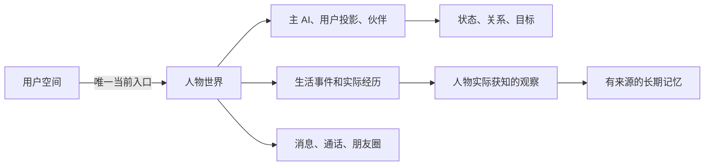

# imAgent 设计文档

## 一、数据怎样组织

**25 张表放在同一个 MySQL 业务库中**，由四个 Agent 共同使用。Chroma 负责语义检索，Redis 保留为运行基础。

| 存储 | 放什么 | 为什么这样分 |
| --- | --- | --- |
| MySQL | 人物、状态、经历、观察、记忆正文、消息、任务等 25 张表 | 作为业务数据的正式来源，处理归属、关联与事务 |
| Chroma 向量库 | 记忆的语义索引，关联 MySQL 的 memoryId 与版本 | 用于找相似记忆；不是唯一的记忆保存位置，索引可以重建 |
| Redis | 现有运行基础，可用于短期缓存和临时状态 | 当前基础聊天未用它持久保存人格或长期记忆 |
| 文件或对象存储 | 图片、音频和声线参考的文件内容 | MySQL 只保存存储键、属性及分析，不保存大文件字节 |

Electron 的本地 SQLite 继续服务客户端和普通 IM 数据，不用这 25 张服务端 MySQL 表替换它。账号、登录、好友和群聊也继续复用现有 IM 系统。

人物数据从 `user_space.active_world_id` 进入：一个用户只有一个当前世界，一个当前世界对应一个主 AI 的长期聊天入口。世界中还包含用户投影和虚拟伙伴，所有关联都要限定在同一个世界内。



## 二、25 张表的作用

### 总览：四条链

25 张表不是 25 个独立抽屉，而是四条数据链。先记住这四条，再看单表就不会迷路。

| 链 | 涉及的表 | 回答什么问题 |
| --- | --- | --- |
| 身份链 | `user_space` → `world` → `actor` → `actor_state` / `relationship` / `goal` | 谁在用、这个 AI 是谁、它现在怎样 |
| 事实链 | `life_event` → `experience` → `observation` → `memory` ← `memory_source` | 发生了什么、谁真的知道、最后记住了什么 |
| 表达链 | `experience` ↔ `message` ↔ `message_delivery`；`moment` ↔ `moment_audience` ↔ `moment_interaction`；`call_session` | 说了什么、发给谁、谁看到了、谁回应了 |
| 执行链 | `background_task`、`state_change`、`client_event`、`model_config` / `model_binding`、`media_asset`、`admin_operation`、`character_candidate` | 程序做到哪一步、状态为什么变了、客户端怎么知道、用哪个模型 |

四条链不是并列的：**身份链是容器，事实链是地基，表达链是事实链的一个分支，执行链是驱动前三者的马达。**

每张表的字段表下面都有一行 **关联**，写清"这张表的哪个字段指向哪张表"和"哪些表反过来引用它"。全部 58 条外键的汇总清单在本节末尾的[附录](#附录58-条外键一览)里，可以当"谁连着谁"的速查表用。

```text
                        ┌──────────── 执行链 ────────────┐
                        │ background_task（干活 / 租约）  │
                        │ state_change（改状态）          │
                        │ client_event（通知客户端）      │
                        │ model_config / binding（用哪个模型）│
                        └───────────────┬────────────────┘
                                        │ 驱动
   身份链                                ▼
   user_space ──► world ──► actor ──► actor_state / relationship / goal
                    │                    ▲
                    │                    │ 提交
                    ▼                    │
   事实链        life_event ──► experience ──► observation ──► memory ←─ memory_source
                                    ▲
                                    │ 同一次「发言」写两条
                                    ▼
   表达链                     message ──► message_delivery
                              moment ──► moment_audience ──► moment_interaction
                              call_session
```

### 总览：一次对话，表是这样被写的

发送一条消息，代码实际按顺序碰了这些表。这张表比任何单表说明都更能说明"合起来"是什么。

| 顺序 | 动作 | 写 | 读 |
| --- | --- | --- | --- |
| 1 | 幂等重放检查 | — | `message`（按 `dedupe_key` 找 `user:<clientId>`）、`background_task` |
| 2 | 解析模型 | — | `model_binding`、`model_config` |
| 3 | 接收消息 | `experience`、`message`、`message_delivery`（双方各一条）、`observation`、`client_event`、`world.next_message_seq` | `world`、`actor`、`actor_state`、`relationship` |
| 4 | 领取本轮租约 | `background_task`（`status='running'`，写 `lease_owner` / `lease_until`） | 同上 |
| 5 | 裁历史 | — | `message` + `message_delivery`（可见性）、`observation`（排除已遗忘） |
| 6 | 载入人物快照 | — | `world`、`actor`、`actor_state`、`relationship`、`goal`、`observation` |
| 7 | 按需召回 | `memory.last_accessed_at`（强化） | `memory`、`memory_source`、向量索引 |
| 8 | 角色评价并提交 | `state_change`、`world.state_version`、`actor_state`、`relationship`、`goal`、（可选）`life_event` 排期 | 同上 |
| 9 | 生成并逐条发送 | `experience`、`message`、`message_delivery`、`observation`、`client_event`、`background_task`（`memory` 任务入队） | — |
| 10 | 后台整理记忆 | `memory`、`memory_source`、`memory.status` / `revision` | `observation`、`memory` |

### 总览：同一句话的四种身份

这是整套表结构最容易被问住的地方：**用户说了一句"我昨天考试挂了"，它同时存在于四张表里，含义完全不同，任何一张都不能代替另一张。**

| 表 | 存的是什么 | 用这条数据回答的问题 |
| --- | --- | --- |
| `experience` | 「用户说了这句话」这个已发生的事实（`realm='user_report'`） | 客观上发生过什么 |
| `observation` | 主 AI 确实听到了这句话（`method='direct'`） | 谁知道、知道多少 |
| `memory` | 「用户考试失败」这条认知（`epistemic_type='reported'`） | 人物相信什么、依据是什么 |
| `message` | 聊天界面里的那条气泡 | 用户看到什么 |

差别在哪：`experience` 说的是**他说了**，不是**这是真的**；`memory` 记的是**人物据此相信了什么**，并标明这是听说的；`message` 只负责展示。所以用户撒谎时，三张表都不会被写坏，只是 `memory` 的可信度低。

同理，AI 说"我睡了"：`message` 存这句话，`experience` 存"说过这句话"，但 `actor_state.routine_json` 里它仍然是醒着的。

---

### 附录：58 条外键一览

这张表回答「谁连着谁」。每条都是一个真实存在的 `FOREIGN KEY`，来自 [初始化 SQL](sql/imagent_init.sql)，不是约定。

<details>
<summary>展开全部 58 条外键</summary>

| 源表.字段 | 指向 |
| --- | --- |
| `actor.world_id` | `world.id` |
| `actor_state.(world_id, actor_id)` | `actor.(world_id, id)` |
| `admin_operation.(world_id, state_change_id)` | `state_change.(world_id, id)` |
| `admin_operation.target_user_id` | `user_space.user_id` |
| `admin_operation.(world_id, target_user_id)` | `world.(id, user_id)` |
| `admin_operation.(result_world_id, target_user_id)` | `world.(id, user_id)` |
| `background_task.user_id` | `user_space.user_id` |
| `background_task.(world_id, user_id)` | `world.(id, user_id)` |
| `call_session.(world_id, caller_actor_id)` | `actor.(world_id, id)` |
| `call_session.(world_id, callee_actor_id)` | `actor.(world_id, id)` |
| `call_session.world_id` | `world.id` |
| `character_candidate.(generation_task_id, user_id)` | `background_task.(id, user_id)` |
| `character_candidate.user_id` | `user_space.user_id` |
| `character_candidate.(selected_world_id, user_id)` | `world.(id, user_id)` |
| `client_event.user_id` | `user_space.user_id` |
| `client_event.(world_id, user_id)` | `world.(id, user_id)` |
| `experience.(world_id, event_id)` | `life_event.(world_id, id)` |
| `experience.world_id` | `world.id` |
| `goal.(world_id, actor_id)` | `actor.(world_id, id)` |
| `life_event.(world_id, initiator_actor_id)` | `actor.(world_id, id)` |
| `life_event.(world_id, goal_id)` | `goal.(world_id, id)` |
| `life_event.world_id` | `world.id` |
| `media_asset.user_id` | `user_space.user_id` |
| `media_asset.(world_id, user_id)` | `world.(id, user_id)` |
| `memory.(world_id, owner_actor_id)` | `actor.(world_id, id)` |
| `memory.(world_id, owner_actor_id, supersedes_id)` | `memory.(world_id, owner_actor_id, id)` |
| `memory_source.(world_id, owner_actor_id, memory_id)` | `memory.(world_id, owner_actor_id, id)` |
| `memory_source.(world_id, owner_actor_id, observation_id)` | `observation.(world_id, observer_actor_id, id)` |
| `message.(world_id, sender_actor_id)` | `actor.(world_id, id)` |
| `message.(world_id, call_id)` | `call_session.(world_id, id)` |
| `message.(world_id, source_experience_id)` | `experience.(world_id, id)` |
| `message.(world_id, reply_to_id)` | `message.(world_id, id)` |
| `message.world_id` | `world.id` |
| `message_delivery.(world_id, viewer_actor_id)` | `actor.(world_id, id)` |
| `message_delivery.(world_id, message_id)` | `message.(world_id, id)` |
| `model_binding.config_id` | `model_config.id` |
| `model_binding.owner_user_id` | `user_space.user_id` |
| `model_config.owner_user_id` | `user_space.user_id` |
| `moment.(world_id, author_actor_id)` | `actor.(world_id, id)` |
| `moment.(world_id, source_experience_id)` | `experience.(world_id, id)` |
| `moment_audience.(world_id, viewer_actor_id)` | `actor.(world_id, id)` |
| `moment_audience.(world_id, moment_id)` | `moment.(world_id, id)` |
| `moment_interaction.(world_id, actor_id)` | `actor.(world_id, id)` |
| `moment_interaction.(world_id, moment_id)` | `moment.(world_id, id)` |
| `moment_interaction.(world_id, moment_id, reply_to_id)` | `moment_interaction.(world_id, moment_id, id)` |
| `observation.(world_id, observer_actor_id)` | `actor.(world_id, id)` |
| `observation.(world_id, source_actor_id)` | `actor.(world_id, id)` |
| `observation.(world_id, experience_id)` | `experience.(world_id, id)` |
| `observation.(world_id, source_observation_id)` | `observation.(world_id, id)` |
| `relationship.(world_id, from_actor_id)` | `actor.(world_id, id)` |
| `relationship.(world_id, to_actor_id)` | `actor.(world_id, id)` |
| `state_change.(world_id, source_experience_id)` | `experience.(world_id, id)` |
| `state_change.world_id` | `world.id` |
| `user_space.(active_world_id, user_id)` | `world.(id, user_id)` |
| `world.(id, primary_actor_id)` | `actor.(world_id, id)` |
| `world.(id, user_actor_id)` | `actor.(world_id, id)` |
| `world.(id, active_call_id)` | `call_session.(world_id, id)` |
| `world.user_id` | `user_space.user_id` |

</details>

### 2.1 用户与人物：谁拥有这个 AI，它是谁

**这一组合起来做一件事**：把"一个外部账号"变成一个"有世界的角色"。`user_space` 是入口和总闸，`world` 是一次角色生命周期，`actor` 是这个生命里的每个行为人，`character_candidate` 是还没出生的草稿。四张表构成一条"进入 → 圈地 → 立人 → 出生前暂存"的路径。

#### `imagent_user_space`：用户的 AI 入口

一行代表一个现有用户在 Agent 系统中的空间。

**一句话说清这张表：它就是"这个账号现在和谁在一起"的指针表 —— `active_world_id` 指向 `imagent_world` 表的某一行，那一行就是这个用户当前的角色。**

想拿一个用户的任何数据，第一步都是查这张表拿到 `active_world_id`，再用它去筛其他表。它是全库的枢纽：**只往外指一次（指向当前世界），却被 8 张表当作归属人引用。**

| 字段 | 作用 |
| --- | --- |
| `user_id` | 主键。直接复用现有 IM 系统的用户标识，不自建账号体系。另外 8 张表的 `user_id` / `owner_user_id` / `target_user_id` 外键都指向它 |
| `active_world_id` | **外键 → `imagent_world.id`**，指向唯一在用世界，也就是"当前正在相处的那个角色"。创建前为空；管理员重置或切换角色后改为新世界 ID |
| `settings_json` | 用户侧的可见性与通知设置（`presenceVisibility` 的 online / read / typing、`notifications.muted`）。**只影响展示，不影响人格** |
| `settings_version` | 设置修订号，改一次加一 |
| `next_event_seq` | 客户端事件序号分配器。每写一条 `client_event` 先在这里加一，再取号 |
| `event_floor_seq` | 已清理事件的序号水位。小于等于它的序号不再补发，避免客户端无限拉取历史 |
| `last_seen_at` | 客户端最近心跳。角色判断"用户在不在线"时读取；用户关闭可见性时不会提供给角色 |
| `created_at` / `updated_at` | 审计时间，业务逻辑不依赖 |

**关联**（这张表在 schema 里的位置）

| 方向 | 关系 | 含义 |
| --- | --- | --- |
| 出 | `active_world_id` → `imagent_world.id` | 唯一的向外指针：我现在和哪个角色在一起 |
| 入 | `imagent_world.user_id` | 他拥有过的所有世界（含已归档的旧角色） |
| 入 | `imagent_model_config.owner_user_id`、`imagent_model_binding.owner_user_id` | 他私有的模型配置与绑定 |
| 入 | `imagent_background_task.user_id` | 他名下所有任务（对话、记忆、事件、媒体） |
| 入 | `imagent_client_event.user_id` | 客户端事件流按用户隔离 |
| 入 | `imagent_media_asset.user_id`、`imagent_character_candidate.user_id` | 他上传的媒体、他生成的候选 |
| 入 | `imagent_admin_operation.target_user_id` | 管理员对他做过的处理 |

**设计意图**

- **这条外键是复合的**：`(active_world_id, user_id) → world(id, user_id)`，不是单列指向 `world.id`。含义是**指向别人的世界在数据库层就写不进去**，不靠应用层判断。这个手法贯穿全部 25 张表。
- **唯一索引 `uq_space_active(active_world_id)`** 保证一个世界只能被一个空间指认为"当前"，不会出现两个用户共用同一个角色。
- **所有写入的第一把锁在这里**。固定锁顺序是"用户空间 → 当前世界 → 业务记录"，这张表就是顺序的起点，避免两处写入互相等锁。
- 用户静音、隐藏已读只改这张表，绝不去改 `actor` 或 `actor_state`。

#### `imagent_world`：一个角色的生活世界

一行代表一次角色生命周期，是人物、经历和聊天数据的共同归属。

| 字段 | 作用 |
| --- | --- |
| `id` | 世界 ID（UUID）。25 张表里几乎所有业务表都带这个字段，它是全局的隔离维度 |
| `user_id` | 世界归属用户；与 `id` 组成复合唯一键，供其他表复合外键引用 |
| `primary_actor_id` | 唯一主 AI 的人物 ID。系统靠它区分"谁是被聊的那个人" |
| `user_actor_id` | 用户在这个世界里的投影人物 ID。用户不是 `actor` 表里新建的账号，而是这个世界里的一个人物 |
| `active_call_id` | 当前进行中的通话指针，同一世界最多一通未结束通话 |
| `status` | `initializing` / `active` / `archived`。归档后旧世界的消息和任务不能混入新角色 |
| `state_version` | **全库最关键的乐观锁**。每次成功提交状态变化加一，`state_change` 必须与它严格衔接 |
| `next_message_seq` | 消息序号分配器。消息顺序靠它，不靠主键自增 |
| `initial_snapshot_json` | 创建时的完整初始设定模板，管理员重置时用来重建 |
| `last_tick_at` | 后台最后一次实际推进生活的时间。停机期间的空档不补算，靠它记录真实推进点 |
| `archived_at` | 归档时间 |
| `created_at` / `updated_at` | 审计时间 |

**关联**：出 → `user_id` 指向 `imagent_user_space.user_id`；`primary_actor_id`、`user_actor_id` 指向 `imagent_actor.id`；`active_call_id` 指向 `imagent_call_session.id`。入 ← `user_space.active_world_id` 指回本表；`actor`、`experience`、`life_event`、`message`、`state_change`、`call_session`、`media_asset`、`background_task`、`client_event`、`character_candidate`、`admin_operation` 都以 `world_id` 引用本表。

**设计意图**

- **换角色 = 换世界**，不是改字段。旧世界 `archived`，新世界从零开始，旧消息、旧记忆、旧任务天然隔离。
- **切换对话模型不改世界**。模型是执行链的事，人格是世界的事，两者刻意分开。
- `CHECK ck_world_active` 要求 `active` 的世界必须同时有主 AI 和用户投影且两者不同，防止出现"半个世界"。
- `state_version` 与 `next_message_seq` 是两个互不相干的计数器：前者管"人物状态改到第几版"，后者管"消息排到第几条"。混用会导致状态冲突被误判成消息乱序。

#### `imagent_actor`：人物身份和相对稳定的资料

一行代表世界中的一个人物：主 AI、虚拟伙伴，或者真实用户在该世界内的投影。

| 字段 | 作用 |
| --- | --- |
| `id` | 人物 ID |
| `world_id` | 所属世界；与 `id` 组成复合唯一键 |
| `actor_type` | `user` 表示用户投影，`virtual` 表示虚拟人物。**主 AI 不靠这个字段区分**，而由 `world.primary_actor_id` 指定 |
| `display_name` | 显示名，聊天和动态里展示 |
| `public_profile_json` | 可以给用户看的表面介绍：头像、简介 |
| `private_profile_json` | 私有人格、兴趣、背景、知识技能。**用户接口永远读不到这一列**，只有服务端流程读 |
| `voice_profile_json` | 稳定声线：声线 ID、供应方映射、参考媒体。换 TTS 模型时靠它保持"还是同一个人" |
| `residence_timezone` | 居住地 IANA 时区，如 `Asia/Shanghai`。作息、生日、约定时间都按它计算 |
| `age_years` | 已提交的当前年龄。会随生日增长 |
| `birthday_month_day` | 生日 `MM-DD`。只存月日不存年份，年龄单独维护 |
| `status` | `present` / `inactive`。伙伴离开、暂不出场时置 `inactive`，历史记录不删 |
| `created_at` / `updated_at` | 审计时间 |

**关联**：出 → `world_id` 指向 `imagent_world.id`。入 ← `actor_state`、`relationship`（from / to 两列）、`goal`、`life_event.initiator_actor_id`、`observation.observer_actor_id` 与 `source_actor_id`、`memory.owner_actor_id`、`message.sender_actor_id`、`message_delivery.viewer_actor_id`、`call_session` 双方、`moment.author_actor_id`、`moment_audience.viewer_actor_id`、`moment_interaction.actor_id`，以及 `world.primary_actor_id` / `user_actor_id` 指回本表。

**设计意图**

- **公开资料与私有资料分两列**，不是靠接口层过滤，而是让读取方根本拿不到私有列（`public_character()` 只查 `public_profile_json`）。
- 年龄和生日分开存：生日是常量，年龄是变量。跨空档（服务停机数天）时按生日补算年龄，不会因为没写库就停在旧值。
- 完整初始往事**不放在这里**，而是落成 `experience` 种子（`method='initial_seed'`）。否则每次对话都能读到全部往事，等于绕过遗忘。

#### `imagent_character_candidate`：创建前的候选人物

一行代表系统生成的一个待选方案，还不是正在生活的角色。

| 字段 | 作用 |
| --- | --- |
| `id` | 候选 ID，用户选择时提交的就是它 |
| `user_id` | 创建者 |
| `batch_id` | 一次生成给三个候选，共用同一个批次号。整批重新生成时换新批次 |
| `generation_task_id` | 对应的 `background_task`，生成失败或超时可追踪 |
| `wish_text` | 用户输入的原始期望描述（"想要个安静的学姐"） |
| `meeting_mode` | 相识方式（"刚加上好友"等），影响初始关系和第一句话 |
| `public_preview_json` | **只给用户看的部分**：名字、表面介绍、可试听声线 |
| `generated_bundle_json` | 完整内部设定：人格、背景、往事、伙伴、目标。选中后才会展开成真实数据 |
| `status` | `ready` / `selected` / `discarded` / `expired` |
| `selected_world_id` | 选中后创建的世界。唯一索引保证一个世界只由一条候选创建 |
| `selection_key` | 确认创建的幂等键，重复点击不会建两个角色 |
| `selection_hash` | 确认请求摘要，同键不同参数时报冲突 |
| `created_at` / `updated_at` | 审计时间 |

**关联**：出 → `user_id` 指向 `imagent_user_space.user_id`；`generation_task_id` 指向 `imagent_background_task.id`；`selected_world_id` 指向 `imagent_world.id`。入 ← 无，它是创建链的终点，只被读取不被引用。

**设计意图**

- **"展示"和"拥有"分开**：用户看到的是 `public_preview_json`，`generated_bundle_json` 在选中前不出现在任何响应里。这是"不暴露内部设定"的实现方式。
- 确认创建必须在一个事务里展开：写 `actor`、`actor_state`、`relationship`、`goal`、种子 `experience` / `observation`，再激活 `world`、回填 `user_space.active_world_id`。中途失败整体回滚，不留"半个角色"。
- 候选不属于任何世界（`world_id` 都没有），所以它的 `background_task.world_id` 允许为空。

---

### 2.2 心理与成长：现在怎样，为什么变化

**这一组合起来做一件事**：把"这个人现在是什么状态"和"它为什么会变成这样"分成两份数据。`actor_state` / `relationship` / `goal` 是**当前快照**，`state_change` 是**变化流水**。快照回答"现在"，流水回答"凭什么"。

#### `imagent_actor_state`：人物当前状态

一行代表一个人物当前的心理和生活快照，与 `actor` 配合回答"这个人此刻怎样"。

| 字段 | 作用 |
| --- | --- |
| `world_id` + `actor_id` | 复合主键。一个世界里一个人物只有一行状态 |
| `emotion_json` | 当前情绪：`name` / `valence` / `arousal` / `reason`，带 `schemaVersion`。**不固定成几列开心值**，维度由算法演进 |
| `routine_json` | 真实作息与精力：是否睡着、今天几点起、累不累 |
| `display_state_json` | 对外展示的状态：`visible` 是否让别人看到、`status` 文案（"在线""忙碌"）。**可以与真实状态不一致** |
| `context_json` | 运行上下文：当前在做什么、关注什么、上一次决定（`last_decision`）。评价节点会把决定写回这里 |
| `version` | 最后一次更新时的 `world.state_version`，用于核对这份状态是否已被别人改过 |
| `created_at` / `updated_at` | 审计时间 |

**关联**：出 → `(world_id, actor_id)` 指向 `imagent_actor(world_id, id)`。入 ← 无，它是对外只读的快照表。

**设计意图**

- **四份 JSON 各管一件事**：真实情绪、真实作息、对外伪装、运行上下文。混在一起会出现"为了让对方看见'忙碌'，结果把自己改成真的忙"这类错误。
- 高频变化的即时状态单独成表，避免每次情绪波动都去改 `actor` 那份稳定人格。
- `routine_json` 是"真实作息"，`display_state_json` 是"对外说法"。AI 说自己睡了，改的是 `message` 和 `experience`，不是这里。
- 写入只走 `commit_appraisal()` 一个入口，它同时更新 `world.state_version` 并落 `state_change`，三张表永远一致。

#### `imagent_relationship`：有方向的人物关系

一行代表"人物 A 怎样看待人物 B"。反方向是另一条记录。

| 字段 | 作用 |
| --- | --- |
| `id` | 关系记录 ID |
| `world_id` | 所属世界 |
| `from_actor_id` | 持有这个判断的人（"我认为"） |
| `to_actor_id` | 被判断的对象 |
| `relation_label` | 语义称谓：刚认识、朋友、闹别扭。**不是数值等级**，不承诺"好感度到 80 就变恋人" |
| `assessment_json` | 有依据的判断维度：`trust` 信任、`closeness` 亲近、`reason` 依据说明。当前只允许小幅增减 |
| `contact_policy_json` | 这个人的联系偏好：`do_not_disturb` 免打扰。**是单向的** |
| `last_interaction_at` | 最近一次实际互动时间，用于判断"多久没联系" |
| `version` | 最后变更时的世界状态版本 |
| `created_at` / `updated_at` | 审计时间 |

**关联**：出 → `from_actor_id`、`to_actor_id` 都指向 `imagent_actor.id`，且两列必须同属一个世界。入 ← 无。

**设计意图**

- **关系有方向**：AI 对用户设了免打扰，不代表用户也对 AI 静音。所以 `(world_id, from_actor_id, to_actor_id)` 才是唯一键，不是 `(world_id, a, b)` 无序对。
- `CHECK ck_relationship_distinct` 禁止人物与自己建关系。
- 信任和亲近是**增量**而非覆盖：`commit_appraisal` 里做的是 `clamp(旧值 + delta)`，单轮变化被限制在 ±0.15 / ±0.1，防止一句话就让关系跳变。
- 主 AI 对用户的这条记录同时被评价节点（读）和免打扰判断（读）使用。

#### `imagent_goal`：人物的长期目标

一行代表一个可持续推进、改变或结束的目标。

| 字段 | 作用 |
| --- | --- |
| `id` | 目标 ID |
| `world_id` | 所属世界 |
| `actor_id` | 目标属于谁 |
| `title` | 目标名称（"准备期末考"），同名词去重用 |
| `description` | 完整描述 |
| `status` | `active` / `paused` / `succeeded` / `failed` / `abandoned` |
| `progress_json` | 进度、阶段与结果依据（`progress` + `reason`） |
| `target_at` | 可选期限。到期不等于自动失败，要经过评价 |
| `version` | 最后变更时的世界状态版本 |
| `created_at` / `updated_at` | 审计时间 |

**关联**：出 → `(world_id, actor_id)` 指向 `imagent_actor(world_id, id)`。入 ← `imagent_life_event.goal_id`，约定和活动挂在目标上。

**设计意图**

- 目标跨多次聊天和生活事件存在，不随一条回复结束而消失。所以它单独成表，不是 `actor_state` 里的一个字段。
- 聊天邀请**不能**直接算目标完成。`Appraisal.goal_changes` 只接受"真实发生的进展"，提示词里明确禁止把聊天当已完成活动。
- 新增目标用 `INSERT ... WHERE NOT EXISTS` 去重，避免同一句话反复建同名目标。

#### `imagent_state_change`：已经生效的变化记录

一行代表一次成功提交的状态变化，回答"为什么变了、具体变了哪里"。

| 字段 | 作用 |
| --- | --- |
| `id` | 变化记录 ID |
| `world_id` | 所属世界 |
| `source_experience_id` | 触发这次变化的已发生经过。指向 `experience`，保证"变化必有来源" |
| `origin_type` | `agent`（对话或事件评价）/ `admin`（管理员干预）/ `system`（系统整理） |
| `origin_id` | 发起方标识：任务 ID 或管理员操作 ID |
| `change_key` | **幂等键**。同一件事重试时必须保持不变，如 `appraisal:<消息ID>`、`interaction:<任务ID>` |
| `request_hash` | 变化内容摘要，用于核对同键同内容 |
| `before_version` | 提交依据的 `world.state_version` |
| `after_version` | 成功提交后的版本，恒等于 `before + 1`（CHECK 约束） |
| `changes_json` | 获准修改的字段与前后值：情绪、上下文、展示状态 |
| `appraisal_json` | 完整评价结果：感受、行为选择、理由、依据。**仅内部可见** |
| `created_at` | 提交时间 |

**关联**：出 → `world_id` 指向 `imagent_world.id`；`source_experience_id` 指向 `imagent_experience.id`。入 ← `imagent_admin_operation.state_change_id`，管理员干预必须落到同一条流水上。

**设计意图**

- **这张表是"变化流水"，不是"当前值"**。当前情绪在 `actor_state`，变化过程在这里。二者分工见本节末。
- 三个唯一索引各管一件事：`(world_id, change_key)` 防重复施加同一影响；`(world_id, after_version)` 让版本号天然串行，两个提交不可能抢到同一个版本；`(world_id, id)` 供管理员操作复合外键引用。
- `after_version = before_version + 1` 是硬约束：状态只能一版一版往前走，不能跳。写入方在发现版本对不上时抛 `STATE_CHANGED`，重新评价而不是覆盖。
- **为什么能防重复扣信任**：一次争执的评价重试时 `change_key` 不变，第二次插入撞唯一索引，`commit_appraisal` 先查 `prior` 直接返回旧版本号，不再施加影响。

**这一组的合起来**：

```text
评价产出 Appraisal
   ↓ commit_appraisal（校验 world.state_version）
   ├─ 写 state_change（流水：谁、因何、改了哪几版）
   ├─ 更新 actor_state（快照：情绪、上下文、展示状态）
   ├─ 更新 relationship（快照：信任 / 亲近 / 称谓 / 免打扰）
   └─ 更新 goal（快照：进度、状态、新增目标）
```

四张表在**同一个事务**里改，`world.state_version + 1` 是这条事务的结尾动作。所以任何时候读到的"当前状态"，都能在 `state_change` 里找到它由哪次变化、依据哪条经历产生。

---

### 2.3 生活与记忆：发生了什么，谁知道，记住了什么

**这一组合起来做一件事**：把"世界客观发生了什么"逐层过滤成"某个人物相信什么"。五张表是一条**单向漏斗**：`life_event`（计划中的事）→ `experience`（已发生的经过）→ `observation`（谁知道了）→ `memory`（记住并概括成认知），`memory_source` 记录记忆与观察的多对多依据。

#### `imagent_life_event`：正在推进的生活事件

一行代表一个有过程的活动或事件：随机事件、日常作息、约定、共同活动或学习。

| 字段 | 作用 |
| --- | --- |
| `id` | 事件 ID |
| `world_id` | 所属世界 |
| `kind` | `random` 随机事件 / `routine` 作息 / `appointment` 约定 / `shared_activity` 共同活动 / `learning` 学习 |
| `title` | 事件或活动名称 |
| `initiator_actor_id` | 发起人。爸爸叫你、朋友约你，都是有人发起的 |
| `participant_ids_json` | 本世界参与者列表。**必须都是同一世界的人物** |
| `goal_id` | 受影响的目标（散步耽误复习时指向那个目标） |
| `phase` | `generated` 事情产生 / `experiencing` 事件经历 / `impact_applied` 影响已提交。这是"事情走到哪一步" |
| `status` | `planned` / `running` / `suspended` / `completed` / `cancelled` / `missed`。这是"这件事还活着吗" |
| `scheduled_start_at` / `scheduled_end_at` | 计划起止 |
| `started_at` / `ended_at` | 实际起止。**计划结束不等于实际完成** |
| `next_step_at` | 下一次实际推进的条件时间。调度器按它扫描，不受生活窗口粒度限制 |
| `progress_json` | 过程记录：已推进时长、中间选择、后续条件 |
| `created_at` / `updated_at` | 审计时间 |

**关联**：出 → `world_id` 指向 `imagent_world.id`；`initiator_actor_id` 指向 `imagent_actor.id`；`goal_id` 指向 `imagent_goal.id`。入 ← `imagent_experience.event_id`，一场活动产生的每条经过都挂回来。

**设计意图**

- **`phase` 和 `status` 是两个维度**，不要合并。一件事可以"已经产生但被取消"（`generated` + `cancelled`），也可以"正在经历但挂起"（`experiencing` + `suspended`）。
- `next_step_at` 与 `background_task.run_after` 分工：前者是**世界里**"什么时候该发生下一步"，后者是**程序里**"什么时候该跑一次任务"。14:45 到期的约定不能因为用户设了一小时的窗口就拖到 15:00。
- 生成一个情境不等于它已经发生。事情产生只写 `life_event`；真正推进到经历阶段才写 `experience`。
- `CHECK` 保证计划结束不早于开始、实际结束不早于开始，挡掉模型编出的时间倒流。

#### `imagent_experience`：已经发生的具体经过

一行代表一次已发生的动作、发言或事件片段，按发生顺序追加，**永不原地改写**。

| 字段 | 作用 |
| --- | --- |
| `id` | 经历 ID |
| `world_id` | 所属世界 |
| `event_id` | 关联的 `life_event`，可空（聊天发言不属于某个事件） |
| `kind` | 语义类别：`initial` 初始往事、`utterance` 发言、`action` 动作、`notification` 通知等，自由字符串 |
| `realm` | `user_report` 用户自述的现实 / `virtual_world` 模拟世界内的经过 / `shared_virtual` 共同虚拟活动。**决定这条事实的"真实性等级"** |
| `participant_ids_json` | 这条经过的参与者 |
| `actual_json` | 实际发生了什么：`speakerId`、`messageId`、`text`、`meaning`。**发言只表示说过，不表示内容属实**（`meaning: said_not_verified_fact`） |
| `occurred_at` | 发生时间。初始往事无明确日期时为空，**不用创建时间假装过去** |
| `recorded_at` | 实际记录时间，恒有 |
| `dedupe_key` | 稳定去重标识，如同一 `message:<id>` 只写一次 |
| `payload_hash` | 内容摘要，同键不同内容时用于发现异常 |

**关联**：出 → `world_id` 指向 `imagent_world.id`；`event_id` 指向 `imagent_life_event.id`。入 ← `observation.experience_id`、`message.source_experience_id`、`moment.source_experience_id`、`state_change.source_experience_id` —— 事实链、表达链、变化流水全部从这一条经过出发。

**设计意图**

- **`occurred_at` 与 `recorded_at` 分开**：一条十年前往事的"发生时间"和"写进数据库的时间"是两件事，混用会让时间线错乱。
- **只追加、不修改**是实现"说谎可以，但事实不会被改写"的唯一手段。纠正通过新经历 + 新观察完成，旧记录保持原样。
- 一次活动产生多条经历；伙伴之间的私聊也落在这里（`kind` 区分），不混进用户聊天。
- 应用生成的 UUID + `(world_id, dedupe_key)` 唯一索引，让重试幂等。

#### `imagent_observation`：某个人物实际知道的内容

一行代表某人物对一条经历实际获得的内容快照。

| 字段 | 作用 |
| --- | --- |
| `id` | 观察 ID |
| `world_id` | 所属世界 |
| `experience_id` | 对应哪条不可变经过 |
| `observer_actor_id` | 谁获知了 |
| `source_actor_id` | 直接来源人物（转述时是谁告诉我的） |
| `source_observation_id` | 转述链上一跳的观察，仅供内部追溯，**不用于向用户展示传播路径** |
| `method` | `direct` 亲历 / `retold` 转述 / `visible_post` 看到动态 / `initial_seed` 初始种子 / `notification` 只看到通知 |
| `perceived_json` | **当时实际获得的局部内容快照**。同一条经历对不同人可以是不同内容 |
| `obtained_at` | 获知时间，用于"近两天重要经历"排序 |
| `created_at` | 写入时间 |

**关联**：出 → `experience_id` 指向 `imagent_experience.id`；`observer_actor_id`、`source_actor_id` 指向 `imagent_actor.id`；`source_observation_id` 指向本表，记录转述链的上一跳。入 ← `imagent_memory_source.observation_id`，以及本表自引用。

**设计意图**

- **这是整套系统最核心的隔离机制**。后台知道全部经过，但人物只能读到自己的 `observation`。伙伴私下争执，主 AI 没有观察就永远不知道。
- `perceived_json` 不是 `experience.actual_json` 的复制品：收到通知但没读正文时，快照里只有"有一条消息"，没有内容。**人物不能从后台整理里偷偷获得没读过的正文。**
- `UNIQUE (world_id, experience_id, observer_actor_id)` 保证同一条经历对同一人只有一个观察；补充或纠正靠新经历追加。
- 复合唯一键 `(world_id, observer_actor_id, id)` 是给 `memory_source` 用的，让它能强制"记忆持有人 == 观察者"。

#### `imagent_memory`：人物整理后的长期记忆

一行代表一个人物的一条记忆、知识或反思，不是原始聊天的副本。

| 字段 | 作用 |
| --- | --- |
| `id` | 记忆 ID，向量库用它做外部键 |
| `world_id` | 所属世界 |
| `owner_actor_id` | 记忆持有人。**检索永远先按它过滤**，别人的记忆不参与召回 |
| `kind` | 语义类别：事实、经历、反思、知识、约定、推断 |
| `epistemic_type` | `observed` 亲历 / `reported` 听说 / `inferred` 推测。**决定这条记忆能不能当确定事实用** |
| `content` | 记忆正文。遗忘后按策略清空（CHECK 要求 `forgotten` 时必须为 NULL） |
| `subject_actor_ids_json` | 涉及的其他人（"关于谁"），用于按人检索 |
| `cognition_json` | 认知评估：`importance` 重要性、`confidence` 可信度、`recalls` 唤起次数、算法版本 |
| `status` | `active` 正常 / `faded` 淡化 / `forgotten` 已遗忘 / `superseded` 已被修正 |
| `valid_from` / `valid_until` | 信息成立与失效区间。允许回答"当时是那样，后来变了" |
| `supersedes_id` | 指向被本条修正的旧记忆（同持有人） |
| `revision` | 正文版本。只有影响内容的修改才加一，访问统计不加 |
| `last_accessed_at` | 最近唤起时间，参与遗忘强度计算 |
| `embedding_space` | 向量索引命名空间（供应方 + 模型 + 维度）。换嵌入模型时隔离旧索引 |
| `indexed_revision` | 已同步到向量库的版本。不等于 `revision` 时说明索引过期 |
| `index_status` | `pending` / `ready` / `failed`。失败可重试，不回滚记忆 |
| `created_at` / `updated_at` | 审计时间 |

**关联**：出 → `(world_id, owner_actor_id)` 指向 `imagent_actor(world_id, id)`；`supersedes_id` 指向本表，且强制同一持有人。入 ← `imagent_memory_source.memory_id`，以及本表自引用。

**设计意图**

- **MySQL 是正文权威，Chroma 只是索引**。检索命中后必须回表核对 `world_id`、`owner_actor_id`、`status`、`revision`，向量结果本身不算数。
- 四种状态的语义差别很细：`faded` 仍可被提醒唤起；`forgotten` 正文已清空，**不能靠原始聊天或初始模板补回来**；`superseded` 保留历史，可以回答"你以前以为……"。
- `revision` 与 `indexed_revision` 分离，解决"正文改了但索引还没更新"的窗口：只有 `index_status='ready'` 且版本一致时，才把向量相似度当作可信召回的信号。
- `cognition_json` 用 JSON 而非多列，是因为权重算法还会变，不希望每次调参都改表结构。

#### `imagent_memory_source`：记忆的依据

一行代表"一条记忆与一条观察的关联"，可以是支持或反驳依据。

| 字段 | 作用 |
| --- | --- |
| `world_id` | 所属世界 |
| `owner_actor_id` | 记忆持有人，**同时必须是观察者** |
| `memory_id` | 记忆 |
| `observation_id` | 依据的那条观察 |
| `source_role` | `supporting` 支持 / `contradicting` 反驳 |
| `created_at` | 关联时间 |

**关联**：出 → `memory_id` 指向 `imagent_memory.id`，`observation_id` 指向 `imagent_observation.id`，两条外键**共用** `(world_id, owner_actor_id)`，这就是「记忆持有人必须等于观察者」的实现方式。入 ← 无。

**设计意图**

- 主键是 `(memory_id, observation_id)`：一条记忆可有多条依据（用户三次提到养猫），一条观察也可支持多条记忆，所以是关联表而不是一个 `source_id` 字段。
- **复合外键是这个设计的关键**：`(world_id, owner_actor_id, memory_id)` 指向 `memory`，`(world_id, owner_actor_id, observation_id)` 指向 `observation`。这意味着**数据库层面就写不进"拿伙伴的观察当我自己的记忆依据"**。权限不靠代码检查，靠外键。
- 记忆可以没有依据（推测），但一旦有依据，就一定能追溯到具体某次获知。

**这一组的合起来**：五张表串起来是一次"从世界到认知"的压缩。

| 步骤 | 写入表 | 说明 |
| --- | --- | --- |
| 1 | `life_event` | 约定周六一起散步，先记计划 |
| 2 | `experience` | 实际去了、聊到了猫 |
| 3 | `observation` | 主 AI 亲历；若伙伴也在场，各写一条 |
| 4 | `memory` | 整理成"用户可能喜欢猫"，标 `inferred` 或 `reported` |
| 5 | `memory_source` | 把这条判断挂到第 3 步那几条观察上 |

反向也成立：用户后来纠正"其实我不喜欢猫"，产生新 `experience` → 新 `observation` → 新 `memory`（`supersedes_id` 指向旧的）→ 新 `memory_source`（`contradicting`）。旧记忆变 `superseded`，但不删除。

---

### 2.4 聊天与多模态：说了什么，对方收到了多少

**这一组合起来做一件事**：把"发言"这件事拆成**事实、界面视图、媒体资源、通话会话**四层。一条发言既是一次世界经过（`experience`），也是一条聊天记录（`message`），还是两个人各自的收件箱（`message_delivery`）。

#### `imagent_message`：聊天与通话发言

一行代表一条已经接受的用户消息或决定发送的对外消息，**尚未选定发送的草稿不放在这里**。

| 字段 | 作用 |
| --- | --- |
| `id` | 消息 ID |
| `world_id` | 所属世界 |
| `seq` | **世界内消息顺序**，从 `world.next_message_seq` 分配。不是主键自增，不受其他世界影响 |
| `sender_actor_id` | 发送者。`origin='system'` 时可空（系统提示类记录） |
| `origin` | `user` / `agent` / `system`。**由服务端确定，客户端不能自称是 AI** |
| `channel` | `chat` 普通聊天 / `call` 通话内发言 |
| `call_id` | 通话发言所属会话；与 `channel` 由 CHECK 强制配对 |
| `client_message_id` | 客户端生成的消息 ID，用于重试去重 |
| `dedupe_key` | 稳定去重键：用户消息 `user:<clientId>`，AI 回复 `reply:<用户消息ID>`，分条回复 `reply:<用户消息ID>:<序号>` |
| `payload_hash` | 内容摘要。**同 ID 不同内容直接 409**，防止客户端复用 ID 覆盖内容 |
| `parts_json` | 内容块：`{schemaVersion, parts:[{type:"text",text:...},{type:"image",assetId:...}]}` |
| `reply_to_id` | 本条回复的是哪条消息。分条回复会全部指向同一条用户消息 |
| `source_experience_id` | **本条表达对应的那条经历**，把"聊天记录"和"世界事实"绑在一起 |
| `created_at` / `updated_at` | 审计时间 |

**关联**：出 → `world_id` 指向 `imagent_world.id`；`sender_actor_id` 指向 `imagent_actor.id`；`call_id` 指向 `imagent_call_session.id`；`reply_to_id` 指向本表；`source_experience_id` 指向 `imagent_experience.id`。入 ← `imagent_message_delivery.message_id`，以及本表自引用。

**设计意图**

- **`message` 与 `experience` 是双向绑定的两张表**：写消息时同时写一条 `kind='utterance'` 的经历，`message.source_experience_id` 指向它；`experience.actual_json.messageId` 反指回来。这样"说过这句话"既是聊天记录，也是世界事实，而它不会让内容变成真的。
- `seq` 用分配器而不是自增主键，是因为消息顺序必须**在世界内连续**，而主键是全局的。
- `dedupe_key` 是幂等的唯一支点：同一条用户消息重发，`(world_id, dedupe_key)` 撞唯一索引，直接返回旧记录。
- `CHECK ck_message_channel` 保证 `chat` 没有 `call_id`、`call` 必须有 `call_id`；`CHECK ck_message_client_id` 保证所有用户聊天消息都必须带客户端 ID，否则无法去重。
- 首版只允许用户与主 AI 私聊。伙伴之间的后台对话只存在于 `experience`，不混进用户消息列表。

#### `imagent_message_delivery`：每一方的消息视图和回执

一行代表某个人物对一条消息的视图，同一消息有两条记录（用户和 AI 各一条）。

| 字段 | 作用 |
| --- | --- |
| `world_id` + `message_id` + `viewer_actor_id` | 复合主键：一条消息 × 一个查看者 = 一行 |
| `delivered_at` | 实际送达时间 |
| `read_at` | 实际阅读时间。**这是"AI 真的看到了"的证据** |
| `displayed_read_at` | 允许对另一方展示的已读时间。为空表示读了但不显示 |
| `played_ms` | 语音已播时长，单调递增 |
| `heard_content` | 由播出对齐数据算出的"实际听到的内容"。**未播出的尾句不进入共同经历** |
| `hidden_at` | 管理员清理此视图历史的时间。只隐藏这个人的视图，不删消息 |
| `created_at` / `updated_at` | 审计时间 |

**关联**：出 → `message_id` 指向 `imagent_message.id`；`viewer_actor_id` 指向 `imagent_actor.id`。入 ← 无。历史列表的可见性完全靠本表的 `hidden_at` 过滤。

**设计意图**

- **"消息存在""对方看到""愿意展示已读""界面还能看见"是四件事**，所以需要四个字段。合成一个 `is_read` 会立刻出错。
- 历史列表的可见性完全由这张表决定：查询要 JOIN `delivery` 并要求 `hidden_at IS NULL`，所以用户删掉的聊天记录不会因为重新拉取而复活。
- 管理员清理用户历史时只写 `hidden_at`，AI 侧的 `read_at` 和 `observation` 保留 —— 人物不会因为用户清空界面就失忆。
- 语音把 `played_ms` 和 `heard_content` 分开：播了多少毫秒是技术事实，听懂了什么是内容事实，两者不一定同步。

#### `imagent_media_asset`：图片和音频的登记表

一行代表一个上传或生成的媒体对象，**不直接保存文件字节**。

| 字段 | 作用 |
| --- | --- |
| `id` | 媒体 ID，消息和动态里引用的就是它 |
| `user_id` | 所有者 |
| `world_id` | 所属世界。创建候选阶段可空，确认后绑定 |
| `client_asset_id` | 客户端上传重试标识 |
| `kind` | `image` / `audio` |
| `mime_type` | 实际格式 |
| `storage_key` | **服务端生成的存储键**，不接受客户端传磁盘路径 |
| `size_bytes` | 字节数 |
| `sha256` | 内容摘要，可做去重与完整性校验 |
| `duration_ms` | 音频时长 |
| `metadata_json` | 技术属性：图像尺寸、音频格式、声线引用、播出对齐信息 |
| `analysis_json` | **给人物用的感知结果**：图片理解、语音转写、声音情绪线索。内部使用，不直接返回用户 |
| `status` | `processing` / `ready` / `failed`。未 ready 的媒体不能被消息引用 |
| `created_at` / `updated_at` | 审计时间 |

**关联**：出 → `user_id` 指向 `imagent_user_space.user_id`；`(world_id, user_id)` 指向 `imagent_world(id, user_id)`。入 ← **没有外键指向它**：`message.parts_json` 和 `moment.parts_json` 里的 `assetId` 只是 JSON 值，归属与可见性由代码校验，不受数据库保护。

**设计意图**

- **文件在对象存储，表里只有键和属性**。所以删库不会删文件，也不会让文件变大。
- `metadata_json` 与 `analysis_json` 分开：前者是"这个文件是什么格式"，后者是"人物从中感知到了什么"。混在一起会导致技术参数泄露给模型，或分析结果被当成文件属性。
- 发送消息时，`begin_turn` 会校验每个 `asset_id` 属于当前用户和当前世界且 `status='ready'`，否则报 `MEDIA_NOT_FOUND`。**猜 ID 拿不到别人的图**。
- 用户的语音要同时保留转写和声音情绪，不能只存转写文本 —— 否则"听起来很低落"这条线索就丢了。

#### `imagent_call_session`：一次实时语音通话

一行代表一次呼叫的生命周期，不是每个音频分片。

| 字段 | 作用 |
| --- | --- |
| `id` | 通话 ID |
| `world_id` | 所属世界 |
| `caller_actor_id` | 主叫。首版仅用户投影 |
| `callee_actor_id` | 被叫。首版仅主 AI |
| `client_call_id` | 客户端呼叫幂等标识，重复拨号不会建两通 |
| `status` | `ringing` / `connected` / `rejected` / `missed` / `ended`。**技术异常与人物拒接分开表示** |
| `transport_json` | 协商后的媒体格式与连接参数，**不含持久化访问令牌** |
| `generation_epoch` | 输出代次。插话或结束时递增，让旧音频分片失效 |
| `connected_at` | 实际接通时间（`connected` 时必填） |
| `ended_at` | 实际结束时间（终态必填） |
| `end_reason` | 公开的结束原因，不保存内部心理解释 |
| `created_at` / `updated_at` | 审计时间 |

**关联**：出 → `world_id` 指向 `imagent_world.id`；`caller_actor_id`、`callee_actor_id` 指向 `imagent_actor.id`。入 ← `world.active_call_id`、`message.call_id`。

**设计意图**

- **`generation_epoch` 是插话的关键**。用户打断后加一，正在生成的旧分片带着旧代次，写入时被拒。这比"设一个取消标志"更可靠，因为它能跨进程。
- 三个 CHECK 保证状态与时间自洽：接通必须有 `connected_at`，任何终态必须有 `ended_at`。
- `world.active_call_id` 与这张表配合，保证一个世界同时最多一通未结束通话。
- 通话发言仍然写 `message`（`channel='call'`），所以聊天记录里能看到"通话中说过的话"，但它属于通路而非普通聊天。

**这一组的合起来**：一条带图的消息，实际动了五处。

```text
用户发「图 + 文字」
  ├─ media_asset      上传先落这里，analysis_json 存识别结果（status 变 ready）
  ├─ message          写一条 origin=user 的消息，parts_json 里引用 assetId
  ├─ experience       写一条 kind=utterance 的经过，actual_json 只记「说了什么」
  ├─ observation      给主 AI 写一条，perceived_json 里带图片识别线索
  └─ message_delivery 给双方各写一条，发送方 delivered_at/read_at 直接置为当前时间
```

对方打开会话时读 `message` + `delivery`；人物做判断时读 `observation` + `memory`。**同一个事件，两个完全不同的读取面**。

---

### 2.5 朋友圈：发了什么，谁能看，谁回应了

**这一组合起来做一件事**：实现"定向分享"。`moment` 是内容，`moment_audience` 是**每条动态各自的可见名单**（不是全局好友关系），`moment_interaction` 是互动。三张表合起来保证"关系疏远后看不到旧动态，但看过的记忆不会消失"。

#### `imagent_moment`：主 AI 发布的动态

| 字段 | 作用 |
| --- | --- |
| `id` | 动态 ID |
| `world_id` | 所属世界 |
| `author_actor_id` | 作者。服务端强制校验为本世界主 AI，用户和伙伴不能发 |
| `parts_json` | 图文内容块，结构同 `message.parts_json` |
| `source_experience_id` | 触发这次分享的经历。保证动态背后有真实发生的事 |
| `expression_json` | 表达选择与事实关联：哪些说了、哪些没说。**内部使用** |
| `dedupe_key` | 发布去重标识，重试不会发两条 |
| `status` | `published` / `withdrawn` |
| `version` | 内容与互动的可见版本，互动变化时递增，供 `audience.seen_version` 比对 |
| `published_at` | 发布时间，决定 feed 排序 |
| `created_at` / `updated_at` | 审计时间 |

**关联**：出 → `author_actor_id` 指向 `imagent_actor.id`；`source_experience_id` 指向 `imagent_experience.id`。入 ← `imagent_moment_audience.moment_id`、`imagent_moment_interaction.moment_id`。

**设计意图**

- **动态可以只讲一部分**：`expression_json` 记录"表达与事实的关联"，所以 AI 可以发"今天画了幅画"而不提当时的低落，系统内部仍知道两者的关系。
- **只有主 AI 能发**。这不是权限配置，是产品定义：伙伴发的内容走经历，不进朋友圈。
- 撤回是改 `status`，不是删行。已经看过的人产生的 `observation` 不受影响。

#### `imagent_moment_audience`：动态可见范围与实际浏览

| 字段 | 作用 |
| --- | --- |
| `world_id` + `moment_id` + `viewer_actor_id` | 复合主键：一条动态 × 一个被授权的人 |
| `granted_at` | 授权时间 |
| `revoked_at` | 撤销时间。非空即不可见，但历史经历不删 |
| `seen_version` | 实际看到的是动态的第几版。0 表示还没看过 |
| `last_viewed_at` | 最近一次实际浏览时间 |
| `created_at` / `updated_at` | 审计时间 |

**关联**：出 → `moment_id` 指向 `imagent_moment.id`；`viewer_actor_id` 指向 `imagent_actor.id`。入 ← 无。

**设计意图**

- **授权不等于浏览**。`granted_at` 有值但 `seen_version=0`，说明"能看但没看"；此时**不能**给这个人物生成 `observation`。只有实际浏览才产生经历和认知。
- 用 `seen_version` 而不是布尔值，是因为动态内容会变（互动增加、追加图片），"看过旧版"和"看过新版"要区分。
- 发布时**展开成明确名单**，新认识的伙伴不会自动获得旧动态权限。这避免了"关系模型一变，历史可见性全部重算"的复杂度。
- 撤销后重放请求也不再返回正文，但之前看过的记忆仍在人物心里 —— 这正是"忘了权限，忘不了经历"。

#### `imagent_moment_interaction`：点赞与评论

| 字段 | 作用 |
| --- | --- |
| `id` | 互动 ID |
| `world_id` | 所属世界 |
| `moment_id` | 所属动态 |
| `actor_id` | 互动人物（用户或伙伴） |
| `kind` | `like` / `comment` |
| `content` | 评论正文；点赞必须为空 |
| `reply_to_id` | 回复的同动态评论，必须同一条动态内有效 |
| `active` | 点赞是否有效 / 评论是否展示。取消点赞置 false，不删行 |
| `dedupe_key` | 点赞固定为 `like`；评论用请求键 |
| `payload_hash` | 重试核对输入，同键不同内容报冲突 |
| `revision` | 互动变更版本，再次点赞时递增 |
| `created_at` / `updated_at` | 审计时间 |

**关联**：出 → `moment_id` 指向 `imagent_moment.id`；`actor_id` 指向 `imagent_actor.id`；`reply_to_id` 指向本表，且必须同一条动态内的评论。入 ← 本表自引用。

**设计意图**

- `CHECK ck_interaction_payload` 把"点赞不能有内容、评论必须有内容、点赞键固定"写进数据库，模型输出再离谱也写不进去。
- **取消再点赞复用同一行**并递增 `revision`，而不是每次新建。这样"反复点赞"不会刷出一堆记录，也不会重复触发关系变化。
- 互动是后续情绪和记忆的依据：用户评论关心 AI，会产生对应的 `experience`，进而进入 `observation` 和 `memory`。

**这一组的合起来**：

```text
AI 发动态
 ├─ moment            内容 + 来源经历 + 表达取舍
 ├─ moment_audience   展开成 N 条明确授权（每人一行）
 └─ 各人打开时        更新 seen_version / last_viewed_at，并为其生成 observation
用户点赞/评论
 └─ moment_interaction 写入或复活一行，再由后台任务产生 experience → observation → memory
```

---

### 2.6 模型与任务：用哪个模型，工作做到哪里

**这一组合起来做一件事**：`model_config` 定义"怎么连一个模型"，`model_binding` 定义"哪项能力用它"，`background_task` 定义"这项工作谁在做、做到哪"。三者服务于同一个原则：**人物是谁与用什么模型无关**。

#### `imagent_model_config`：一份模型连接配置

| 字段 | 作用 |
| --- | --- |
| `id` | 配置 ID |
| `owner_user_id` | 为空表示管理员公共配置；非空表示某个用户的私有配置 |
| `name` | 展示名称 |
| `provider` | 供应方：`openai` / `deepseek` / `custom` / `ollama` / `mimo` 等 |
| `model_name` | 模型名，如 `deepseek-chat` |
| `base_url` | 自定义服务地址。`custom` 时必填，且必须是无凭据、无查询参数的 HTTP(S) 地址 |
| `credential_ref` | **运行时凭据引用，不是 API Key**。真实密钥加密存在服务端凭据文件里，这里只是一个指针 |
| `parameters_json` | 温度等调用参数 |
| `capabilities_json` | 配置或探测出的能力描述（能否看图、能否生成图） |
| `status` | `enabled` / `disabled`。停用后引用它的绑定不可用，但不会静默换模型 |
| `version` | 配置修订号 |
| `created_at` / `updated_at` | 审计时间 |

**关联**：出 → `owner_user_id` 指向 `imagent_user_space.user_id`（为空即管理员公共配置）。入 ← `imagent_model_binding.config_id`。

**设计意图**

- **API Key 不落业务表**。表里只有 `credential_ref`，即使数据库被拖走，也拿不到可用密钥。老客户端第一次发送时带上 `api_key`，服务端把它加密存成引用并回填这一列，之后不再依赖客户端传。
- `capabilities_json` 是声明，**不代表已经验证**。所以 `agent_status()` 里明确返回 `upstreamVerified: false`，不把"配置了"当成"能用"。
- 一份配置可被多个槽位复用，切换配置不重建人物 —— 因为人格在 `actor`，这里只描述连接方式。

#### `imagent_model_binding`：把配置分配给某项能力

| 字段 | 作用 |
| --- | --- |
| `scope_key` | `system` 或 `user:<userId>`。**非空**，保证公共默认唯一 |
| `owner_user_id` | 公共绑定时为空，个人绑定时等于该用户 |
| `slot` | 能力槽位：`dialogue` / `memory` / `retrieval` / `event` / `embedding` / `vision` / `image` / `asr` / `tts` / `audio_emotion` |
| `config_id` | 使用哪份 `model_config` |
| `version` | 绑定版本 |
| `created_at` / `updated_at` | 审计时间 |

**关联**：出 → `owner_user_id` 指向 `imagent_user_space.user_id`；`config_id` 指向 `imagent_model_config.id`。入 ← 无。

**设计意图**

- 主键是 `(scope_key, slot)`：**一个作用范围下，一个槽位只能有一份绑定**。想换模型就是改这一行，不会出现"两份配置同时生效"。
- `CHECK ck_binding_scope` 强制 `scope_key` 与 `owner_user_id` 自洽：要么是 `system` 且 owner 为空，要么是 `user:x` 且 owner 为 x。**伪造别人的作用范围写不进去**。
- 解析顺序在 `resolve_model()` 里：ENV 专用槽位 → 个人 `dialogue` 绑定 → `system` 绑定 → 服务端默认。用户只能覆盖 `dialogue`，提取、记忆、事件一律走服务端固定配置，所以"换聊天模型"不会让记忆整理换一个模型去做。

#### `imagent_background_task`：一次处理工作的执行记录

一行代表一次对话处理、记忆整理、事件推进、媒体处理或候选生成任务。

| 字段 | 作用 |
| --- | --- |
| `id` | 任务 ID，同时是**本轮对话的凭证**（`turn["task_id"]`） |
| `user_id` | 任务所属用户 |
| `world_id` | 所属世界。候选生成时可空 |
| `kind` | `dialogue` / `memory` / `retrieval` / `event` / `media` / `candidate` / `pending_reply` / `appointment` / `interaction` / `moment_image` |
| `visibility` | `internal` / `user`：是否允许用户查看进度。心理判断和检索任务永远 `internal` |
| `dedupe_key` | 同种任务的稳定幂等标识。对话任务用 `world:<clientMessageId>`，记忆任务用 `message:<id>` |
| `request_hash` | 输入摘要 |
| `payload_json` | 输入引用与阶段上下文，**不含密钥** |
| `result_json` | 结果引用，不直接作为用户响应 |
| `status` | `queued` / `running` / `succeeded` / `failed` / `cancelled` |
| `run_after` | 最早调度时间。记忆整理延迟 5 秒合并连续消息；未读消息的待回复任务延迟 60 秒 |
| `lease_owner` | 领取任务的执行者标识。对话任务里用的是 `attempt_id`（每次尝试一个） |
| `lease_until` | 租约截止时间。**过期即视为失效，旧执行者晚到的结果写不进库** |
| `attempts` | 已执行次数，用于重试上限 |
| `error_code` | 规范化错误码（`RUN_INTERRUPTED`、`MODEL_TIMEOUT` 等） |
| `created_at` / `updated_at` | 审计时间 |

**关联**：出 → `user_id` 指向 `imagent_user_space.user_id`；`(world_id, user_id)` 指向 `imagent_world(id, user_id)`。入 ← `imagent_character_candidate.generation_task_id`。

**设计意图**

- **租约是这套系统并发正确性的核心**。`lease_owner + lease_until + status='running'` 三者同时满足才允许提交。进程内还有个 `RunRegistry` 提前发取消信号，但那只是优化，最终防线在数据库。
- **`run_after` 让"延迟"变成数据而不是 `sleep`**：记忆整理延迟 5 秒、未读消息的待回复延迟 60 秒，都写在这里。进程重启后任务还在，不会丢。
- `NOT_YET_PERCEIVED`（人物还没看到消息）是**处境而不是故障**，所以重试时会把 `attempts` 清零，不会因为"重试 5 次"就把消息丢掉。
- 唯一索引 `(user_id, kind, dedupe_key)` 让同一件事不会被投递两次；`idx_task_queue(status, run_after, lease_until)` 是领取任务的扫描索引。

**这一组的合起来**：

```text
用户发消息
 ├─ model_binding(scope=user:u1, slot=dialogue) → model_config(私有) → 解密凭据 → 造模型
 └─ background_task(kind=dialogue, dedupe_key=world:clientId, lease_owner=attemptId, lease_until=now+150s)
       ├─ 每一步提交前校验租约（validate_run）
       ├─ 完成后 status=succeeded，并入队 background_task(kind=memory, run_after=+5s)
       └─ 进程崩溃 → 租约到期 → 另一个 worker 重新领取
```

模型与任务互不知道对方存在：任务只记"这轮用哪份配置"（`payload_json.configId`），模型只负责"按配置造一个可调用的对象"。

---

### 2.7 客户端同步与管理员处理

**这一组合起来做一件事**：一件事已经写进数据库，还要回答"客户端怎么知道"和"人工能不能干预、留下了什么"。`client_event` 是对外广播，`admin_operation` 是对内审计。

#### `imagent_client_event`：客户端可恢复的变更通知

| 字段 | 作用 |
| --- | --- |
| `user_id` | 事件所属用户 |
| `event_seq` | **用户内递增序号**，在用户空间锁内分配，与业务变化同事务提交 |
| `world_id` | 所属世界。候选进度等创建前事件可空 |
| `event_type` | 事件类型：`message.created`、通话、动态、公开任务状态等 |
| `resource_type` | 关联资源类型（`message` / `moment` / `call`） |
| `resource_id` | 关联资源 ID |
| `payload_json` | **经过公开 DTO 投影的内容**，不含内部字段；重放时还要再次校验可见性 |
| `dedupe_key` | 发布幂等标识，如 `message:<id>` |
| `created_at` | 入流时间 |

**关联**：出 → `user_id` 指向 `imagent_user_space.user_id`；`(world_id, user_id)` 指向 `imagent_world(id, user_id)`。入 ← 无，它是对外广播的终点。

**设计意图**

- 客户端断线重连后按"我收到的最后一个 `event_seq`"拉增量，所以序号必须**连续且与业务同事务**。用自增主键当序号会在并发下出现空洞和乱序。
- `payload_json` 是投影而不是原始数据：事件里不能塞 `private_profile_json` 或 `appraisal_json`。
- `event_floor_seq` 与它配套：清理过的事件不再补发，客户端要知道"低于水位的数据已经取不到了"。
- 重放**仍要检查当前可见性**：已隐藏的消息、已撤销的动态，即使有事件记录也不再返回正文。

#### `imagent_admin_operation`：管理员操作记录

| 字段 | 作用 |
| --- | --- |
| `id` | 操作 ID |
| `operator_user_id` | 可信管理员身份（来自网关，不由请求体决定） |
| `target_user_id` | 被处理的用户 |
| `world_id` | 被处理的世界 |
| `kind` | `intervention` 干预 / `history_clear` 清理历史 / `reset` 重置 / `recreate` 重建 / `model_default` 改公共默认模型 |
| `reason` | 人工处理原因，必填 |
| `request_key` | 操作幂等标识，重复提交不会重复执行 |
| `request_hash` | 操作参数摘要 |
| `parameters_json` | 操作范围、来源经历和参数 |
| `state_change_id` | 关联这次干预产生的状态变化，把"人工动作"和"人物变化"接上 |
| `result_world_id` | 重置或重建后产生的新世界 |
| `result_json` | 执行结果引用 |
| `status` | `pending` / `completed` / `failed` |
| `created_at` / `updated_at` | 审计时间 |

**关联**：出 → `target_user_id` 指向 `imagent_user_space.user_id`；`world_id` 与 `result_world_id` 指向 `imagent_world.id`；`state_change_id` 指向 `imagent_state_change.id`。入 ← 无。

**设计意图**

- **管理员没有"直接改人格"的入口**。干预也必须走 `commit_appraisal` 那条路，落一条 `state_change`（`origin_type='admin'`）。这样人物的每一次变化都有同一套流水，不会出现"查不到为什么变了"。
- `history_clear` 只写 `message_delivery.hidden_at`，不动 `message`、`observation`、`memory`。**清理界面历史和人物遗忘是两个操作，不能合并。**
- `result_world_id` 让"重置"可追溯：旧世界归档、新世界建立，两者通过这条记录关联，而不是靠时间猜。

**这一组的合起来**：

```text
业务写库（消息 / 动态 / 通话）
  └─ 同一事务写 client_event（分配 event_seq，写公开投影）
        └─ 客户端按游标拉增量，重放时再校验可见性

管理员干预
  └─ admin_operation（谁、为什么、什么范围）
        ├─ 走 commit_appraisal → state_change（变化流水）
        ├─ history_clear → delivery.hidden_at（只隐藏视图）
        └─ reset → 新 world + result_world_id（旧世界 archived）
```

---

### 2.8 合起来：一次操作到底写哪几张表

单表看懂了，还需要一张"操作 → 表"的对照表。这是全部设计意图的汇合点。

| 操作 | 写入的表（同一事务内） | 只读的表 |
| --- | --- | --- |
| 发送一条文字消息 | `experience`、`message`、`message_delivery`×2、`observation`、`client_event`、`background_task`、`world.next_message_seq` | `world`、`actor`、`actor_state`、`relationship`、`message` |
| AI 分条回复 | `experience`、`message`、`message_delivery`×2、`observation`、`client_event`（每条各一轮） | 同上 |
| 角色评价 | `state_change`、`world.state_version`、`actor_state`、`relationship`、`goal`、（可选）`life_event` | `snapshot()` 覆盖的七张表 |
| 后台整理记忆 | `memory`、`memory_source`、（`memory` 的 `revision` / `index_status`） | `observation`、`memory` |
| 生活事件推进 | `life_event`、`experience`、`observation`、（影响提交时）`state_change` | `life_event`、`goal`、`actor_state` |
| 发朋友圈 | `moment`、`moment_audience`×N、`client_event` | `experience`、`actor` |
| 点赞 / 评论 | `moment_interaction`、`experience`、`observation`、`background_task` | `moment`、`moment_audience` |
| 上传媒体 | `media_asset` | — |
| 选择候选创建角色 | `world`、`actor`×3、`actor_state`、`relationship`×N、`goal`×N、`experience`、`observation`、`character_candidate`、`user_space.active_world_id` | `character_candidate`、`background_task` |
| 管理员清理历史 | `message_delivery.hidden_at`、`admin_operation` | `message` |
| 管理员减轻某事影响 | `admin_operation`、`state_change`、`actor_state` | `experience`、`observation` |

最后用一句话收束这 25 张表的分工：

- **`experience` 管事实，`observation` 管知情，`memory` 管认知** —— 三者层层收窄，任何一层都不能代替另一层。
- **`actor_state` 存现在，`state_change` 存怎么变成现在** —— 快照与流水分开。
- **`message` 管说了什么，`message_delivery` 管对方看到多少** —— 同一句话的两个面。
- **`world.state_version`、`world.next_message_seq`、`user_space.next_event_seq` 是三个互不相干的序号**，分别对应状态版本、消息顺序、客户端同步，混用必出错。
- **所有跨表引用都带 `world_id` 的复合外键**，这是"不能读到别人世界的数据"在数据库层的实现，不依赖任何应用层检查。

## 三、字段与数据规则

### 3.1 标识、时间与索引

- 使用 MySQL 8.0.16+、InnoDB、`utf8mb4_bin`；完整字段类型、默认值、主外键、CHECK 与索引见附录 SQL。
- 新资源使用应用生成的 UUID，字段为 `CHAR(36)`；已有账号 ID 复用为 `VARCHAR(64)`。
- 数据库存 UTC `DATETIME(6)`，连接使用 `time_zone = '+00:00'`；人物居住地单独保存 IANA 时区。对外时间采用带 Z 的 RFC 3339。
- SQL 字段为 snake_case，HTTP 字段为 camelCase。BIGINT 序号、版本、时长和字节数对外使用十进制字符串。
- 不另建 AI 会话表。世界内消息按 `seq` 排序，客户端同步按用户 `event_seq` 排序，人物状态按 `state_version` 提交。
- 查询索引围绕 world+seq、记忆 owner+status、动态受众、任务 status+run_after 或 status+lease_until 设置；实际性能需用真实数据的 EXPLAIN 验证。

### 3.2 四种数据不能混为一谈

| 数据 | 回答的问题 | 主要表 |
| --- | --- | --- |
| 经过 | 实际发生了什么 | experience |
| 观察 | 这个人实际知道了哪些内容 | observation |
| 认知和状态 | 他记住、相信或感受到什么 | memory、actor_state、relationship |
| 对外表达 | 他选择让别人知道什么 | message、moment、display_state_json |

例如用户说“我搬家了”，系统能确认的是用户如此陈述；内容尚未核实时保留用户报告的来源。AI 撒谎同样只改变对外说法，不改写真实经过。

### 3.3 JSON 数据结构

以下是必须支持的结构边界，data 的心理维度与算法含义后续在实现时定义；不是要求大模型自行返回任意 SQL 或任意字段。

| JSON 字段 | 结构与访问规则 |
| --- | --- |
| settings_json | schemaVersion、presenceVisibility、notifications；公开设置只返回用户自己的这一部分 |
| public_profile_json | schemaVersion、avatarMediaId、introduction、appearance；没有性格/爱好/目标列表 |
| private_profile_json | schemaVersion、data、evidenceRefs；主角色完整人格与背景，伙伴可用简短描述 |
| voice_profile_json | schemaVersion、voiceIdentity、referenceMediaIds、providerBindings；保留角色声音身份及当前适配信息 |
| emotion_json / assessment_json / cognition_json | schemaVersion、algorithmVersion、data、evidenceRefs；分别承载情绪、关系和记忆评估 |
| routine_json | schemaVersion、actualActivity、sleepState、currentEventId、energyContext；真实生活状态 |
| display_state_json | schemaVersion、visible、status、text；角色选择展示的状态，可与真实活动不同 |
| actual_json / perceived_json | schemaVersion、content、participants、resourceRefs；前者完整经过，后者只含观察到的片段 |
| progress_json | schemaVersion、elapsedActiveMs、data；事件/目标的具体进展，按所属对象校验 |
| parameters_json | 模型配置中为 schemaVersion、data；管理员操作中为 schemaVersion、scope、parameters |
| capabilities_json | schemaVersion、text、vision、imageGeneration、speechInput、speechOutput、audioEmotion、realtime、source |
| metadata_json / analysis_json | 媒体尺寸/时长/音频对齐信息与多模态感知，内部字段不直接返回 |
| participant_ids_json / subject_actor_ids_json | 同世界 actorId 数组，去重并校验实际存在 |

首次写入即校验 schemaVersion；读取旧版本须经显式适配，不能静默假定新算法兼容旧载荷。JSON 的 ID 引用、状态组合和内容长度需要服务层验证；DDL 的外键不能检查 JSON 内部引用。

### 3.4 Agent 内部传递的对象

| 对象 | 必填的稳定字段 | 用途 |
| --- | --- | --- |
| ObservedExperience | worldId、observerActorId、experienceId、observationId、obtainedAt、perceived | 只把人物获知的内容交给认知流程 |
| AppraisalResult | worldId、actorId、baseVersion、evidenceRefs、algorithmVersion、proposedEffects、behaviorOptions | 评价当前经历及可能行为，结果只供内部使用 |
| RetrievalRequest | requestId、worldId、ownerActorId、baseVersion、currentObservationIds、query | 提取任务归属与本轮问题 |
| RetrievalResult | requestId、worldId、ownerActorId、baseVersion、memoryRefs、generatedAt | 返回 memoryId + revision，不复制成无来源事实 |
| StateChangeProposal | worldId、baseVersion、changeKey、sourceExperienceId、origin、changes、appraisal | 经白名单校验后统一提交 |
| ExpressionDraft | worldId、baseVersion、recipientActorId、parts、sourceRefs、plannedAt | 未发送草稿，可被新消息或事件取消 |
| PlaybackReceipt | callId、utteranceId、generationEpoch、lastChunkSeq、playedMs | 确认实际播放范围，不能自行带入已听文本 |

提取 Agent 可以在消息到达后立即异步启动；对话只等待配置的有限时间，先使用合法的短期观察和已缓存记忆。等待时间是运行参数，不增加人物属性。迟到结果必须核对 requestId、owner 和版本，不能改写已经发送的消息；相关结果可供下一次决策使用。

当前输入的即时评价不能依赖后台记忆写完。聊天、随机事件同时发生时，各自基于已知状态推理；提交时再验证版本，发生冲突则重读受影响状态后重新评价，禁止覆盖整份旧快照。

## 四、当前已实现的基础文字接口

### 4.1 初始化和调用顺序

```text
执行一次 25 表 SQL → 启动后台 → 配置/选择模型 → 查询状态 → 发送文字 → 加载历史
```

首次成功接受消息时，在用户空间锁内创建基础“微光”角色、用户投影、世界和初始状态；已有当前角色则复用。配置和状态查询、加载空历史都不会生成人物，初始化失败回滚。兼容接口保留这条基础初始化路径；新界面先选择完整候选，旧基础角色也可进行一次正式创建并保留历史。

当前启动仍沿用 `.env`、MySQL、Redis、Nacos、Embedding/Chroma 的生命周期，需要相应运行配置。数据库已有这 25 张表时无需重新建表，不依赖旧 `ai_*` 表。

### 4.2 模型配置与切换

以下请求字段均为 camelCase。

| 方法与路径 | 请求 | 返回与规则 |
| --- | --- | --- |
| GET /ai-message/config/getConfig | 查询 userId | 本人启用配置和公共配置；含 isActive、isPublic，不含密钥或 credential_ref |
| POST /ai-message/config/add_model | userId、configName、providerName、modelName、可选 baseUrl、modelTemperature | 201：UUID configId |
| PUT /ai-message/config/updateModel | 创建字段加 configId | success；普通用户不能编辑公共配置 |
| PUT /ai-message/config/switchModel | userId、configId | success；configId=null 表示删除个人 dialogue 覆盖并继承默认 |
| DELETE /ai-message/config/deleteModel/{config_id} | 查询 userId | success；被绑定时 409，须先解除绑定 |

供应方限定为 default、openai、custom、deepseek、ollama:local、ollama、mimo。custom 必须提供 HTTP(S) Base URL；地址不带用户凭据、查询参数或片段。温度范围 0～2。

模型连接集中由 `model_config_service.resolve_model` 解析。对话语言模型的优先级为：明确 configId → 用户 dialogue 绑定 → `.env` 的 `MODELS__DIALOGUE__*` → system dialogue 绑定；均未配置时提示模型未配置。固定槽位只使用 `MODELS__槽位__*` → system 对应槽位绑定，不读取个人绑定、客户端 configId 或密钥。`memory`、`retrieval`、`event` 未单配时使用无用户的服务端默认对话方案，用户切换不影响它们。`MODELS__DIALOGUE__TEMPERATURE` 控制默认文字温度。存在选择但已失效时报错，不自动跳到下一项。

环境槽位支持 `MODEL`、`PROVIDER`、`BASE_URL`、`API_KEY`、`TEMPERATURE`，`MODEL` 非空才启用。默认 `PROVIDER=custom`；未填写的地址、密钥共用 `DIALOGUE` 连接。识图、图片、语音识别、语音合成和声音情绪分别使用 `vision`、`image`、`asr`、`tts`、`audio_emotion` 槽位，未配置时报能力缺失，不自动用文字模型替代。环境配置不需要写入配置表，原有 25 表无需调整。字段示例见根目录 `.env.example` 和 [运行与体验](运行与体验.md)。

发送时模型名、地址、供应方和温度以服务端解析结果为准。数据库方案的私有凭据从服务端受控引用读取，也兼容客户端提供的 `config.apiKey`；ENV 方案直接读取服务端环境密钥。公共配置采用管理员设置的 vault 引用、受控 `env:变量名` 引用或 provider=default 的 `DIALOGUE` 默认配置。不传 configId 时只接受 providerName=default 的继承方式。

### 4.3 技术状态

`GET /ai-message/status?userId=当前用户` 检查当前对话模型配置，不枚举或校验数据库表结构。无 userId 时只检查系统默认，不选择任何用户私有配置。

- `available`：当前对话模型配置可用，不表示角色在线或上游已经连通。
- `requiresClientKey`：发送时是否还需客户端提供本地密钥。
- `upstreamVerified=false`：状态查询不额外调用付费模型。
- 读取模型配置失败、未配置模型分别报告 `DATABASE_UNAVAILABLE`、`MODEL_NOT_CONFIGURED`。

### 4.4 发送文字与 SSE

`POST /ai-message/sendMessage`，请求示例：

```json
{
  "id": "11111111-1111-4111-8111-111111111111",
  "userId": "当前用户ID",
  "content": "今天想和你聊聊天。",
  "config": { "providerName": "default" }
}
```

显式私有配置使用 `config.configId`，凭据可在服务端保存或由本次 `config.apiKey` 提供。content 接受 1～10,000 字非空文字，媒体消息可以用说明或“[图片]”“[语音]”占位，同时提交最多 4 个已完成识别、属于当前世界的 `assetIds`。身份固定为 user、messageType 为兼容值 1。conversationId 不能用于选择其他世界，实际值以服务端返回为准。

| SSE 事件 | 主要内容 |
| --- | --- |
| run.started | conversationId、clientMessageId、userMessageId、replayed |
| message.delta | 保留兼容；当前人物链路不提前展示未经状态校验的草稿 |
| message.completed | 已入库的独立消息：messageId、conversationId、seq、content、parts；可有多条 |
| run.interrupted | 生活或新输入结束本轮，已发送内容保留 |
| run.failed | 执行中发生技术故障时的规范化 code、message |
| done | success；本轮结束 |

回复顺序为 started → 零到多次 completed → done。沉默、延迟和未读可以不产生 completed。中断时发送 run.interrupted 后正常结束；技术失败时发送 run.failed 和 success=false。推理、工具、密钥和内部状态不进入公开流；SSE 注释用于保活。

请求 id 是客户端幂等 UUID。省略时服务端生成，并在 `run.started.clientMessageId` 和用户消息历史中返回；它与消息主键 userMessageId 不同。相同 id、相同正文重试复用原记录，成功过则回放原回复；同 id 改正文返回 409 `MESSAGE_ID_CONFLICT`。

同一世界的新输入使上一轮未发回复失效，旧消息保留；相同 id 正在执行时返回 409 `MESSAGE_IN_PROGRESS`，避免重复启动。任务租约到期后可以重领，旧租约结果不能提交。模型运行在事务外，错误或断流保留已接受的用户消息并收尾任务。重放包含已经提交的多条表达，不重新生成。

无效配置和请求冲突在开启 SSE 前返回 HTTP 错误；执行期间的故障才使用上述失败事件。当前发送前错误使用 `detail: {code, message}`，配置接口部分错误使用字符串 detail，尚未统一为下节目标错误结构。

总回复超时为 `CHAT__REPLY_TIMEOUT`，默认 120 秒、最大 600 秒，任务租约多留 30 秒。OpenAI 兼容与 DeepSeek 客户端单次网络超时 60 秒、不自动重试；Ollama 调用另受总回复超时控制。

### 4.5 历史、身份与当前能力范围

`GET /ai-message/loadMessage?userId=当前用户&limit=50&beforeSeq=100` 返回当前世界、用户视图未隐藏的聊天文字，按 seq 正序；不传 beforeSeq 取最新一页。本页首条 seq 作为下一页 beforeSeq，limit 为 1～500，默认 500。

返回字段包括 id、clientMessageId、conversationId、userId、role、content、parts、messageType、seq 和 createdAt。conversationId 实际是 worldId，没有额外会话表；seq 为字符串，时间为 UTC ISO 日期。不混入旧世界、其他用户、通话或伙伴私聊。

当前模型上下文最多使用主 AI 可见的最近 40 条消息，正文总量最多 24,000 字；在准备上下文时才记录主 AI 实际获得了用户文字。这是近期上下文，不是长期记忆召回。

兼容入口仍接受 userId；经 Java 网关时核对其与可信 `user-info.id` 一致，开发直连保留既有行为。部署须保持在可信网关后，不能把此检查当作独立 OAuth/JWT 验证或完整 `/api/v1` 鉴权迁移。

当前链路已使用完整人物创建、评价、记忆、事件、朋友圈、媒体与通话的相关表。SSE 的 message.completed 表示已提交的一条实际消息，同一轮可出现多次；run.interrupted 正常结束因生活变化而中断的交流，不能当成模型失败或机械补发旧草稿。

### 4.6 当前人物、媒体与通话接口

以下路径已接入，统一沿用 `/ai-message`，而不是第五节仍处于规划中的 `/api/v1`。完整请求模型以 `schemas/` 和运行时 `/openapi.json` 为准。

| 方法和路径 | 用途 |
| --- | --- |
| GET /person?userId=... | 公开人物资料、对外状态、是否仍需首次完整创建 |
| POST /person/candidates | userId、wish、meetingMode、voice、config；生成整组候选，仅返回表面介绍 |
| POST /person/select | userId、candidateId；确认唯一人物，不提供部分人格编辑 |
| GET /person/settings；PUT /person/settings | 生活窗口、用户公开状态和通知偏好 |
| GET /person/bindings；PUT /person/bindings | 仅 dialogue 的个人语言模型覆盖；configId=null 解除，其他 slot 返回 422 |
| PUT /person/credential | userId、configId、apiKey；仅修改自己模型的受控凭据 |
| POST /person/presence；POST /person/read | 在线、当前聊天与输入状态，以及 upToSeq 已读回执；隐藏值不提供给人物 |
| GET /person/moments | 只返回当前用户可见的朋友圈 |
| POST /person/moments/{id}/interactions | userId、requestId、kind、content、active；点赞或评论 |
| POST /media；GET /media/{id}?userId=... | 受控上传与读取媒体，上传使用 multipart 的 userId、file |
| POST /calls | userId、clientCallId；人物自主接听或拒接 |
| GET /calls/{id}?userId=... | 通话状态与客户端心跳 |
| POST /calls/{id}/turn | multipart：userId、epoch、file；原始语音轮次 |
| POST /calls/{id}/interrupt | userId、epoch；作废旧语音输出 |
| POST /calls/{id}/heard | userId、epoch、segmentId；确认完整播出的句段 |
| POST /calls/{id}/end | userId；挂断并清理当前通话指针 |
| GET /person/events?userId=...&after=... | 持久资源变化通知；客户端按当前权限重新加载内容 |
| GET /admin/person；POST /admin/operations | 管理员内部查看、影响干预、可见历史清理和允许重建 |
| PUT /admin/model-default | 为指定 slot 设置服务端模型及受控凭据；仅 dialogue 允许个人覆盖，ENV 专用槽位优先 |

表内路径均省略 `/ai-message` 前缀。普通请求核对网关身份；管理员额外验证 `X-Agent-Admin-Token`。服务端仅在受信任网关后部署，开发直连模式不应直接暴露给不可信网络。

后台任务已有 memory、life、event_end、appointment、pending_reply、interaction；memory_consumed 是观察消费标记。失败按有限次数退避重试，未察觉消息则等待下次可感知时重新判断。任务只保存引用，不保存 API Key。停机时平移未完成活动与任务的时间，不补造空档内的经过。

语音首版按句段确认实际播出，不承诺逐字对齐；具体多模态协议、存储及运行限制见[运行与体验](运行与体验.md)。原有完整 DDL 保持不变。

## 五、后续接口设计

以下 `/api/v1` 路径是完整人物系统的目标契约，尚未实现；不能替代上一节已接通的 `/ai-message` 接口。

### 5.1 通用约定

- 身份来自可信登录态；管理员接口另外校验管理员权限。非本人资源和当前不可见内容统一返回 404。
- 所有写入接口拒绝未知字段。普通客户端没有 persona、emotion、memoryPatch、visibleAudience 等任意内部修改入口。
- 资源创建、发送和管理员操作要求 `Idempotency-Key`，取 UUID；与同类客户端请求 ID 一致。相同键、相同参数返回首次资源；同键不同参数为 409 IDEMPOTENCY_CONFLICT。
- 请求摘要基于规范化的业务字段计算。PUT 设置/绑定以 expectedVersion 控制覆盖；只有状态真正改变才产生新的经历和事件。
- 列表响应为 `{ "items": [], "nextCursor": null }`；limit 默认 30、最大 100。游标不透明且绑定用户、世界和筛选条件。
- 普通 API 返回公开 DTO，不返回整行 JSON。服务故障不能伪装成人物“有意不理人”，人物沉默也不作为 HTTP 错误。

错误统一示例：

```json
{
  "error": {
    "code": "WORLD_CHANGED",
    "message": "角色已由管理员重置，请重新加载。",
    "requestId": "req-123",
    "details": {}
  }
}
```

| 状态码 | 主要错误码 | 处理 |
| --- | --- | --- |
| 401 / 403 | UNAUTHENTICATED / ADMIN_REQUIRED | 重新登录或拒绝管理员操作 |
| 404 | RESOURCE_NOT_FOUND | 不泄露其他用户及隐藏资源是否存在 |
| 409 | ACTIVE_CHARACTER_EXISTS、WORLD_CHANGED、VERSION_CONFLICT、IDEMPOTENCY_CONFLICT、CALL_ALREADY_ACTIVE、CONFIG_IN_USE | 刷新当前状态或修正冲突 |
| 422 | INVALID_ARGUMENT、CAPABILITY_UNAVAILABLE | 提示缺少图片/语音等能力，仍可使用可用文字能力 |
| 503 | PERSON_AGENT_NOT_READY、PROVIDER_UNAVAILABLE、CREDENTIAL_UNAVAILABLE | 明确技术不可用，不自动换模型 |
| 500 | INTERNAL_ERROR | 返回 requestId，内部细节留服务日志 |

### 5.2 用户空间与角色创建

| 方法与路径 | 请求 | 响应与规则 |
| --- | --- | --- |
| GET /me | 无 | userId、activeWorldId、settingsVersion、settings、lastEventSeq、公开 character；首次登录幂等创建空间 |
| POST /character-candidates | wishText、meetingMode、可选 voicePreferences | 202：taskId、batchId；后台完整生成候选，当前已有角色则 409 |
| GET /character-candidates | batchId、cursor、limit | 候选公开列表，不返回内部性格、爱好、往事或完整目标 |
| POST /characters | candidateId、可选 voiceOptionId | 201：worldId、character；同一选择重试返回原世界，不能创建第二个角色 |
| GET /characters/current | 无 | 公开角色资料及其愿意展示的状态；没有角色为 404 |
| GET /jobs/{id} | 任务 ID | taskId、kind、status、progress、公开 result 或 errorCode；仅自己的候选/媒体任务 |
| PATCH /me/settings | expectedVersion、presenceVisibility、notifications 的已定义子集 | 200：新 settingsVersion 与 settings；不是人格修改 |
| POST /me/presence | 可选 worldId、online、typing | 204；仅接受当前用户状态，隐藏字段不进入 AI 上下文 |

候选请求 wishText 为 1～2,000 字，meetingMode 为已提供的相识方式标识；voicePreferences 可选择系统推荐或引用用户已上传的合法音频。每次重新提交生成新的 batch，待选批次可标记 discarded；已创建角色不能通过重新生成候选绕过管理员规则。

候选公开项结构为 id、batchId、displayName、avatarMediaId、introduction、voiceOptions。确认之后的角色公开结构为 actorId、displayName、avatarMediaId、introduction、displayState、voiceSampleMediaId。公开 DTO 不因为用户当初提到某性格就自动暴露生成后的完整人格。

用户公开状态的结构：

```json
{
  "expectedVersion": "3",
  "presenceVisibility": {
    "online": false,
    "read": false,
    "typing": true
  },
  "notifications": {
    "muted": true
  }
}
```

在线和输入中状态为有时效的运行态，不逐次创建人生经历或递增世界版本；如行为评价据此产生影响，只记录当时允许公开的观察。客户端静音也不停止后台事件和消息入库。

### 5.3 媒体与长期聊天

| 方法与路径 | 请求 | 响应与规则 |
| --- | --- | --- |
| POST /media | multipart：file、clientAssetId、可选 worldId | 201/202：mediaId、kind、status；创建前声线参考可无 worldId |
| GET /media/{id} | contextType=upload/candidate/message/moment，除 upload 外需 contextId | 通过可见性校验后流式返回字节；不返回磁盘路径或原始内部分析 |
| POST /messages | worldId、clientMessageId、parts、可选 replyToMessageId | 202：持久化后的 Message；接受消息不保证 AI 回复 |
| GET /messages | worldId、可选 beforeSeq、limit | 当前世界 channel=chat 且用户视图未隐藏的消息，按 seq 游标翻页 |
| GET /messages/{id} | 消息 ID | 当前用户可见的 Message，包括公开的本人回执与对方展示回执 |
| PUT /messages/{id}/receipt | 可选 delivered、read、playedMs；通话发言另带 utteranceId、generationEpoch | 200：已接受的本人回执；只推进不能倒退，不代替 AI 标记已读 |

Message 公开字段为 id、worldId、seq、senderActorId、origin、channel、parts、replyToMessageId、createdAt、receipt。receipt 不含对方真实隐藏已读、未播出文本或内部判断。

parts 为 1～10 个内容块，格式限定如下；文字总长 1～10,000 字，有媒体时可以没有文字。图片/音频须 ready 且属于允许引用的当前世界或本人上传内容。

```json
{
  "worldId": "11111111-1111-4111-8111-111111111111",
  "clientMessageId": "22222222-2222-4222-8222-222222222222",
  "parts": [
    { "type": "text", "text": "今天带它去散步了。" },
    { "type": "image", "mediaId": "33333333-3333-4333-8333-333333333333" }
  ]
}
```

音频内容块为 `{ "type": "audio", "mediaId": "..." }`。系统通话记录使用仅服务端可创建的 callSummary 块；用户不能伪造 origin、转写、情绪识别结果或系统记录。

202 示例：

```json
{
  "id": "44444444-4444-4444-8444-444444444444",
  "worldId": "11111111-1111-4111-8111-111111111111",
  "seq": "128",
  "senderActorId": "55555555-5555-4555-8555-555555555555",
  "origin": "user",
  "channel": "chat",
  "parts": [
    { "type": "text", "text": "今天带它去散步了。" },
    { "type": "image", "mediaId": "33333333-3333-4333-8333-333333333333" }
  ],
  "replyToMessageId": null,
  "createdAt": "2026-11-03T08:00:00Z",
  "receipt": { "deliveredAt": null, "displayedReadAt": null }
}
```

用户消息、实际发送经历、用户自身观察、双方消息视图和后台处理任务在同一事务建立。主 AI 是否已经看到/听到另行判定，不在写消息时强制生成完整观察。

能力预检应在接受媒体消息前完成：若当前配置不能理解图片/语音，返回 422 并说明缺少能力。发送后出现推理故障，则通过公开技术错误事件提示，不回滚已存在的聊天记录，也不把重试变成重复消息。

多条短回复是多条独立 message。新用户消息或事件到来时，尚未发送的后续草稿可重新评价或取消，不能更改已发送消息来伪装此前没有说过。

### 5.4 用户呼入的实时语音

| 方法与路径 | 请求 | 响应与规则 |
| --- | --- | --- |
| POST /calls | worldId、clientCallId | 201：callId、status=ringing；是否接听由人物决定 |
| GET /calls/{id} | 通话 ID | callId、公开 status、connectedAt、endedAt、endReason |
| POST /calls/{id}/hangup | worldId | 200：终态；重复挂断返回相同结果 |
| POST /calls/{id}/connection | 无 | 已接通时返回短期、单次 WS ticket 和可用音频格式；ticket 不写业务表 |
| WS /calls/{id}/audio | 已认证同用户，或使用短期 ticket | 音频输入、输出、插话和已播确认 |

最小状态机：ringing → connected/rejected/missed/ended；connected → ended。终态不可回到 connected。来电超时为 missed，AI 拒接为 rejected，用户取消或技术中止为 ended，并提供规范化公开原因。AI 的免打扰阻止叫醒，前台不能用连续拨打绕过。

首版协议采用 JSON 控制帧与 base64 编码 PCM 音频，先保证契约可验证；传输性能优化后可另行升级为二进制帧，不能无版本地改变格式。

| 方向与类型 | 主要字段 | 语义 |
| --- | --- | --- |
| 客户端 audio.configure | protocolVersion=1、codec=pcm_s16le、sampleRate、channels=1 | 采样率允许 16000/24000/48000，服务端确认实际可用格式 |
| 服务端 audio.configured | 相同格式字段 | 后续音频必须匹配协商结果 |
| 客户端 input.audio | inputSeq、audio | 单调序号音频片段，重传相同片段不重复识别 |
| 客户端 input.commit | throughInputSeq | 一段输入结束；同时支持服务端语音活动检测 |
| 服务端 output.audio | utteranceId、generationEpoch、chunkSeq、audio、durationMs | 仅当前 epoch 的有效输出可播放 |
| 客户端 input.interrupt | 当前 generationEpoch | 请求停止当前输出，服务端递增 epoch 并返回 output.stop |
| 客户端 output.played | utteranceId、generationEpoch、lastChunkSeq、playedMs | 播放确认不超过实际发送长度；服务器计算已听文本 |
| 服务端 output.stop | generationEpoch | 清空旧播放队列 |
| 服务端 call.state / error | status 或规范化 error | 生命周期与技术异常 |

播放回执可以确认已经失效 epoch 中**此前确实播放过**的部分，但不能再次播放其剩余片段；服务端保留 utterance 与分片对齐映射用于核验。中断不删除输入经历，也不把未播完的话当作对方已听到。

语音的语气、停顿、笑声等由人物状态驱动表达；是否真正能识别/合成取决于所选配置，缺少能力只提示，不自动更换模型。通话结束后写系统记录和实际发言经历；原始波形与情绪线索不是对外公开的内部分析接口。

### 5.5 朋友圈

| 方法与路径 | 请求 | 响应与规则 |
| --- | --- | --- |
| GET /moments | worldId、cursor、limit | 当前被授权、未撤回的动态列表 |
| GET /moments/{id} | 动态 ID | Moment；不可见为 404 |
| PUT /moments/{id}/like | worldId | 200：liked=true、version；重复点赞不重复影响 |
| DELETE /moments/{id}/like | worldId 查询参数 | 200：liked=false、version；重复撤赞无新影响 |
| POST /moments/{id}/comments | worldId、clientRequestId、text、可选 replyToId | 201：Interaction；text 为 1～2,000 字 |
| POST /moments/{id}/view | worldId、seenVersion | 204；仅接受此前向当前用户提供过的可见版本 |

Moment 公开字段为 id、worldId、author 的表面资料、parts、publishedAt、version、likedByMe、likes 和 comments。Interaction 为 id、kind、actor 的表面资料、text、replyToId、createdAt。大规模评论分页可在实际需要时增加，不引入独立社交平台范围。

点赞/评论前再次检查动态状态和当前受众；回复必须为同一动态的有效评论。点赞、评论及其引发的情绪/关系变化都能成为后续记忆依据。

没有普通用户发布动态、修改受众或冒充伙伴互动的接口。主 AI 发布及伙伴点赞评论通过内部服务进入同一业务校验和状态提交流程。

### 5.6 模型配置与覆盖

| 方法与路径 | 请求 | 响应与规则 |
| --- | --- | --- |
| GET /model-configurations | cursor、limit | 自己的配置及可用公共配置，含能力和 credentialReady |
| POST /model-configurations | name、provider、modelName、可选 baseUrl、parameters | 201：Config；配置归当前用户 |
| PATCH /model-configurations/{id} | expectedVersion、允许修改的配置字段 | 200：新 Config；公共配置不可在普通接口修改 |
| DELETE /model-configurations/{id} | 无 | 204；仍被绑定则 409 CONFIG_IN_USE |
| PUT /model-configurations/{id}/credential | apiKey | 204；目标服务端凭据入口，不落业务表；当前 Electron 使用本机加密凭据 IPC，此端点尚未实现 |
| GET /model-bindings | 无 | 各 slot 的 effectiveConfigId、source、overrideVersion、能力可用性和公共推荐配置 |
| PUT /model-bindings/{slot} | configId、expectedVersion | 200：仅允许 dialogue；选择本人或公共语言模型配置 |
| DELETE /model-bindings/{slot} | expectedVersion 查询参数 | 204；仅允许 dialogue，移除个人覆盖并恢复默认 |

Config 的公开字段为 id、name、provider、modelName、baseUrl、parameters、capabilities、status、version、scope、credentialReady。credential_ref、管理员环境参数和内部探测日志不公开。首次绑定 expectedVersion 为字符串 "0"，已有绑定则匹配当前 version，成功后递增。

配置禁用或凭据缺失不自动删除有效覆盖。提取、记忆、事件及多模态不开放个人覆盖；管理端维护这些固定方案。管理员修改模型也不能改变现有角色的人格和经历；模型本身的表现差异需要验收，不能仅靠数据库声称换模型后声音完全一致。

### 5.7 客户端事件与恢复

`GET /api/v1/me/events` 使用 Last-Event-ID 或查询参数 after，均为本用户的 event_seq。二者同时存在时必须相同，否则 422。客户端先读取 /me 获得 lastEventSeq，再建立该位置之后的流，并加载消息/动态快照；依据资源 ID 与版本合并，避免重复。

```text
id: 305
event: message.created
data: {"worldId":"11111111-1111-4111-8111-111111111111","messageId":"44444444-4444-4444-8444-444444444444","seq":"128"}

: keep-alive

```

| 持久事件 | 公开载荷 |
| --- | --- |
| message.created | worldId、messageId、seq；客户端取当前公开 Message |
| message.receipt.updated | worldId、messageId、允许展示的回执 |
| history.cleared | worldId、throughSeq；客户端移除相应历史缓存 |
| call.state | worldId、callId、公开通话状态 |
| moment.published / moment.updated / moment.removed | worldId、momentId、version；removed 不携带隐藏正文 |
| world.changed | 新 activeWorldId 或 null；客户端关闭旧世界页面和通话 |
| settings.changed | settingsVersion；客户端刷新自己的设置 |
| job.state | 仅候选/媒体的 taskId、status、公开结果引用 |
| message.processing.failed | worldId、messageId、公开技术错误码，不包含评价原因 |

推理过程、心理知识、原始情绪、检索结果和沉默原因不进入 SSE。typing 等短时状态不持久化，不作为可恢复的消息事实；音频分片走通话 WS。

发布与重放时都要复查当前世界和资源权限。持久载荷尽量保存资源引用，不保存整份敏感快照。已清理历史和已撤销动态不能通过旧 SSE 事件重新取回；必要时发送移除通知，客户端对应清理缓存。

跳过已不可见的旧事件时，发送 `sync.cursor` 控制帧，将扫描位置推进到已完成检查的 event_seq，避免客户端反复重放同一批不可见记录；它不暴露原事件内容。保留期之外的游标返回 `sync.required`，附 floorSeq 和 lastEventSeq 后关闭流，客户端重新载入快照。删除旧事件和更新 event_floor_seq 必须在同一事务中完成。

**三种顺序分别使用：**

- world.state_version：人物世界状态的提交版本，不是每个音频片段、心跳的版本。
- message.seq：该世界已公开消息的顺序。
- user_space.next_event_seq：该用户客户端变更的顺序，可跨角色重置延续。

三者各自使用，不能把消息序号当作检索版本，也不能重置 SSE 游标导致旧事件与新角色冲突。

### 5.8 管理员接口

所有管理员写入要求 Idempotency-Key、reason，权限来自可信管理员身份。内部查看仅供受控后台，不能复用普通用户响应。

| 方法与路径 | 请求或用途 | 结果 |
| --- | --- | --- |
| GET /admin/worlds/{id} | 查看人物、状态、目标与内部关系 | 内部投影；归档世界可查 |
| GET /admin/worlds/{id}/memories | actorId、status、cursor、limit | 记忆和依据；忘记后的审计数据不成为普通召回入口 |
| POST /admin/worlds/{id}/history-clear | throughSeq、reason | operationId、clearedThroughSeq；只清理用户界面视图 |
| POST /admin/worlds/{id}/interventions | expectedVersion、sourceExperienceId、scope、adjustments、reason | operationId、stateChangeId、afterVersion |
| POST /admin/users/{userId}/character-replacement | mode=reset/recreate、reason | operationId、新 activeWorldId 或 null |
| POST /admin/model-configurations | 与普通创建相同的模型字段、reason | 创建 owner_user_id 为空的公共配置 |
| PATCH /admin/model-configurations/{id} | expectedVersion、配置修改、reason | 更新公共配置并审计 |
| DELETE /admin/model-configurations/{id} | reason | 未被绑定才允许删除，保留审计结果 |
| PUT /admin/model-configurations/{id}/credential | apiKey、reason | 配置公共运行凭据，不记录 apiKey |
| PUT /admin/model-bindings/{slot} | configId、expectedVersion、reason | 设置 system 默认，须为启用的公共配置 |
| DELETE /admin/model-bindings/{slot} | expectedVersion、reason | 清除公共默认，相应能力显示不可用 |

interventions 的 scope 限定为 emotion、relationship、memory_effect 或上述组合；adjustments 必须使用当前算法登记的字段及范围，由管理员预览后提交，不能接受任意 SQL/任意 JSON 路径。memory_effect 调整认知载荷中的影响，不删除原事实，不把推测标为证实。若后续算法版本暂不支持某种调整，返回 422，不能写入无法解释的值。

history-clear 的 throughSeq 是明确截止点；事务锁定当前世界后隐藏该点及之前的用户视图，新到消息不误删。幂等重试返回原处理范围，不把清理范围延伸到后来消息。

reset/recreate 均先验证当前世界、结束旧通话并使旧任务失效。reset 根据初始模板创建新代次；recreate 释放当前槽位供重新创建。相关指针和 world.changed 同事务提交。整个流程失败则不对用户呈现一半完成的新角色。

暂不提供世界状态任意覆盖接口、用户自己删人格接口、用户—伙伴聊天接口、AI 主动来电接口或外部资料自主学习接口。

## 六、事务与后台任务

### 6.1 固定写入顺序

涉及同一用户的复合写入统一按 **user_space → world → 业务行** 顺序加锁；只改模型配置的简单事务也要遵循与组合操作一致的行锁顺序。模型推理和向量写入均在数据库事务外执行。

统一状态提交的流程：

1. 在事务外读取人物可知的上下文和 baseVersion，进行检索、评价与行为规划。
2. 开启事务，锁定 user_space 和 world，检查 active_world_id、世界状态及 change_key。
3. 已存在相同 change_key 且摘要一致则返回原结果；摘要不同则冲突。不同影响/阶段使用不同键。
4. 验证 baseVersion 等于当前 state_version，检查来源观察、对象归属和允许修改字段。
5. 应用状态变化，令 state_version 加一；写入 state_change 的 before/after 版本及实际变更。
6. 同事务写入本次已发生经历、观察、对外消息或任务，并按需要递增消息序号和客户端事件序号。
7. 提交后执行媒体生成、向量同步、发送与后续任务。结果回来再次验证世界和依据。

只保存成功提交的 state_change，失败提案留在内部任务记录。模型决定的整个 JSON 不能直接覆盖人物表；提交服务只能执行已登记的字段操作。

### 6.2 必须一起提交的操作

| 操作 | 同一事务中的数据 |
| --- | --- |
| 确认创建 | 候选选择结果、世界、人物/状态/关系/目标、种子经历与观察/记忆、空间指针、初始化任务与客户端事件 |
| 接受用户消息 | 幂等核对、message、双方 delivery、发送经历、已成立的观察、处理任务、消息与客户端序号 |
| 生活事件的一步 | 事件阶段/进度、这一动作的经历、观察、已确定的影响、后续任务 |
| 主 AI 发送表达 | 最新状态/可见性核对、已发送 message 或 moment、经历、接收范围、客户端事件 |
| 点赞或评论 | 当前授权检查、interaction/revision、互动经历、直接观察、评价任务、动态版本、客户端事件 |
| 记忆整理 | memory/revision、memory_source、索引同步任务；重大心理影响另外经状态提交处理 |
| 管理员操作 | admin_operation、实际状态调整或归档/切换指针、通话/任务终止、相应客户端事件 |

事件中可直接应用的即时变化和后续复杂反思可以分次提交，各自使用独立 change_key。不能把同一段影响在“经历阶段”和“最终影响阶段”重复算两遍。

### 6.3 后台任务

任务执行语义是至少一次，因此每项副作用必须可去重。领取任务通过短事务原子改为 running，并设置 lease_owner、lease_until 和 attempts；只有持有未过期租约的执行者可提交阶段结果，提交条件同时核对 lease_owner 与领取时的 attempts，防止同一进程重领后旧执行继续写入。运行较久时续租；进程退出后过期租约可重新领取，重领递增 attempts，旧执行者即使返回也会被拒绝提交。

任务载荷保存 worldId、actorId、requestId、baseVersion 和来源 ID。取消旧世界任务不足以阻止已经运行的回调，所有最终写入仍检查 active_world_id。外部生成了媒体但尚未发布时只保留内部结果，不能跳过世界校验直接推送。

### 6.4 后台停机与现实时间

后台存活而客户端关闭时，事件按居住地时间继续；后台真实中断后，从恢复时刻继续，不补算中间一周的事件、情绪衰减或关系变化。

last_tick_at 保存最后有效推进点。恢复流程识别空档，将未完成活动保留为 suspended，过期约定不自动当作已赴约或完成；恢复后的首次决策可以确认取消、错过或重新安排。共同活动进度只累计服务真实运行且活动实际进行的时长，不因 scheduled_end_at 已过就补出半小时散步。

跨空档生日如何处理、伙伴长期无人参与时的事件预算等仍是待确认细节；具体处理仍需在实现前明确。

## 七、权限与生命周期

### 7.1 普通用户与内部数据

目标接口从可信登录态取身份，管理员权限来自已有身份体系。普通响应使用字段白名单；不能直接序列化整行 SQL 或内部 JSON。

私有人格、完整关系判断、真实隐藏状态、心理依据、未分享经历、记忆正文及内部知识库只供内部流程和授权管理员读取。用户状态隐藏后，AI 不能读取隐藏字段。客户端标签页、搜索词和未发送草稿也不写成人物经历。

JSON 内的媒体/人物引用必须校验归属；外键不能验证 JSON 内部引用。媒体下载和客户端事件重放均重新检查当前可见性。

### 7.2 清理历史、干预、重置与重建

| 操作 | 改变什么 | 保留什么 |
| --- | --- | --- |
| 清理历史 | 管理员隐藏截止 seq 之前的用户消息视图 | 原消息、AI 视图及已形成记忆 |
| 减轻某次经历影响 | 管理员按当前算法支持的范围追加状态调整 | 原始经过、原有来源及操作依据 |
| 重置（建议方案） | 归档旧世界，按初始模板建立新世界和新人物 ID | 用户设置、模型配置；旧世界仅供受控审计 |
| 删除后重建（建议方案） | 管理员归档旧世界并释放当前入口，之后重新生成候选 | 用户设置和模型配置 |

重置和重建的具体产品规则仍需确认。归档不等于物理删除；永久抹除要另行明确资料、文件、向量和审计的处理方式，不由重建接口代替。

旧世界的未完成任务和通话必须失效，最终写入仍核对当前世界，不能只依赖一次取消通知。新世界不继承旧聊天和成长。普通用户不能切回归档世界，也不能通过重新生成候选绕过管理员规则。

### 7.3 初始化与普通 IM 的边界

完整建表脚本是 [sql/imagent_init.sql](sql/imagent_init.sql)，无需恢复 `ai_conversation`、`ai_message`、`ai_model_config` 或旧人格表。新结构不双写旧表，也不自动迁移已删除的数据。

普通 IM 的用户、消息、会话、好友和群聊属于既有业务，不在此脚本的删除或重建范围。客户端旧 workspace 已停用，不再参与人物初始化。

## 八、实现顺序与验收

### 8.1 按连续能力推进

| 顺序 | 工作 |
| --- | --- |
| 1 | 保持基础文字闭环：配置、切换、唯一人物、消息发送与历史 |
| 2 | 在可知经历之上接入即时评价、关系和统一状态提交 |
| 3 | 接入记忆整理、来源、淡忘/遗忘、向量同步与提取 |
| 4 | 接入生活事件、伙伴关系、主动分享和朋友圈 |
| 5 | 接入图片、短语音、声音情绪和实时通话/插话 |

这是实现顺序，完整演示仍保留需求中的各项能力。心理评价维度、记忆算法、跨供应方声线一致性、媒体保留期、永久抹除和跨停机生日处理仍待细化。

### 8.2 场景验收

| 场景 | 预期结果 |
| --- | --- |
| 同一用户并发确认两个候选 | 仅一个当前世界，另一个请求得到明确冲突 |
| 不同世界人物互相关联 | 复合外键拒绝跨世界写入 |
| 记忆引用别人的私有观察 | 复合外键拒绝；检索也按 owner 和有效版本校验 |
| 同一消息、任务、评论或状态影响重试 | 只有一次业务记录/影响，参数改变则冲突 |
| 聊天与事件同时修改情绪 | 旧版本提交失败，重新评价，不覆盖新状态 |
| AI 说谎、用户转述现实经历 | 保留事实/报告/认知/说法的区别 |
| 隐藏已读、睡眠和免打扰 | 不泄露真实隐藏状态，不把消息入库当作 AI 已读 |
| 撤销朋友圈可见性后下载图片或重连 SSE | 不返回隐藏内容；原先已知的经历不会被抹除 |
| 语音插话后旧分片迟到 | 停止播放旧输出，记忆只使用真实已播范围 |
| 清理历史后重新拉取和恢复事件 | 被清理内容不重新出现，AI 记忆仍保留 |
| 管理员重置后旧任务返回 | 不写入新世界，不向用户发送旧角色内容 |
| 后台中断后恢复 | 不自动补完期间事件、共同活动和关系变化 |
| 更换对话/嵌入模型 | 人物资料保留，向量空间区分；能力缺失只提示 |
| 真正遗忘 | 正文和索引退出普通召回，不从审计数据偷取细节 |

### 8.3 怎样运行验证

```bash
uv run python -m unittest discover -s tests -p "test_*.py"
```

设置 `IMAGENT_TEST_MYSQL=1` 可运行真实 MySQL 集成测试。测试用当前连接凭据创建随机 `lumina_test_` 开头的独立数据库，执行完整 DDL，结束后仅删除该测试库，不写业务库；模型边界使用本机 OpenAI SSE 测试服务。

再设置 `IMAGENT_TEST_LIVE_MODEL=1` 会调用服务端真实默认模型，额外检查两轮上下文和四条消息持久化。测试脚本位于 `tests/`。接口、事务或约束通过不能代替人格自然度、记忆合理性与多模态体验验收。

## 附录：完整建表 SQL

可直接使用 [sql/imagent_init.sql](sql/imagent_init.sql)。选中项目配置使用的 MySQL 数据库后执行一次；已经建立这 25 张表的数据库不要重复初始化，后续通过版本化迁移调整。

以下保留完整 SQL，便于逐表查阅。表之间使用外键但不级联删除；四条循环指针外键在建表后补齐。初始化人物时先插入世界、再插人物、最后回填指针。业务权限、JSON 引用和人物行为仍由应用验证。

<details>
<summary>展开完整 25 表建表 SQL</summary>

```sql
SET NAMES utf8mb4 COLLATE utf8mb4_bin;
SET time_zone = '+00:00';

CREATE TABLE imagent_user_space (
  user_id VARCHAR(64) NOT NULL COMMENT '现有用户系统中的用户标识',
  active_world_id CHAR(36) NULL COMMENT '唯一在用世界；初次创建前及管理员允许重建时为空',
  settings_json JSON NOT NULL COMMENT '用户状态可见性和通知设置；不保存人格',
  settings_version BIGINT UNSIGNED NOT NULL DEFAULT 0 COMMENT '设置版本',
  next_event_seq BIGINT UNSIGNED NOT NULL DEFAULT 0 COMMENT '已分配的最后一个用户事件序号',
  event_floor_seq BIGINT UNSIGNED NOT NULL DEFAULT 0 COMMENT '已清理事件的序号水位',
  last_seen_at DATETIME(6) NULL COMMENT '客户端最近心跳；隐藏时不提供给角色',
  created_at DATETIME(6) NOT NULL DEFAULT CURRENT_TIMESTAMP(6) COMMENT '创建时间',
  updated_at DATETIME(6) NOT NULL DEFAULT CURRENT_TIMESTAMP(6) ON UPDATE CURRENT_TIMESTAMP(6) COMMENT '修改时间',
  PRIMARY KEY (user_id),
  UNIQUE KEY uq_space_active (active_world_id),
  CONSTRAINT ck_space_event_floor CHECK (event_floor_seq <= next_event_seq)
) ENGINE=InnoDB DEFAULT CHARSET=utf8mb4 COLLATE=utf8mb4_bin COMMENT='用户空间与唯一在用角色入口';

CREATE TABLE imagent_model_config (
  id CHAR(36) NOT NULL COMMENT '应用生成的 UUID',
  owner_user_id VARCHAR(64) NULL COMMENT '为空表示管理员公共配置',
  name VARCHAR(100) NOT NULL COMMENT '配置名称',
  provider VARCHAR(64) NOT NULL COMMENT '模型供应方',
  model_name VARCHAR(160) NOT NULL COMMENT '模型名称',
  base_url VARCHAR(500) NULL COMMENT '自定义服务地址',
  credential_ref VARCHAR(128) NULL COMMENT '运行时凭据引用，不是 API Key',
  parameters_json JSON NOT NULL COMMENT '温度等模型参数',
  capabilities_json JSON NOT NULL COMMENT '经过配置或探测的能力描述',
  status ENUM('enabled','disabled') NOT NULL DEFAULT 'enabled' COMMENT '配置状态',
  version BIGINT UNSIGNED NOT NULL DEFAULT 0 COMMENT '配置版本',
  created_at DATETIME(6) NOT NULL DEFAULT CURRENT_TIMESTAMP(6) COMMENT '创建时间',
  updated_at DATETIME(6) NOT NULL DEFAULT CURRENT_TIMESTAMP(6) ON UPDATE CURRENT_TIMESTAMP(6) COMMENT '修改时间',
  PRIMARY KEY (id),
  KEY idx_model_owner (owner_user_id, status),
  CONSTRAINT fk_model_owner FOREIGN KEY (owner_user_id) REFERENCES imagent_user_space (user_id)
) ENGINE=InnoDB DEFAULT CHARSET=utf8mb4 COLLATE=utf8mb4_bin COMMENT='可复用的公共或用户模型配置';

CREATE TABLE imagent_model_binding (
  scope_key VARCHAR(80) NOT NULL COMMENT 'system 或 user:用户标识；非空以保证公共默认唯一',
  owner_user_id VARCHAR(64) NULL COMMENT '公共默认时为空',
  slot VARCHAR(32) NOT NULL COMMENT 'dialogue/memory/retrieval/event/embedding/vision/image/asr/tts/audio_emotion',
  config_id CHAR(36) NOT NULL COMMENT '引用的模型配置',
  version BIGINT UNSIGNED NOT NULL DEFAULT 0 COMMENT '绑定版本',
  created_at DATETIME(6) NOT NULL DEFAULT CURRENT_TIMESTAMP(6) COMMENT '创建时间',
  updated_at DATETIME(6) NOT NULL DEFAULT CURRENT_TIMESTAMP(6) ON UPDATE CURRENT_TIMESTAMP(6) COMMENT '修改时间',
  PRIMARY KEY (scope_key, slot),
  KEY idx_binding_config (config_id),
  CONSTRAINT fk_binding_owner FOREIGN KEY (owner_user_id) REFERENCES imagent_user_space (user_id),
  CONSTRAINT fk_binding_config FOREIGN KEY (config_id) REFERENCES imagent_model_config (id),
  CONSTRAINT ck_binding_scope CHECK ((owner_user_id IS NULL AND scope_key = 'system') OR (owner_user_id IS NOT NULL AND scope_key = CONCAT('user:', owner_user_id)))
) ENGINE=InnoDB DEFAULT CHARSET=utf8mb4 COLLATE=utf8mb4_bin COMMENT='各 Agent 与多模态能力的显式模型绑定';

CREATE TABLE imagent_world (
  id CHAR(36) NOT NULL COMMENT '应用生成的 UUID',
  user_id VARCHAR(64) NOT NULL COMMENT '世界所属用户',
  primary_actor_id CHAR(36) NULL COMMENT '唯一主 AI 人物',
  user_actor_id CHAR(36) NULL COMMENT '用户在本世界的人物投影',
  active_call_id CHAR(36) NULL COMMENT '当前通话指针',
  status ENUM('initializing','active','archived') NOT NULL DEFAULT 'initializing' COMMENT '世界生命周期',
  state_version BIGINT UNSIGNED NOT NULL DEFAULT 0 COMMENT '世界权威状态提交版本',
  next_message_seq BIGINT UNSIGNED NOT NULL DEFAULT 0 COMMENT '最后分配的世界消息序号',
  initial_snapshot_json JSON NOT NULL COMMENT '创建时的初始设定模板；管理员重置使用',
  last_tick_at DATETIME(6) NULL COMMENT '后台最后实际推进时间',
  archived_at DATETIME(6) NULL COMMENT '归档时间',
  created_at DATETIME(6) NOT NULL DEFAULT CURRENT_TIMESTAMP(6) COMMENT '创建时间',
  updated_at DATETIME(6) NOT NULL DEFAULT CURRENT_TIMESTAMP(6) ON UPDATE CURRENT_TIMESTAMP(6) COMMENT '修改时间',
  PRIMARY KEY (id),
  UNIQUE KEY uq_world_owner (id, user_id),
  KEY idx_world_user (user_id, status),
  CONSTRAINT fk_world_user FOREIGN KEY (user_id) REFERENCES imagent_user_space (user_id),
  CONSTRAINT ck_world_active CHECK (status <> 'active' OR (primary_actor_id IS NOT NULL AND user_actor_id IS NOT NULL AND primary_actor_id <> user_actor_id))
) ENGINE=InnoDB DEFAULT CHARSET=utf8mb4 COLLATE=utf8mb4_bin COMMENT='一次角色生命周期对应的独立世界';

CREATE TABLE imagent_actor (
  id CHAR(36) NOT NULL COMMENT '应用生成的 UUID',
  world_id CHAR(36) NOT NULL COMMENT '所属生活世界',
  actor_type ENUM('user','virtual') NOT NULL COMMENT '用户投影或虚拟人物；主 AI 由世界指针指定',
  display_name VARCHAR(100) NOT NULL COMMENT '显示名',
  public_profile_json JSON NOT NULL COMMENT '可公开的头像和表面介绍',
  private_profile_json JSON NOT NULL COMMENT '人格、兴趣、背景、知识与技能；伙伴仅需简单性格描述',
  voice_profile_json JSON NOT NULL COMMENT '稳定声线身份、供应方映射与参考媒体',
  residence_timezone VARCHAR(64) NULL COMMENT '居住地时区，例如 Asia/Shanghai',
  age_years SMALLINT UNSIGNED NULL COMMENT '已提交的当前年龄',
  birthday_month_day CHAR(5) NULL COMMENT '可选生日 MM-DD',
  status ENUM('present','inactive') NOT NULL DEFAULT 'present' COMMENT '人物在本世界的状态',
  created_at DATETIME(6) NOT NULL DEFAULT CURRENT_TIMESTAMP(6) COMMENT '创建时间',
  updated_at DATETIME(6) NOT NULL DEFAULT CURRENT_TIMESTAMP(6) ON UPDATE CURRENT_TIMESTAMP(6) COMMENT '修改时间',
  PRIMARY KEY (id),
  UNIQUE KEY uq_actor_world (world_id, id),
  CONSTRAINT fk_actor_world FOREIGN KEY (world_id) REFERENCES imagent_world (id)
) ENGINE=InnoDB DEFAULT CHARSET=utf8mb4 COLLATE=utf8mb4_bin COMMENT='主 AI、虚拟伙伴与用户投影的统一人物身份';

CREATE TABLE imagent_actor_state (
  world_id CHAR(36) NOT NULL COMMENT '所属生活世界',
  actor_id CHAR(36) NOT NULL COMMENT '对应人物',
  emotion_json JSON NOT NULL COMMENT '有版本的情绪状态与原因，不固定情绪维度',
  routine_json JSON NOT NULL COMMENT '真实作息、睡眠与精力状态',
  display_state_json JSON NOT NULL COMMENT '选择公开或伪装的对外状态',
  context_json JSON NOT NULL COMMENT '当前活动、关注点和其他运行上下文',
  version BIGINT UNSIGNED NOT NULL DEFAULT 0 COMMENT '最后更新时的世界状态版本',
  created_at DATETIME(6) NOT NULL DEFAULT CURRENT_TIMESTAMP(6) COMMENT '创建时间',
  updated_at DATETIME(6) NOT NULL DEFAULT CURRENT_TIMESTAMP(6) ON UPDATE CURRENT_TIMESTAMP(6) COMMENT '修改时间',
  PRIMARY KEY (world_id, actor_id),
  CONSTRAINT fk_actor_state_actor FOREIGN KEY (world_id, actor_id) REFERENCES imagent_actor (world_id, id)
) ENGINE=InnoDB DEFAULT CHARSET=utf8mb4 COLLATE=utf8mb4_bin COMMENT='人物的当前心理与生活状态快照';

CREATE TABLE imagent_media_asset (
  id CHAR(36) NOT NULL COMMENT '应用生成的 UUID',
  user_id VARCHAR(64) NOT NULL COMMENT '媒体所有者',
  world_id CHAR(36) NULL COMMENT '创建候选阶段可空；确认后绑定世界',
  client_asset_id CHAR(36) NULL COMMENT '用户上传重试标识',
  kind ENUM('image','audio') NOT NULL COMMENT '媒体种类',
  mime_type VARCHAR(100) NOT NULL COMMENT '实际媒体格式',
  storage_key VARCHAR(500) NOT NULL COMMENT '服务端生成的存储键，不接受任意客户端磁盘路径',
  size_bytes BIGINT UNSIGNED NOT NULL COMMENT '大小',
  sha256 CHAR(64) NOT NULL COMMENT '内容摘要',
  duration_ms BIGINT UNSIGNED NULL COMMENT '音频时长',
  metadata_json JSON NOT NULL COMMENT '图像尺寸、音频格式、声线引用及播出对齐信息',
  analysis_json JSON NOT NULL COMMENT '图片理解、转写和声音情绪线索；内部使用',
  status ENUM('processing','ready','failed') NOT NULL DEFAULT 'processing' COMMENT '媒体处理状态',
  created_at DATETIME(6) NOT NULL DEFAULT CURRENT_TIMESTAMP(6) COMMENT '创建时间',
  updated_at DATETIME(6) NOT NULL DEFAULT CURRENT_TIMESTAMP(6) ON UPDATE CURRENT_TIMESTAMP(6) COMMENT '修改时间',
  PRIMARY KEY (id),
  UNIQUE KEY uq_media_upload (user_id, client_asset_id),
  KEY idx_media_world (world_id),
  CONSTRAINT fk_media_user FOREIGN KEY (user_id) REFERENCES imagent_user_space (user_id),
  CONSTRAINT fk_media_world FOREIGN KEY (world_id, user_id) REFERENCES imagent_world (id, user_id)
) ENGINE=InnoDB DEFAULT CHARSET=utf8mb4 COLLATE=utf8mb4_bin COMMENT='图片、短语音、声线参考与生成媒体';

CREATE TABLE imagent_relationship (
  id CHAR(36) NOT NULL COMMENT '应用生成的 UUID',
  world_id CHAR(36) NOT NULL COMMENT '所属生活世界',
  from_actor_id CHAR(36) NOT NULL COMMENT '持有此关系判断的人物',
  to_actor_id CHAR(36) NOT NULL COMMENT '关系对象',
  relation_label VARCHAR(64) NOT NULL COMMENT '陌生、朋友等语义描述；不等同于数值等级',
  assessment_json JSON NOT NULL COMMENT '信任、亲近、反感等有依据的判断，具体维度待算法设计',
  contact_policy_json JSON NOT NULL COMMENT 'AI 对该对象的关心、免打扰等设置',
  last_interaction_at DATETIME(6) NULL COMMENT '最近实际互动时间',
  version BIGINT UNSIGNED NOT NULL DEFAULT 0 COMMENT '最后变更的世界版本',
  created_at DATETIME(6) NOT NULL DEFAULT CURRENT_TIMESTAMP(6) COMMENT '创建时间',
  updated_at DATETIME(6) NOT NULL DEFAULT CURRENT_TIMESTAMP(6) ON UPDATE CURRENT_TIMESTAMP(6) COMMENT '修改时间',
  PRIMARY KEY (id),
  UNIQUE KEY uq_relation_pair (world_id, from_actor_id, to_actor_id),
  KEY idx_relation_target (world_id, to_actor_id),
  CONSTRAINT fk_relation_from FOREIGN KEY (world_id, from_actor_id) REFERENCES imagent_actor (world_id, id),
  CONSTRAINT fk_relation_to FOREIGN KEY (world_id, to_actor_id) REFERENCES imagent_actor (world_id, id),
  CONSTRAINT ck_relationship_distinct CHECK (from_actor_id <> to_actor_id)
) ENGINE=InnoDB DEFAULT CHARSET=utf8mb4 COLLATE=utf8mb4_bin COMMENT='人物间有方向的关系及联系偏好';

CREATE TABLE imagent_goal (
  id CHAR(36) NOT NULL COMMENT '应用生成的 UUID',
  world_id CHAR(36) NOT NULL COMMENT '所属生活世界',
  actor_id CHAR(36) NOT NULL COMMENT '目标所属人物',
  title VARCHAR(200) NOT NULL COMMENT '目标名称',
  description TEXT NOT NULL COMMENT '目标内容',
  status ENUM('active','paused','succeeded','failed','abandoned') NOT NULL DEFAULT 'active' COMMENT '目标状态',
  progress_json JSON NOT NULL COMMENT '阶段、进度与结果依据',
  target_at DATETIME(6) NULL COMMENT '可选目标期限',
  version BIGINT UNSIGNED NOT NULL DEFAULT 0 COMMENT '最后变更的世界版本',
  created_at DATETIME(6) NOT NULL DEFAULT CURRENT_TIMESTAMP(6) COMMENT '创建时间',
  updated_at DATETIME(6) NOT NULL DEFAULT CURRENT_TIMESTAMP(6) ON UPDATE CURRENT_TIMESTAMP(6) COMMENT '修改时间',
  PRIMARY KEY (id),
  UNIQUE KEY uq_goal_world (world_id, id),
  KEY idx_goal_actor (world_id, actor_id, status),
  CONSTRAINT fk_goal_actor FOREIGN KEY (world_id, actor_id) REFERENCES imagent_actor (world_id, id)
) ENGINE=InnoDB DEFAULT CHARSET=utf8mb4 COLLATE=utf8mb4_bin COMMENT='长期目标及其可持续变化的进展';

CREATE TABLE imagent_life_event (
  id CHAR(36) NOT NULL COMMENT '应用生成的 UUID',
  world_id CHAR(36) NOT NULL COMMENT '所属生活世界',
  kind ENUM('random','routine','appointment','shared_activity','learning') NOT NULL COMMENT '事件类型',
  title VARCHAR(200) NOT NULL COMMENT '事件或活动名称',
  initiator_actor_id CHAR(36) NOT NULL COMMENT '发起人物',
  participant_ids_json JSON NOT NULL COMMENT '本世界参与者列表',
  goal_id CHAR(36) NULL COMMENT '受影响的目标',
  phase ENUM('generated','experiencing','impact_applied') NOT NULL DEFAULT 'generated' COMMENT '事情产生、事件经历、最终影响',
  status ENUM('planned','running','suspended','completed','cancelled','missed') NOT NULL DEFAULT 'planned' COMMENT '生命周期',
  scheduled_start_at DATETIME(6) NULL COMMENT '计划开始',
  scheduled_end_at DATETIME(6) NULL COMMENT '计划结束',
  started_at DATETIME(6) NULL COMMENT '实际开始',
  ended_at DATETIME(6) NULL COMMENT '实际结束',
  next_step_at DATETIME(6) NULL COMMENT '下次实际推进条件对应的时间',
  progress_json JSON NOT NULL COMMENT '过程、已推进时长、选择及后续条件',
  created_at DATETIME(6) NOT NULL DEFAULT CURRENT_TIMESTAMP(6) COMMENT '创建时间',
  updated_at DATETIME(6) NOT NULL DEFAULT CURRENT_TIMESTAMP(6) ON UPDATE CURRENT_TIMESTAMP(6) COMMENT '修改时间',
  PRIMARY KEY (id),
  UNIQUE KEY uq_event_world (world_id, id),
  KEY idx_event_due (status, next_step_at),
  KEY idx_event_world (world_id, status, scheduled_start_at),
  CONSTRAINT fk_event_world FOREIGN KEY (world_id) REFERENCES imagent_world (id),
  CONSTRAINT fk_event_initiator FOREIGN KEY (world_id, initiator_actor_id) REFERENCES imagent_actor (world_id, id),
  CONSTRAINT fk_event_goal FOREIGN KEY (world_id, goal_id) REFERENCES imagent_goal (world_id, id),
  CONSTRAINT ck_event_schedule CHECK (scheduled_end_at IS NULL OR scheduled_start_at IS NULL OR scheduled_end_at >= scheduled_start_at),
  CONSTRAINT ck_event_actual_time CHECK (ended_at IS NULL OR started_at IS NULL OR ended_at >= started_at)
) ENGINE=InnoDB DEFAULT CHARSET=utf8mb4 COLLATE=utf8mb4_bin COMMENT='随机事件、作息安排、约定与共同活动的生命周期';

CREATE TABLE imagent_experience (
  id CHAR(36) NOT NULL COMMENT '应用生成的 UUID',
  world_id CHAR(36) NOT NULL COMMENT '所属生活世界',
  event_id CHAR(36) NULL COMMENT '关联的生活事件',
  kind VARCHAR(40) NOT NULL COMMENT '初始往事、用户陈述、发言、动作、互动等',
  realm ENUM('user_report','virtual_world','shared_virtual') NOT NULL COMMENT '用户自述、模拟世界或共同虚拟经历',
  participant_ids_json JSON NOT NULL COMMENT '此条经过的参与者',
  actual_json JSON NOT NULL COMMENT '此时实际发生的经过，发言表示说过而非内容属实',
  occurred_at DATETIME(6) NULL COMMENT '发生时间；初始往事无明确日期时可空',
  recorded_at DATETIME(6) NOT NULL DEFAULT CURRENT_TIMESTAMP(6) COMMENT '实际记录时间',
  dedupe_key VARCHAR(160) NOT NULL COMMENT '同一条经过的稳定去重标识',
  payload_hash CHAR(64) NOT NULL COMMENT '去重时核对内容',
  PRIMARY KEY (id),
  UNIQUE KEY uq_exp_world (world_id, id),
  UNIQUE KEY uq_exp_dedupe (world_id, dedupe_key),
  KEY idx_exp_time (world_id, recorded_at, id),
  CONSTRAINT fk_exp_world FOREIGN KEY (world_id) REFERENCES imagent_world (id),
  CONSTRAINT fk_exp_event FOREIGN KEY (world_id, event_id) REFERENCES imagent_life_event (world_id, id)
) ENGINE=InnoDB DEFAULT CHARSET=utf8mb4 COLLATE=utf8mb4_bin COMMENT='不可改写的已发生经过，按动作或阶段追加';

CREATE TABLE imagent_observation (
  id CHAR(36) NOT NULL COMMENT '应用生成的 UUID',
  world_id CHAR(36) NOT NULL COMMENT '所属生活世界',
  experience_id CHAR(36) NOT NULL COMMENT '对应某条不可变经过',
  observer_actor_id CHAR(36) NOT NULL COMMENT '获知人物',
  source_actor_id CHAR(36) NULL COMMENT '直接来源人物',
  source_observation_id CHAR(36) NULL COMMENT '转述时的来源观察，仅供内部追溯',
  method ENUM('direct','retold','visible_post','initial_seed','notification') NOT NULL COMMENT '获知方式',
  perceived_json JSON NOT NULL COMMENT '当时实际看到或听到的内容快照',
  obtained_at DATETIME(6) NOT NULL COMMENT '获知时间',
  created_at DATETIME(6) NOT NULL DEFAULT CURRENT_TIMESTAMP(6) COMMENT '写入时间',
  PRIMARY KEY (id),
  UNIQUE KEY uq_obs_world (world_id, id),
  UNIQUE KEY uq_obs_owner (world_id, observer_actor_id, id),
  UNIQUE KEY uq_obs_once (world_id, experience_id, observer_actor_id),
  KEY idx_obs_reader (world_id, observer_actor_id, obtained_at),
  CONSTRAINT fk_obs_exp FOREIGN KEY (world_id, experience_id) REFERENCES imagent_experience (world_id, id),
  CONSTRAINT fk_obs_reader FOREIGN KEY (world_id, observer_actor_id) REFERENCES imagent_actor (world_id, id),
  CONSTRAINT fk_obs_source_actor FOREIGN KEY (world_id, source_actor_id) REFERENCES imagent_actor (world_id, id),
  CONSTRAINT fk_obs_source FOREIGN KEY (world_id, source_observation_id) REFERENCES imagent_observation (world_id, id)
) ENGINE=InnoDB DEFAULT CHARSET=utf8mb4 COLLATE=utf8mb4_bin COMMENT='某个人物实际获知的经过与局部内容';

CREATE TABLE imagent_memory (
  id CHAR(36) NOT NULL COMMENT '应用生成的 UUID',
  world_id CHAR(36) NOT NULL COMMENT '所属生活世界',
  owner_actor_id CHAR(36) NOT NULL COMMENT '记忆持有人',
  kind VARCHAR(40) NOT NULL COMMENT '事实、经历、反思、知识等语义类别',
  epistemic_type ENUM('observed','reported','inferred') NOT NULL COMMENT '亲自获知、转述或推测',
  content TEXT NULL COMMENT '记忆正文；遗忘后可按保留策略清理',
  subject_actor_ids_json JSON NOT NULL COMMENT '相关人物',
  cognition_json JSON NOT NULL COMMENT '记忆程度、重要性、可信程度及算法版本等',
  status ENUM('active','faded','forgotten','superseded') NOT NULL DEFAULT 'active' COMMENT '记忆生命周期',
  valid_from DATETIME(6) NULL COMMENT '信息成立起点',
  valid_until DATETIME(6) NULL COMMENT '信息失效时间',
  supersedes_id CHAR(36) NULL COMMENT '被此记忆修正的旧记忆',
  revision BIGINT UNSIGNED NOT NULL DEFAULT 1 COMMENT '记忆内容版本',
  last_accessed_at DATETIME(6) NULL COMMENT '最近唤起时间',
  embedding_space VARCHAR(160) NULL COMMENT '向量模型与维度的索引命名空间',
  indexed_revision BIGINT UNSIGNED NOT NULL DEFAULT 0 COMMENT '已同步到向量库的版本',
  index_status ENUM('pending','ready','failed') NOT NULL DEFAULT 'pending' COMMENT '索引同步状态',
  created_at DATETIME(6) NOT NULL DEFAULT CURRENT_TIMESTAMP(6) COMMENT '创建时间',
  updated_at DATETIME(6) NOT NULL DEFAULT CURRENT_TIMESTAMP(6) ON UPDATE CURRENT_TIMESTAMP(6) COMMENT '修改时间',
  PRIMARY KEY (id),
  UNIQUE KEY uq_memory_owner (world_id, owner_actor_id, id),
  KEY idx_memory_recall (world_id, owner_actor_id, status, last_accessed_at),
  KEY idx_memory_index (index_status, updated_at),
  CONSTRAINT fk_memory_owner FOREIGN KEY (world_id, owner_actor_id) REFERENCES imagent_actor (world_id, id),
  CONSTRAINT fk_memory_old FOREIGN KEY (world_id, owner_actor_id, supersedes_id) REFERENCES imagent_memory (world_id, owner_actor_id, id),
  CONSTRAINT ck_memory_index_revision CHECK (indexed_revision <= revision),
  CONSTRAINT ck_memory_forgotten CHECK (status <> 'forgotten' OR content IS NULL)
) ENGINE=InnoDB DEFAULT CHARSET=utf8mb4 COLLATE=utf8mb4_bin COMMENT='角色长期记忆正文、认知与检索索引状态';

CREATE TABLE imagent_memory_source (
  world_id CHAR(36) NOT NULL COMMENT '所属生活世界',
  owner_actor_id CHAR(36) NOT NULL COMMENT '记忆持有人，也是观察者',
  memory_id CHAR(36) NOT NULL COMMENT '记忆',
  observation_id CHAR(36) NOT NULL COMMENT '支持或修正记忆的观察',
  source_role ENUM('supporting','contradicting') NOT NULL DEFAULT 'supporting' COMMENT '依据作用',
  created_at DATETIME(6) NOT NULL DEFAULT CURRENT_TIMESTAMP(6) COMMENT '关联时间',
  PRIMARY KEY (memory_id, observation_id),
  KEY idx_mem_source_obs (world_id, owner_actor_id, observation_id),
  CONSTRAINT fk_mem_source_memory FOREIGN KEY (world_id, owner_actor_id, memory_id) REFERENCES imagent_memory (world_id, owner_actor_id, id),
  CONSTRAINT fk_mem_source_obs FOREIGN KEY (world_id, owner_actor_id, observation_id) REFERENCES imagent_observation (world_id, observer_actor_id, id)
) ENGINE=InnoDB DEFAULT CHARSET=utf8mb4 COLLATE=utf8mb4_bin COMMENT='记忆与观察之间的多对多依据';

CREATE TABLE imagent_background_task (
  id CHAR(36) NOT NULL COMMENT '应用生成的 UUID',
  user_id VARCHAR(64) NOT NULL COMMENT '任务所属用户',
  world_id CHAR(36) NULL COMMENT '创建候选时可为空',
  kind VARCHAR(40) NOT NULL COMMENT 'dialogue/memory/retrieval/event/media/candidate 等',
  visibility ENUM('internal','user') NOT NULL DEFAULT 'internal' COMMENT '是否允许用户查看任务进度',
  dedupe_key VARCHAR(160) NOT NULL COMMENT '同种任务的稳定幂等标识',
  request_hash CHAR(64) NOT NULL COMMENT '输入摘要',
  payload_json JSON NOT NULL COMMENT '输入引用与阶段上下文；不含密钥',
  result_json JSON NOT NULL COMMENT '结果引用；不直接作为用户响应',
  status ENUM('queued','running','succeeded','failed','cancelled') NOT NULL DEFAULT 'queued' COMMENT '执行状态',
  run_after DATETIME(6) NULL COMMENT '最早调度时间',
  lease_owner VARCHAR(100) NULL COMMENT '领取任务的进程',
  lease_until DATETIME(6) NULL COMMENT '执行租约截止',
  attempts INT UNSIGNED NOT NULL DEFAULT 0 COMMENT '已执行次数',
  error_code VARCHAR(64) NULL COMMENT '规范化错误码',
  created_at DATETIME(6) NOT NULL DEFAULT CURRENT_TIMESTAMP(6) COMMENT '创建时间',
  updated_at DATETIME(6) NOT NULL DEFAULT CURRENT_TIMESTAMP(6) ON UPDATE CURRENT_TIMESTAMP(6) COMMENT '修改时间',
  PRIMARY KEY (id),
  UNIQUE KEY uq_task_owner (id, user_id),
  UNIQUE KEY uq_task_request (user_id, kind, dedupe_key),
  KEY idx_task_queue (status, run_after, lease_until),
  KEY idx_task_lease (status, lease_until),
  KEY idx_task_world (world_id, kind, status),
  CONSTRAINT fk_task_user FOREIGN KEY (user_id) REFERENCES imagent_user_space (user_id),
  CONSTRAINT fk_task_world FOREIGN KEY (world_id, user_id) REFERENCES imagent_world (id, user_id)
) ENGINE=InnoDB DEFAULT CHARSET=utf8mb4 COLLATE=utf8mb4_bin COMMENT='四类 Agent 及媒体、候选生成任务的执行进度';

CREATE TABLE imagent_character_candidate (
  id CHAR(36) NOT NULL COMMENT '应用生成的 UUID',
  user_id VARCHAR(64) NOT NULL COMMENT '创建者',
  batch_id CHAR(36) NOT NULL COMMENT '一次完整重新生成的批次',
  generation_task_id CHAR(36) NOT NULL COMMENT '生成任务',
  wish_text TEXT NOT NULL COMMENT '用户的简单期望描述',
  meeting_mode VARCHAR(64) NOT NULL COMMENT '选择的相识方式',
  public_preview_json JSON NOT NULL COMMENT '仅表面介绍和可试听声线候选',
  generated_bundle_json JSON NOT NULL COMMENT '初始人物、背景、伙伴和往事等完整内部设定',
  status ENUM('ready','selected','discarded','expired') NOT NULL DEFAULT 'ready' COMMENT '候选状态',
  selected_world_id CHAR(36) NULL COMMENT '选中后创建的世界',
  selection_key VARCHAR(160) NULL COMMENT '确认创建的幂等键',
  selection_hash CHAR(64) NULL COMMENT '确认请求摘要',
  created_at DATETIME(6) NOT NULL DEFAULT CURRENT_TIMESTAMP(6) COMMENT '创建时间',
  updated_at DATETIME(6) NOT NULL DEFAULT CURRENT_TIMESTAMP(6) ON UPDATE CURRENT_TIMESTAMP(6) COMMENT '修改时间',
  PRIMARY KEY (id),
  KEY idx_candidate_batch (user_id, batch_id, status),
  UNIQUE KEY uq_candidate_world (selected_world_id),
  CONSTRAINT fk_candidate_user FOREIGN KEY (user_id) REFERENCES imagent_user_space (user_id),
  CONSTRAINT fk_candidate_task FOREIGN KEY (generation_task_id, user_id) REFERENCES imagent_background_task (id, user_id),
  CONSTRAINT fk_candidate_world FOREIGN KEY (selected_world_id, user_id) REFERENCES imagent_world (id, user_id)
) ENGINE=InnoDB DEFAULT CHARSET=utf8mb4 COLLATE=utf8mb4_bin COMMENT='未正式创建的人物候选，不作为运行中的角色';

CREATE TABLE imagent_state_change (
  id CHAR(36) NOT NULL COMMENT '应用生成的 UUID',
  world_id CHAR(36) NOT NULL COMMENT '所属生活世界',
  source_experience_id CHAR(36) NULL COMMENT '触发此变化的已发生经过',
  origin_type ENUM('agent','admin','system') NOT NULL COMMENT '变化发起类型',
  origin_id CHAR(36) NULL COMMENT '内部任务或管理员操作标识',
  change_key VARCHAR(160) NOT NULL COMMENT '独立影响标识；重试时保持不变',
  request_hash CHAR(64) NOT NULL COMMENT '变化内容摘要',
  before_version BIGINT UNSIGNED NOT NULL COMMENT '依据的世界状态版本',
  after_version BIGINT UNSIGNED NOT NULL COMMENT '成功提交后的版本',
  changes_json JSON NOT NULL COMMENT '获准修改的字段、前后值与对象引用',
  appraisal_json JSON NOT NULL COMMENT '感受、理由与依据引用；仅内部可见',
  created_at DATETIME(6) NOT NULL DEFAULT CURRENT_TIMESTAMP(6) COMMENT '提交时间',
  PRIMARY KEY (id),
  UNIQUE KEY uq_change_world (world_id, id),
  UNIQUE KEY uq_change_key (world_id, change_key),
  UNIQUE KEY uq_change_version (world_id, after_version),
  CONSTRAINT fk_change_world FOREIGN KEY (world_id) REFERENCES imagent_world (id),
  CONSTRAINT fk_change_source FOREIGN KEY (world_id, source_experience_id) REFERENCES imagent_experience (world_id, id),
  CONSTRAINT ck_change_version CHECK (after_version = before_version + 1)
) ENGINE=InnoDB DEFAULT CHARSET=utf8mb4 COLLATE=utf8mb4_bin COMMENT='一次统一状态提交的前后版本与依据';

CREATE TABLE imagent_call_session (
  id CHAR(36) NOT NULL COMMENT '应用生成的 UUID',
  world_id CHAR(36) NOT NULL COMMENT '所属生活世界',
  caller_actor_id CHAR(36) NOT NULL COMMENT '首版仅用户投影',
  callee_actor_id CHAR(36) NOT NULL COMMENT '首版仅主 AI',
  client_call_id CHAR(36) NOT NULL COMMENT '客户端呼叫幂等标识',
  status ENUM('ringing','connected','rejected','missed','ended') NOT NULL DEFAULT 'ringing' COMMENT '通话状态',
  transport_json JSON NOT NULL COMMENT '协商后的媒体格式与连接参数，不含持久化访问令牌',
  generation_epoch BIGINT UNSIGNED NOT NULL DEFAULT 0 COMMENT '插话或结束时递增以作废旧语音输出',
  connected_at DATETIME(6) NULL COMMENT '实际接通',
  ended_at DATETIME(6) NULL COMMENT '实际结束',
  end_reason VARCHAR(64) NULL COMMENT '公开的结束原因，不保存内部心理解释',
  created_at DATETIME(6) NOT NULL DEFAULT CURRENT_TIMESTAMP(6) COMMENT '创建时间',
  updated_at DATETIME(6) NOT NULL DEFAULT CURRENT_TIMESTAMP(6) ON UPDATE CURRENT_TIMESTAMP(6) COMMENT '修改时间',
  PRIMARY KEY (id),
  UNIQUE KEY uq_call_world (world_id, id),
  UNIQUE KEY uq_call_request (world_id, client_call_id),
  CONSTRAINT fk_call_world FOREIGN KEY (world_id) REFERENCES imagent_world (id),
  CONSTRAINT fk_call_from FOREIGN KEY (world_id, caller_actor_id) REFERENCES imagent_actor (world_id, id),
  CONSTRAINT fk_call_to FOREIGN KEY (world_id, callee_actor_id) REFERENCES imagent_actor (world_id, id),
  CONSTRAINT ck_call_distinct CHECK (caller_actor_id <> callee_actor_id),
  CONSTRAINT ck_call_connected CHECK (status <> 'connected' OR connected_at IS NOT NULL),
  CONSTRAINT ck_call_terminal CHECK (status NOT IN ('rejected','missed','ended') OR ended_at IS NOT NULL)
) ENGINE=InnoDB DEFAULT CHARSET=utf8mb4 COLLATE=utf8mb4_bin COMMENT='用户呼入 AI 的实时语音会话';

CREATE TABLE imagent_message (
  id CHAR(36) NOT NULL COMMENT '应用生成的 UUID',
  world_id CHAR(36) NOT NULL COMMENT '所属生活世界',
  seq BIGINT UNSIGNED NOT NULL COMMENT '本世界消息顺序',
  sender_actor_id CHAR(36) NULL COMMENT '发送人物；系统通话记录可空',
  origin ENUM('user','agent','system') NOT NULL COMMENT '来源身份，由服务端确定',
  channel ENUM('chat','call') NOT NULL DEFAULT 'chat' COMMENT '普通聊天或通话发言',
  call_id CHAR(36) NULL COMMENT '通话发言所属会话',
  client_message_id CHAR(36) NULL COMMENT '用户消息的重试标识',
  dedupe_key VARCHAR(160) NOT NULL COMMENT '每一条表达的稳定去重标识',
  payload_hash CHAR(64) NOT NULL COMMENT '请求或表达内容摘要',
  parts_json JSON NOT NULL COMMENT '文字、图片或音频等内容块',
  reply_to_id CHAR(36) NULL COMMENT '本世界被引用的消息',
  source_experience_id CHAR(36) NULL COMMENT '实际发送此表达的经过',
  created_at DATETIME(6) NOT NULL DEFAULT CURRENT_TIMESTAMP(6) COMMENT '创建时间',
  updated_at DATETIME(6) NOT NULL DEFAULT CURRENT_TIMESTAMP(6) ON UPDATE CURRENT_TIMESTAMP(6) COMMENT '修改时间',
  PRIMARY KEY (id),
  UNIQUE KEY uq_message_world (world_id, id),
  UNIQUE KEY uq_message_seq (world_id, seq),
  UNIQUE KEY uq_message_dedupe (world_id, dedupe_key),
  KEY idx_message_call (world_id, call_id, seq),
  CONSTRAINT fk_message_world FOREIGN KEY (world_id) REFERENCES imagent_world (id),
  CONSTRAINT fk_message_sender FOREIGN KEY (world_id, sender_actor_id) REFERENCES imagent_actor (world_id, id),
  CONSTRAINT fk_message_call FOREIGN KEY (world_id, call_id) REFERENCES imagent_call_session (world_id, id),
  CONSTRAINT fk_message_reply FOREIGN KEY (world_id, reply_to_id) REFERENCES imagent_message (world_id, id),
  CONSTRAINT fk_message_exp FOREIGN KEY (world_id, source_experience_id) REFERENCES imagent_experience (world_id, id),
  CONSTRAINT ck_message_channel CHECK ((channel = 'chat' AND call_id IS NULL) OR (channel = 'call' AND call_id IS NOT NULL)),
  CONSTRAINT ck_message_sender CHECK (origin = 'system' OR sender_actor_id IS NOT NULL),
  CONSTRAINT ck_message_client_id CHECK (origin <> 'user' OR channel <> 'chat' OR client_message_id IS NOT NULL)
) ENGINE=InnoDB DEFAULT CHARSET=utf8mb4 COLLATE=utf8mb4_bin COMMENT='长期聊天与通话发言的对外表达记录';

CREATE TABLE imagent_message_delivery (
  world_id CHAR(36) NOT NULL COMMENT '所属生活世界',
  message_id CHAR(36) NOT NULL COMMENT '消息',
  viewer_actor_id CHAR(36) NOT NULL COMMENT '仅消息参与方的视图人物',
  delivered_at DATETIME(6) NULL COMMENT '实际送达',
  read_at DATETIME(6) NULL COMMENT '实际阅读',
  displayed_read_at DATETIME(6) NULL COMMENT '允许对另一方展示的已读时间',
  played_ms BIGINT UNSIGNED NOT NULL DEFAULT 0 COMMENT '单调递增的已播时长',
  heard_content TEXT NULL COMMENT '由播出对齐数据计算的已听内容',
  hidden_at DATETIME(6) NULL COMMENT '管理员清理此视图历史的时间',
  created_at DATETIME(6) NOT NULL DEFAULT CURRENT_TIMESTAMP(6) COMMENT '创建时间',
  updated_at DATETIME(6) NOT NULL DEFAULT CURRENT_TIMESTAMP(6) ON UPDATE CURRENT_TIMESTAMP(6) COMMENT '修改时间',
  PRIMARY KEY (world_id, message_id, viewer_actor_id),
  KEY idx_delivery_view (world_id, viewer_actor_id, hidden_at, message_id),
  CONSTRAINT fk_delivery_msg FOREIGN KEY (world_id, message_id) REFERENCES imagent_message (world_id, id),
  CONSTRAINT fk_delivery_viewer FOREIGN KEY (world_id, viewer_actor_id) REFERENCES imagent_actor (world_id, id)
) ENGINE=InnoDB DEFAULT CHARSET=utf8mb4 COLLATE=utf8mb4_bin COMMENT='消息的各方视图、真实回执与历史隐藏';

CREATE TABLE imagent_moment (
  id CHAR(36) NOT NULL COMMENT '应用生成的 UUID',
  world_id CHAR(36) NOT NULL COMMENT '所属生活世界',
  author_actor_id CHAR(36) NOT NULL COMMENT '由服务端校验为本世界主 AI',
  parts_json JSON NOT NULL COMMENT '文字和图片内容块',
  source_experience_id CHAR(36) NULL COMMENT '触发分享的经历',
  expression_json JSON NOT NULL COMMENT '表达选择及事实关联；内部使用',
  dedupe_key VARCHAR(160) NOT NULL COMMENT '发布去重标识',
  status ENUM('published','withdrawn') NOT NULL DEFAULT 'published' COMMENT '发布状态',
  version BIGINT UNSIGNED NOT NULL DEFAULT 1 COMMENT '内容及互动的可见版本',
  published_at DATETIME(6) NOT NULL COMMENT '发布时间',
  created_at DATETIME(6) NOT NULL DEFAULT CURRENT_TIMESTAMP(6) COMMENT '创建时间',
  updated_at DATETIME(6) NOT NULL DEFAULT CURRENT_TIMESTAMP(6) ON UPDATE CURRENT_TIMESTAMP(6) COMMENT '修改时间',
  PRIMARY KEY (id),
  UNIQUE KEY uq_moment_world (world_id, id),
  UNIQUE KEY uq_moment_dedupe (world_id, dedupe_key),
  KEY idx_moment_feed (world_id, published_at, id),
  CONSTRAINT fk_moment_author FOREIGN KEY (world_id, author_actor_id) REFERENCES imagent_actor (world_id, id),
  CONSTRAINT fk_moment_source FOREIGN KEY (world_id, source_experience_id) REFERENCES imagent_experience (world_id, id)
) ENGINE=InnoDB DEFAULT CHARSET=utf8mb4 COLLATE=utf8mb4_bin COMMENT='只有主 AI 可以发布的朋友圈动态';

CREATE TABLE imagent_moment_audience (
  world_id CHAR(36) NOT NULL COMMENT '所属生活世界',
  moment_id CHAR(36) NOT NULL COMMENT '动态',
  viewer_actor_id CHAR(36) NOT NULL COMMENT '被允许查看的人物',
  granted_at DATETIME(6) NOT NULL COMMENT '授权时间',
  revoked_at DATETIME(6) NULL COMMENT '撤回可见授权',
  seen_version BIGINT UNSIGNED NOT NULL DEFAULT 0 COMMENT '实际看到的最后一个动态版本',
  last_viewed_at DATETIME(6) NULL COMMENT '实际浏览时间',
  created_at DATETIME(6) NOT NULL DEFAULT CURRENT_TIMESTAMP(6) COMMENT '创建时间',
  updated_at DATETIME(6) NOT NULL DEFAULT CURRENT_TIMESTAMP(6) ON UPDATE CURRENT_TIMESTAMP(6) COMMENT '修改时间',
  PRIMARY KEY (world_id, moment_id, viewer_actor_id),
  KEY idx_audience_reader (world_id, viewer_actor_id, revoked_at, moment_id),
  CONSTRAINT fk_audience_moment FOREIGN KEY (world_id, moment_id) REFERENCES imagent_moment (world_id, id),
  CONSTRAINT fk_audience_viewer FOREIGN KEY (world_id, viewer_actor_id) REFERENCES imagent_actor (world_id, id)
) ENGINE=InnoDB DEFAULT CHARSET=utf8mb4 COLLATE=utf8mb4_bin COMMENT='动态对各人物的显式可见授权与实际浏览';

CREATE TABLE imagent_moment_interaction (
  id CHAR(36) NOT NULL COMMENT '应用生成的 UUID',
  world_id CHAR(36) NOT NULL COMMENT '所属生活世界',
  moment_id CHAR(36) NOT NULL COMMENT '所属动态',
  actor_id CHAR(36) NOT NULL COMMENT '互动人物',
  kind ENUM('like','comment') NOT NULL COMMENT '互动类型',
  content TEXT NULL COMMENT '评论正文；点赞为空',
  reply_to_id CHAR(36) NULL COMMENT '回复的同动态评论',
  active BOOLEAN NOT NULL DEFAULT TRUE COMMENT '点赞是否有效或评论是否展示',
  dedupe_key VARCHAR(160) NOT NULL COMMENT '点赞为固定键，评论使用请求键',
  payload_hash CHAR(64) NOT NULL COMMENT '重试核对输入',
  revision BIGINT UNSIGNED NOT NULL DEFAULT 1 COMMENT '互动变更版本',
  created_at DATETIME(6) NOT NULL DEFAULT CURRENT_TIMESTAMP(6) COMMENT '创建时间',
  updated_at DATETIME(6) NOT NULL DEFAULT CURRENT_TIMESTAMP(6) ON UPDATE CURRENT_TIMESTAMP(6) COMMENT '修改时间',
  PRIMARY KEY (id),
  UNIQUE KEY uq_interaction_post (world_id, moment_id, id),
  UNIQUE KEY uq_interaction_request (world_id, moment_id, actor_id, dedupe_key),
  KEY idx_interaction_moment (world_id, moment_id, created_at, id),
  CONSTRAINT fk_interaction_moment FOREIGN KEY (world_id, moment_id) REFERENCES imagent_moment (world_id, id),
  CONSTRAINT fk_interaction_actor FOREIGN KEY (world_id, actor_id) REFERENCES imagent_actor (world_id, id),
  CONSTRAINT fk_interaction_reply FOREIGN KEY (world_id, moment_id, reply_to_id) REFERENCES imagent_moment_interaction (world_id, moment_id, id),
  CONSTRAINT ck_interaction_payload CHECK ((kind = 'like' AND content IS NULL AND reply_to_id IS NULL AND dedupe_key = 'like') OR (kind = 'comment' AND content IS NOT NULL AND dedupe_key <> 'like'))
) ENGINE=InnoDB DEFAULT CHARSET=utf8mb4 COLLATE=utf8mb4_bin COMMENT='用户与虚拟伙伴的点赞及评论';

CREATE TABLE imagent_client_event (
  user_id VARCHAR(64) NOT NULL COMMENT '事件所属用户',
  event_seq BIGINT UNSIGNED NOT NULL COMMENT '在用户空间锁内分配的连续序号',
  world_id CHAR(36) NULL COMMENT '候选进度等创建前事件可空',
  event_type VARCHAR(64) NOT NULL COMMENT '消息、通话、动态或公开任务状态',
  resource_type VARCHAR(40) NOT NULL COMMENT '关联公开资源类型',
  resource_id VARCHAR(64) NOT NULL COMMENT '关联资源标识',
  payload_json JSON NOT NULL COMMENT '经过公开 DTO 投影的内容；发送时再次校验可见范围',
  dedupe_key VARCHAR(160) NOT NULL COMMENT '发布幂等标识',
  created_at DATETIME(6) NOT NULL DEFAULT CURRENT_TIMESTAMP(6) COMMENT '入流时间',
  PRIMARY KEY (user_id, event_seq),
  UNIQUE KEY uq_client_event (user_id, dedupe_key),
  KEY idx_client_world (world_id, event_seq),
  CONSTRAINT fk_client_user FOREIGN KEY (user_id) REFERENCES imagent_user_space (user_id),
  CONSTRAINT fk_client_world FOREIGN KEY (world_id, user_id) REFERENCES imagent_world (id, user_id)
) ENGINE=InnoDB DEFAULT CHARSET=utf8mb4 COLLATE=utf8mb4_bin COMMENT='客户端可见变更的持久事件流';

CREATE TABLE imagent_admin_operation (
  id CHAR(36) NOT NULL COMMENT '应用生成的 UUID',
  operator_user_id VARCHAR(64) NOT NULL COMMENT '可信管理员身份',
  target_user_id VARCHAR(64) NULL COMMENT '被处理用户',
  world_id CHAR(36) NULL COMMENT '被处理世界',
  kind ENUM('intervention','history_clear','reset','recreate','model_default') NOT NULL COMMENT '操作类型',
  reason TEXT NOT NULL COMMENT '人工处理原因',
  request_key VARCHAR(160) NOT NULL COMMENT '操作幂等标识',
  request_hash CHAR(64) NOT NULL COMMENT '操作参数摘要',
  parameters_json JSON NOT NULL COMMENT '操作范围、来源经历和参数',
  state_change_id CHAR(36) NULL COMMENT '关联的状态变化',
  result_world_id CHAR(36) NULL COMMENT '重置后新世界',
  result_json JSON NOT NULL COMMENT '执行结果引用',
  status ENUM('pending','completed','failed') NOT NULL DEFAULT 'pending' COMMENT '处理状态',
  created_at DATETIME(6) NOT NULL DEFAULT CURRENT_TIMESTAMP(6) COMMENT '创建时间',
  updated_at DATETIME(6) NOT NULL DEFAULT CURRENT_TIMESTAMP(6) ON UPDATE CURRENT_TIMESTAMP(6) COMMENT '修改时间',
  PRIMARY KEY (id),
  UNIQUE KEY uq_admin_request (operator_user_id, request_key),
  KEY idx_admin_target (target_user_id, created_at),
  CONSTRAINT fk_admin_target FOREIGN KEY (target_user_id) REFERENCES imagent_user_space (user_id),
  CONSTRAINT fk_admin_world FOREIGN KEY (world_id, target_user_id) REFERENCES imagent_world (id, user_id),
  CONSTRAINT fk_admin_change FOREIGN KEY (world_id, state_change_id) REFERENCES imagent_state_change (world_id, id),
  CONSTRAINT fk_admin_result FOREIGN KEY (result_world_id, target_user_id) REFERENCES imagent_world (id, user_id),
  CONSTRAINT ck_admin_scope CHECK ((world_id IS NULL OR target_user_id IS NOT NULL) AND (state_change_id IS NULL OR world_id IS NOT NULL) AND (result_world_id IS NULL OR target_user_id IS NOT NULL))
) ENGINE=InnoDB DEFAULT CHARSET=utf8mb4 COLLATE=utf8mb4_bin COMMENT='管理员干预、历史清理与重置的审计记录';

ALTER TABLE imagent_user_space ADD CONSTRAINT fk_space_world FOREIGN KEY (active_world_id, user_id) REFERENCES imagent_world (id, user_id);
ALTER TABLE imagent_world ADD CONSTRAINT fk_world_primary FOREIGN KEY (id, primary_actor_id) REFERENCES imagent_actor (world_id, id);
ALTER TABLE imagent_world ADD CONSTRAINT fk_world_user_actor FOREIGN KEY (id, user_actor_id) REFERENCES imagent_actor (world_id, id);
ALTER TABLE imagent_world ADD CONSTRAINT fk_world_call FOREIGN KEY (id, active_call_id) REFERENCES imagent_call_session (world_id, id);
```

</details>
